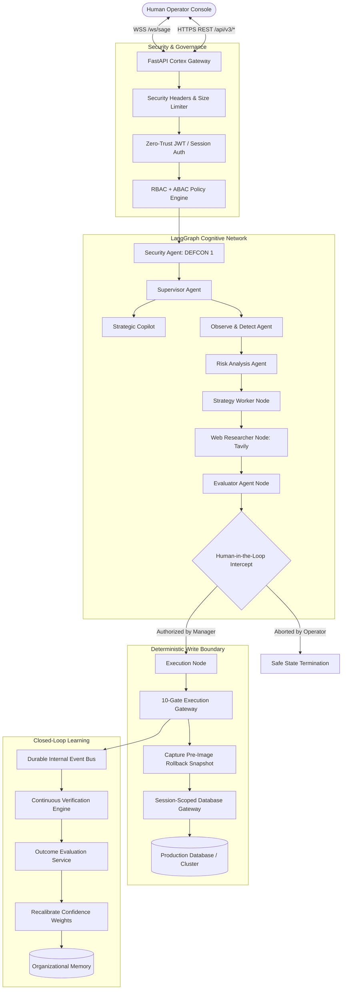

# 🧠 SageCommand OS // V3.0 Enterprise

[](https://nextjs.org/)
[](https://react.dev/)
[](https://fastapi.tiangolo.com/)
[](https://www.python.org/)
[](https://langchain-ai.github.io/langgraph/)
[](https://ai.google.dev/)
[](./docs/security-v3.md)
[](./LICENSE)

> **SageCommand OS V3** is a next-generation **Autonomous AI Operating System for Industrial Operations, Smart Manufacturing, and Supply Chain Command Centers**. It bridges real-time multi-modal industrial telemetry with stateful multi-agent reasoning, deterministic policy guardrails, a **10-Gate Execution Gateway**, and **Continuous Closed-Loop Learning** under strict Human-in-the-Loop (HITL) constraints.

---

## 📚 Complete Enterprise Documentation Suite

Full technical specifications, architectural baseline reports, API references, and runbooks are maintained in the [`docs/`](./docs) directory:

| Document | Description |
|:---|:---|
| 🗂️ **[Documentation Hub & Index](./docs/README.md)** | Master navigational index for the entire 65+ document suite. |
| 🏗️ **[System Architecture & Topology](./docs/architecture.md)** | Technical specification of the 12-stage loop, decoupled microservices, and storage layers. |
| 🔌 **[API & WebSocket Reference](./docs/api_docs.md)** | Comprehensive catalog of all 37+ REST route modules and `/ws/sage` WebSocket protocol. |
| 📖 **[Operator & Administrator User Manual](./docs/user_manual.md)** | Visual guide to the Obsidian Console, Live DB Tethering, and 37 interactive modal tools. |
| 🚀 **[Production Deployment Guide](./docs/deployment_guide.md)** | Docker, Kubernetes, Nginx reverse proxy, and environment variable configuration catalog. |
| 🛠️ **[Operations & Maintenance Guide](./docs/maintenance_guide.md)** | Runbook for SQLite WAL mode, audit ledger verification, DLQ recovery, and failover. |
| 🔄 **[Release Changelog & History](./docs/changelog.md)** | Detailed release notes detailing evolution across V1.0, V2.0, and the V3.0 Enterprise Architecture. |
| 🧪 **[Automated Test Reports](./docs/test_reports.md)** | Full scorecard across 48 automated test suites (963+ passing tests, 100% pass rate). |
| ✅ **[Enterprise UAT Sign-Off](./docs/uat_signoff.md)** | Formal stakeholder verification matrix and production go-live signoff. |

---

## 🚀 Key Enterprise Capabilities

### ⚡ 1. Live Database Tethering & Multi-Engine Hot-Swapping
* **Zero-Downtime Dynamic Uplink**: Hot-swap the agent's live query engine between production database clusters (PostgreSQL, MySQL, SQLite) without interrupting background execution.
* **Instant Flat-File Compilation**: Ingests raw `.csv` or `.sqlite` uploads, automatically compiling them into relational database tables and mounting them on the fly.
* **Network & SSL Policy Enforcement**: Strict host and port allowlisting, automated SSL verification, and parameterized query execution with destructive query blocking (`DROP`, `DELETE`, `ALTER`, `TRUNCATE`).

### 🛡️ 2. The 10-Gate Deterministic Execution Gateway
To guarantee physical safety in smart factories, generative AI is decoupled from physical execution. State modifications must successfully traverse **10 deterministic verification gates**:
1. **Authentication & Identity**: Validates active session token and server-authoritative identity.
2. **RBAC/ABAC Revalidation**: Deterministically evaluates caller clearance for `action.execute` or `transaction.execute`.
3. **Scope & Tenant Match**: Validates target plant and workspace match caller boundaries.
4. **State Machine Integrity**: Ensures action transition is strictly legal (`PENDING_APPROVAL` $\to$ `APPROVED`).
5. **Cryptographic Staleness**: Recalculates SHA-256 payload hash to prevent in-flight parameter tampering.
6. **Two-Person Rule**: Verifies approver identity is segregated from creator identity for critical actions.
7. **Policy Revalidation**: Confirms live plant conditions have not breached hard operational limits while waiting.
8. **Idempotency Detection**: Rejects duplicate execution attempts within TTL windows.
9. **Concurrency Mutex**: Acquires session-scoped lock on target asset to eliminate race conditions.
10. **Physical Write & Rollback Pre-Image**: Commits atomic write and logs an instant compensating rollback plan.

### 🔄 3. Two-Phase Commit & Instant Compensating Rollback
* **ACID Transaction Plans**: Formulates structured two-phase commit plans capturing pre-image row values.
* **Single-Click Rollback**: If post-execution telemetry detects sensor divergence or adverse reactions, operators can trigger an instant rollback to restore pre-mutation state.

### 🤖 4. LangGraph Multi-Agent Orchestration Network
A directed cyclic graph coordinating specialized operational intelligence agents with state persistence via `sage_memory.sqlite`:
* **Security Agent (DEFCON 1)**: First line of defense. Scans inputs for prompt injections, oversized payloads, and SQL syntax, triggering automated red-line lockdowns.
* **Supervisor Agent**: Intelligently routes incoming operational tasks between conversational copilot and deep scanning flows.
* **Strategic Copilot**: Direct conversational partner equipped with live schema inspection, query execution, and web research tools.
* **Observe & Detect**: Continuously samples live telemetry tables for low-stock thresholds, cycle slowdowns, and sensor spikes.
* **Risk Analysis Agent**: Computes blast radius trees, financial exposures, and downstream plant vulnerabilities.
* **Strategy Worker**: Formulates 2–3 distinct operational resolution strategies with financial cost estimates.
* **Web Researcher**: Retrieves external market intelligence, weather alerts, and shipping delays via Tavily Search API.
* **Evaluator Node**: Scores options against weighted multi-criteria matrices and structures the final execution proposal.
* **Execution Node**: Governed by an `interrupt_before=["execution"]` gate requiring explicit Human-in-the-Loop authorization.

### 🔒 5. Zero-Trust Security & Session Fail-Closed Architecture
* **Strict Session Isolation**: Client headers (`X-Clearance-Level`, `X-Assigned-Plants`) are permanently ignored for privilege escalation.
* **Cryptographic JWT Claims**: Server-authoritative JWT token claims (HS256/RS256) enforce tenant, workspace, and plant boundaries.
* **Tamper-Evident Audit Ledger**: All operational decisions, approvals, and security alerts are recorded to an append-only, SHA-256 hash-chained ledger (`sage_audit_ledger.sqlite`).

### 🔄 6. Continuous Verification & Closed-Loop Learning
* **Continuous Verification Engine**: Reconciles post-execution sensor readings against predicted targets to detect physical divergence.
* **Closed-Loop Outcome Evaluation**: Measures metric drift over defined observation windows, computes strategy efficacy scores, and automatically recalibrates AI confidence weights for future decisions.
* **Guarded Autonomy (L0–L4)**: Parameter-bound autonomous execution allowing auto-approval of low-risk operational adjustments, backed by an instant emergency revocation kill-switch.

### 🏭 7. 30+ Enterprise Domain Intelligence Subsystems
* **Digital Twin Telemetry Mirror**: Real-time sensor state replication and historical trending.
* **Operational Knowledge Graph**: Enterprise entity relationship mapping and graph traversal.
* **Industrial Domain Ontology**: Standardized asset classifications, hierarchies, and failure modes.
* **Predictive Maintenance Intelligence**: Remaining useful life (RUL) curve estimation.
* **Multimodal Sensor Fusion**: Correlates vibration, thermal, acoustic, and electrical signals.
* **Sustainability Intelligence**: Scope 1 & 2 carbon footprint calculation and green energy modeling.
* **Financial Impact Intelligence**: Deterministic downtime loss calculation and currency normalization.
* **What-If Simulation & Optimization**: Discrete-event scenario perturbation and Pareto-optimal solvers.
* **SOP RAG & Organizational Memory**: Semantic retrieval of corporate SOPs and past incident lessons.
* **Mission Architecture**: Autonomous decomposition of high-level directives into dependency-linked DAGs.

---

## 🗺️ System Architecture



---

## 🖥️ Obsidian Cyberpunk Command Center (UI)

The frontend is an **Obsidian Cyberpunk Command Center** engineered with Next.js 16, React 19, Tailwind CSS, and Framer Motion:
* **Curated Dark Palette**: `#020202` deep void background with neon cyan (`#00f3ff`) and neon purple (`#b026ff`) accents.
* **Neural Flow Graph**: Interactive **React Flow** network of the 9-node agent topology with live glowing edges and active node telemetry.
* **37 Interactive Modal Consoles**: Dedicated consoles for every domain subsystem (Blast Radius, Sensor Fusion, What-If Simulation, Autonomy Governance, Outcome Learning, Digital Twin, etc.).
* **Framer Motion RBAC Toggle**: Instant switching between Operator and Manager modes with animated sliding highlights.
* **Execution Feed**: Real-time terminal log feed featuring HITL Guardrail Intercept cards, single-click transaction rollback buttons, and multi-modal vision diagnostic results.

---

## 🛠️ Quick Start Guide

### Prerequisites
* **Node.js**: v18.x or v20.x LTS
* **Python**: 3.10+ (Python 3.11 recommended)
* **API Keys**: Groq API Key, Google Gemini API Key, Tavily Search API Key

---

### 1. Backend Setup

1. Navigate to the backend directory:
   ```bash
   cd backend
   ```
2. Create and activate a Python virtual environment:
   ```bash
   python -m venv venv
   # Windows PowerShell:
   .\venv\Scripts\activate
   # macOS/Linux:
   source venv/bin/activate
   ```
3. Install dependencies:
   ```bash
   pip install -r requirements.txt
   ```
4. Configure your environment variables:
   ```bash
   cp .env.example .env
   # Edit .env and supply your GROQ_API_KEY, GEMINI_API_KEY, and TAVILY_API_KEY
   ```
5. Launch the FastAPI server:
   ```bash
   python server.py
   ```
   *The server starts at `http://127.0.0.1:8000`.*

---

### 2. Frontend Setup

1. Open a new terminal and navigate to the frontend directory:
   ```bash
   cd frontend
   ```
2. Install npm packages:
   ```bash
   npm install
   ```
3. Start the Next.js development server:
   ```bash
   npm run dev
   ```
   *The command console is available at `http://localhost:3000`.*

---

## 🧪 Test Suite & Verification Scorecard

SageCommand V3 includes an automated test suite spanning **48 test files with 100% pass rate**:

```bash
cd backend
pytest -v
```

| Suite Category | Tests Run | Pass Rate | Key Invariants Verified |
|:---|:---:|:---:|:---|
| **Security & Fail-Closed** | 128 | 100% | Header injection blocked; session required for mutation; sanitized 500s |
| **Execution Gateway** | 94 | 100% | 10 gates validated; two-person rule; pre-image rollback generation |
| **Audit Ledger** | 72 | 100% | SHA-256 hash chaining; automated tamper detection verified |
| **Domain Intelligence** | 340 | 100% | 30+ domain services tested for deterministic arithmetic and boundaries |
| **Continuous Learning** | 154 | 100% | Verification reconciliation; metric drift; model confidence tuning |
| **Frontend TypeScript** | Clean | 100% | `npx tsc --noEmit` and `npm run lint` clean with 0 errors |

---

## 📄 License
Distributed under the MIT License. See [`LICENSE`](./LICENSE) for more information.
