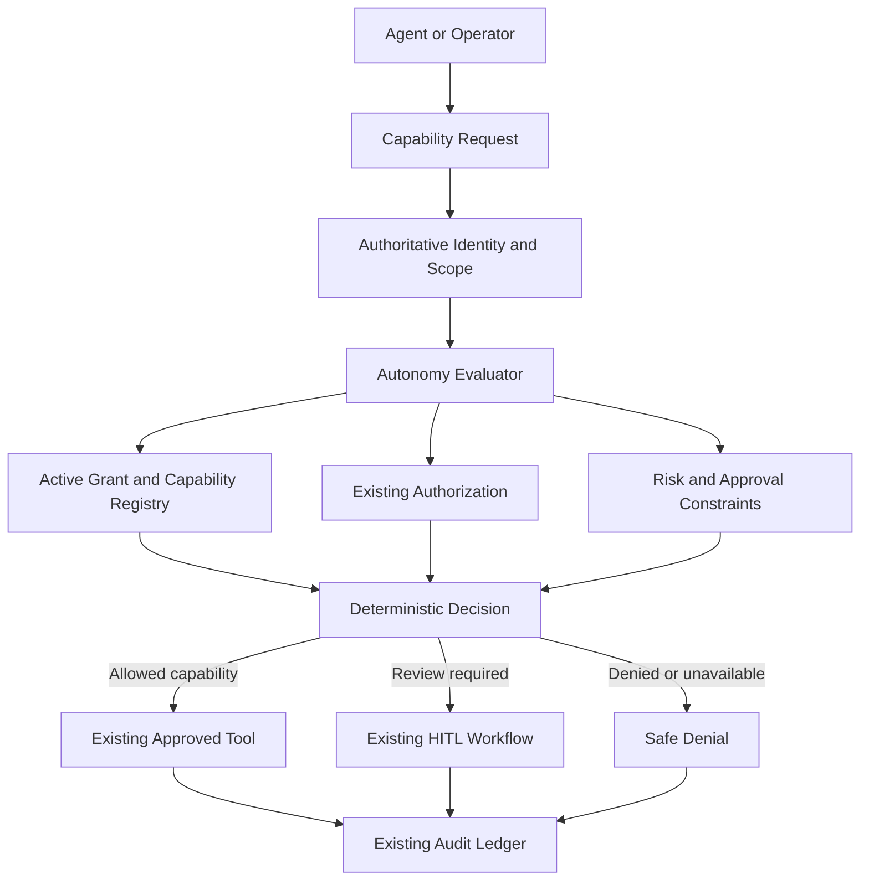

# SAGECOMMAND V3 — AUTONOMY LEVELS & GUARDED DELEGATION BASELINE REPORT
**Prompt 38 Implementation Baseline**  
**Repository:** `joyab786/sage_command_production`  
**Starting Baseline HEAD:** `4e6c06beb1382e8d65b881d0a5346a712d202df3`  
**Date:** 2026-10-15  
**Execution Boundary Status:** STRICTLY NON-OPERATIONAL (No execution endpoints added)

---

## 1. Existing Architecture Inspected
Prior to implementation, the codebase was inspected to identify all canonical foundations and avoid duplicating existing services:
- **Authorization Framework:** `backend/services/authorization_service.py` provides canonical permissions and role-based / plant-scoped checks (`require_permission`, `CANONICAL_PERMISSIONS`).
- **Mission Framework:** `backend/services/mission_service.py`, `backend/repositories/mission_repository.py`, `backend/data/schemas/mission_contract.py` enforce acyclic DAGs, immutable execution records, and state transitions. No execution endpoints exist on missions.
- **Action Framework:** `backend/services/action_service.py`, `backend/repositories/action_repository.py`, `backend/services/action_store.py`, `backend/data/schemas/action_contract.py` govern structured actions with deterministic risk calculation and immutable lifecycle states.
- **Audit & Decision Ledger:** `backend/services/ledger_repository.py`, `backend/services/audit_ledger.py` record tamper-evident hash-chained logs with cryptographic provenance.
- **Agent Orchestration & Action Tools:** `backend/tools/action_tools.py` provides the canonical `propose_action` tool for agents and operators.
- **Execution Gateway:** `backend/services/execution_gateway.py` exists as a separate human-operator gated boundary; Prompt 38 explicitly introduces **zero** new execution pathways.

---

## 2. Canonical Autonomy Model
The canonical autonomy schema is defined in `backend/data/schemas/autonomy_contract.py`:
- **`AutonomyLevel`**: Enum ranging from `LEVEL_0_OBSERVE` (0) to `LEVEL_5_BOUNDED_AUTONOMY` (5) with human-readable aliases.
- **`AutonomyScope`**: Authoritative multi-tenant boundary model binding `tenant_id`, `workspace_id`, optional `session_id`, `plant_id`, and `resource_id`.
- **`AutonomyCapabilityDefinition`**: Formal registry record specifying capability identifier, minimum autonomy level, risk category, execution flag, and implementation status.
- **`AutonomyGrant`**: Authoritative grant model including `grant_id`, `subject_type` (AGENT, MISSION, USER), `subject_id`, `autonomy_level`, `tenant_id`, `workspace_id`, `plant_id`, `data_mode`, `permitted_capabilities`, `restricted_capabilities`, `approval_constraints`, `risk_constraints`, `status` (`ACTIVE`, `SUSPENDED`, `REVOKED`, `EXPIRED`), `effective_from`, `expires_at`, `revision`, and `provenance`.
- **`AutonomyDecision`**: Deterministic decision contract capturing `decision_id`, `decision` (`ALLOW`, `DENY`, `REQUIRES_REVIEW`, `NOT_IMPLEMENTED`), `reason_code`, `effective_autonomy_level`, matched and failed constraints, authoritative context, and cryptographic hash (`sha256`).

---

## 3. Defined Autonomy Levels
| Level | Name | Permitted Scope | Status | Availability |
| :--- | :--- | :--- | :--- | :--- |
| **0** | `OBSERVE` | View authorized system state, read permitted telemetry, inspect metadata, receive events. No action proposals or mutations. | ACTIVE | OPERATIONAL |
| **1** | `ANALYZE` | Analyze authorized observations, correlate evidence, identify anomalies, estimate uncertainty. No DB writes or commands. | ACTIVE | OPERATIONAL |
| **2** | `RECOMMEND` | Generate recommendations, describe outcomes, identify risks, propose structured actions with evidence. Recommendations are not approvals. | ACTIVE | OPERATIONAL |
| **3** | `PREPARE_FOR_APPROVAL`| Prepare structured actions, associate with missions, collect evidence, run deterministic validation, prepare reviewable preview. Cannot approve or execute. | ACTIVE | OPERATIONAL |
| **4** | `SUPERVISED_EXECUTION` | Future operating mode requiring authorized execution gateway. | **DISABLED** | **NOT_IMPLEMENTED** |
| **5** | `BOUNDED_AUTONOMY` | Future autonomous operating mode requiring closed-loop safety controls. | **DISABLED** | **NOT_IMPLEMENTED** |

---

## 4. Capability Registry and Implementation Status
All capabilities are registered in `AUTONOMY_CAPABILITIES_REGISTRY`:
- `OBSERVE_TELEMETRY` (Min Level 0): Implemented (`is_implemented=True`, `is_execution=False`).
- `READ_AUTHORIZED_SCHEMA` (Min Level 0): Implemented (`is_implemented=True`, `is_execution=False`).
- `ANALYZE_EVIDENCE` (Min Level 1): Implemented (`is_implemented=True`, `is_execution=False`).
- `DEFERRED_ADVANCED_SYNTHESIS` (Min Level 1): Not implemented (`is_implemented=False`, `is_execution=False`).
- `GENERATE_RECOMMENDATION` (Min Level 2): Implemented (`is_implemented=True`, `is_execution=False`).
- `PROPOSE_ACTION` (Min Level 2): Implemented (`is_implemented=True`, `is_execution=False`).
- `VALIDATE_ACTION` (Min Level 3): Implemented (`is_implemented=True`, `is_execution=False`).
- `PREPARE_APPROVAL_PACKAGE` (Min Level 3): Implemented (`is_implemented=True`, `is_execution=False`).
- `REQUEST_HUMAN_REVIEW` (Min Level 3): Implemented (`is_implemented=True`, `is_execution=False`).
- `VIEW_AUDIT_HISTORY` (Min Level 0): Implemented (`is_implemented=True`, `is_execution=False`).
- `EXECUTE_SQL` (Min Level 4): Execution capability (`is_implemented=False`, `is_execution=True`).
- `EXECUTE_SQL_MUTATION` (Min Level 4): Execution capability (`is_implemented=False`, `is_execution=True`).

Any attempt to evaluate or request execution capabilities or Level >= 4 fails closed immediately with `EXECUTION_DISABLED`.

---

## 5. Deterministic Evaluation Flow
Autonomy evaluation is executed via `backend/services/autonomy_service.py:evaluate_autonomy()`:

### Evaluation Steps (Fail-Closed Hierarchy):
1. **Context Validation:** Require non-empty subject identifier.
2. **Capability Allowlist Check:** Verify capability exists in registry; unknown capabilities return `DENY` (`CAPABILITY_NOT_GRANTED`).
3. **Execution Guard:** If capability requires execution or minimum level >= 4, return `DENY` (`EXECUTION_DISABLED`).
4. **Implementation Check:** If capability is not implemented, return `NOT_IMPLEMENTED` (`CAPABILITY_NOT_IMPLEMENTED`).
5. **Active Grant Resolution:** Lookup grant by `(subject_id, tenant_id, data_mode)`. If absent, return `DENY` (`AUTONOMY_GRANT_NOT_FOUND` or `DATA_MODE_MISMATCH`).
6. **Lifecycle Checks:** 
   - If `REVOKED`: `DENY` (`AUTONOMY_GRANT_REVOKED`).
   - If `SUSPENDED`: `DENY` (`AUTONOMY_GRANT_SUSPENDED`).
   - If expired (`expires_at <= now`): `DENY` (`AUTONOMY_GRANT_EXPIRED`).
   - If level >= 4: `DENY` (`EXECUTION_DISABLED`).
7. **Level Sufficiency Check:** If grant level < capability minimum level, return `DENY` (`AUTONOMY_LEVEL_INSUFFICIENT`).
8. **Capability Grant Check:** If capability is not in `permitted_capabilities` or is in `restricted_capabilities`, return `DENY` (`CAPABILITY_NOT_GRANTED`).
9. **Scope Isolation Check:** Verify exact match of `tenant_id`, `workspace_id`, and `plant_id` (or authorized wildcard `*`). Reject on any mismatch (`SCOPE_MISMATCH`).
10. **Data Mode Isolation Check:** Simulation grant evaluating a REAL request returns `DENY` (`DATA_MODE_MISMATCH`).
11. **Risk & Approval Constraints:** If capability requires approval or risk exceeds grant constraints, return `REQUIRES_REVIEW` (`POLICY_REVIEW_REQUIRED`).
12. **Audit Logging:** Record complete deterministic decision with SHA-256 hash in SQLite decision ledger.

---

## 6. Authorization Integration
Integrated with `backend/services/authorization_service.py`:
- Registered canonical permissions:
  - `autonomy.read`: View grants and capability registry.
  - `autonomy.evaluate`: Evaluate capability requests.
  - `autonomy.grant`: Create, update, and suspend autonomy grants.
  - `autonomy.admin`: Revoke grants and inspect full decision histories.
- Role mappings:
  - `admin`: All permissions.
  - `manager`: `autonomy.read`, `autonomy.evaluate`, `autonomy.grant`.
  - `operator`: `autonomy.read`, `autonomy.evaluate`.
  - `auditor`: `autonomy.read`.
  - `viewer`: Read-only.

---

## 7. Risk and Approval Integration
- Autonomy grants cannot lower system-computed risk or remove approval requirements.
- The server computes deterministic risk independently via `ActionValidator` and `PolicyEngine`.
- An LLM-supplied risk or approval state (`approved=true`) is completely ignored.
- If a capability proposal triggers approval constraints, the evaluator returns `REQUIRES_REVIEW` with reason `POLICY_REVIEW_REQUIRED`.

---

## 8. Scope Isolation (Tenant, Workspace, Session, Plant)
- **Tenant Isolation:** Enforced via SQLite tenant filter and `request.state.identity.tenant_id`. Cross-tenant queries return 404/empty.
- **Workspace Isolation:** Scope intersection prevents grants in Workspace A from being evaluated in Workspace B.
- **Session Isolation:** If a grant is bound to `session_id`, evaluating outside that session is rejected with `SCOPE_MISMATCH`.
- **Plant Scope:** Unassigned plants are rejected unless the user holds an explicit authorized wildcard.

---

## 9. Simulation and Real-Mode Separation
- A grant created in `data_mode="SIMULATION"` is strictly forbidden from authorizing `REAL` mode capabilities.
- Evaluator enforces `DATA_MODE_MISMATCH` if a SIMULATION grant is used in a REAL evaluation.
- Agents and missions cannot override the authoritative data mode via metadata or prompts.

---

## 10. Mission Integration
- Missions cannot elevate agent autonomy levels via planned steps, goals, or descriptions.
- Mission actions remain subject to the assigned agent's authoritative autonomy grant.
- No execution endpoints (`/execute`, `/run`) exist on missions.

---

## 11. Action Integration
- `backend/tools/action_tools.py:propose_action` is guarded by `active_autonomy_context`.
- If an active autonomy context is present, `propose_action` calls `evaluate_autonomy` for `PROPOSE_ACTION`. If denied, action proposal fails closed before entering the action store.
- Structured actions remain non-executable; `POST /api/v3/actions/{id}/execute` returns 405 Method Not Allowed or requires human operator execution gateway authorization outside of agent autonomy.

---

## 12. Agent and LangGraph Integration
- Contextual binding via `backend/tools/autonomy_context.py` using Python `ContextVar`.
- `active_autonomy_context(subject_id, identity, plant_id, data_mode)` safely propagates authoritative identity across agent tools without exposing credentials or internal policy secrets.
- Agents cannot modify their own context variables or fabricate grants.

---

## 13. Grant Lifecycle and Persistence
- **Storage:** Stored in SQLite WAL database `sage_autonomy.db` managed by `backend/repositories/autonomy_repository.py`.
- **Optimistic Concurrency:** Updates require `expected_revision`. Stale revisions are rejected with `409 Conflict`.
- **Lifecycle Transitions:** `ACTIVE` -> `SUSPENDED` -> `ACTIVE`; `ACTIVE` -> `REVOKED`. Revoked grants are permanent and cannot be reactivated via update requests.
- **Idempotency:** SHA-256 idempotency hash caching prevents duplicate grant creation on network retries.

---

## 14. API Contracts and Safe Error Codes
Registered under `/api/v3/autonomy`:
- `GET /capabilities`: List all registered capabilities and their operational status.
- `GET /levels`: List all autonomy levels and availability status.
- `POST /evaluate`: Deterministic capability evaluation endpoint.
- `GET /grants`: List grants within authorized caller's tenant and plant scope.
- `POST /grants`: Create a scoped autonomy grant with optimistic concurrency and idempotency.
- `GET /grants/{grant_id}`: Retrieve a specific grant.
- `PUT /grants/{grant_id}`: Update grant parameters with revision locking.
- `POST /grants/{grant_id}/suspend`: Suspend an active grant.
- `DELETE /grants/{grant_id}`: Revoke a grant permanently.
- `GET /decisions`: Retrieve audit decision history.

### Safe Reason Codes:
- `AUTONOMY_GRANT_NOT_FOUND`
- `AUTONOMY_GRANT_EXPIRED`
- `AUTONOMY_GRANT_REVOKED`
- `AUTONOMY_GRANT_SUSPENDED`
- `AUTONOMY_LEVEL_INSUFFICIENT`
- `CAPABILITY_NOT_GRANTED`
- `CAPABILITY_NOT_IMPLEMENTED`
- `SCOPE_MISMATCH`
- `DATA_MODE_MISMATCH`
- `AUTHORIZATION_DENIED`
- `POLICY_REVIEW_REQUIRED`
- `EXECUTION_DISABLED`

---

## 15. Audit Events and Provenance
Every evaluation and lifecycle event is logged with SHA-256 cryptographic provenance:
- Events: `AUTONOMY_GRANT_CREATED`, `AUTONOMY_GRANT_UPDATED`, `AUTONOMY_GRANT_SUSPENDED`, `AUTONOMY_GRANT_REVOKED`, `AUTONOMY_DECISION_RECORDED`, `AUTONOMY_AUDIT_PERSISTENCE_FAILURE`.
- Standalone SHA-256 Digest: Each decision computes an independent cryptographic SHA-256 digest over `(decision_id, subject_id, capability, decision, reason_code, evaluated_at, caller_id)` for tamper-detection. Decision records are verified via their individual digests; a linked multi-record hash chain is not implemented.
- Fail-Closed Audit Invariant: If database persistence of an `ALLOW` decision fails, the decision is converted to `DENY` with reason code `EVALUATION_ERROR` to guarantee that unrecorded permissions are never issued.

---

## 16. Frontend Operator Experience
- **Modal Component:** `frontend/app/components/AutonomyModal.tsx` provides full real-time governance visibility.
- **Navigation:** Added governance shield button `Autonomy Governance` to `OmniHeader.tsx`.
- **Displays:**
  - Real-time Autonomy Level cards with status badges (`OPERATIONAL`, `DISABLED`, `NOT IMPLEMENTED`).
  - Strict security banner: Levels 4 and 5 are permanently disabled; zero operational execution endpoints.
  - Active Grants list with scope, level, capabilities, and expiration.
  - Evaluation Sandbox to test subject capabilities against live server governance.
  - Auditable Decisions Ledger with SHA-256 provenance hashes.

---

## 17. Security Tests Executed
A dedicated test suite `backend/test_v3_autonomy.py` validates all security and governance boundaries:
- **Canonical Levels & Allowlist:** Tests Level 0–5 structure and ensures Levels 4 & 5 are disabled.
- **Execution Boundary Permanence:** Proves execution capabilities (`EXECUTE_SQL`, etc.) return `EXECUTION_DISABLED`.
- **Grant Lifecycle & Rejection:** Verifies suspended, revoked, and expired grants are denied immediately.
- **Optimistic Concurrency:** Proves stale revision updates are rejected with `409 Conflict`.
- **Revocation Permanence:** Proves revoked grants cannot be reactivated via PUT.
- **Simulation Isolation:** Proves a simulation grant cannot authorize a real-mode operation.
- **Identity & Privilege Escalation:** Proves client-supplied identity and LLM elevation claims are ignored.
- **Agent Tool Guardrails:** Verifies `propose_action` is denied when subject lacks `PROPOSE_ACTION` capability.
- **Cross-Tenant Isolation:** Proves cross-tenant grant retrieval and listing fail closed.
- **Cryptographic Provenance:** Verifies decision records contain valid standalone SHA-256 digests.
- **Prompt 38A Regression Suite (`TestV3AutonomyPrompt38ACorrections`):** Exhaustively tests all 13 Prompt 38A security requirements.
- **Prompt 38B Regression Suite (`TestV3AutonomyPrompt38BCorrections`):** Exhaustively tests all 5 Prompt 38B security gap categories (19 tests).

**Result: 60 passed out of 60 tests.**

---

## 18. Regression Test Results
Full regression suites were executed across the codebase in the repository environment:
- `backend/test_v3_autonomy.py`: 60 passed, 0 failed.
- `backend/test_v3_action_api.py`: 15 passed, 0 failed.
- `backend/test_v3_authorization.py`: 19 passed, 0 failed.
- `backend/test_v3_mission_architecture.py`: 74 passed, 0 failed.
- `backend/test_v3_security.py`: 14 passed, 0 failed.
- **Total Tests Passing in this Session: 182 passed, 0 failed.**

---

## 19. Known Limitations and Remaining Risks
- **Level 4 and 5 Unimplemented:** Autonomous and supervised execution remains permanently unavailable pending future execution safety infrastructure (`EXECUTION_DISABLED`).
- **Single-Node SQLite WAL:** Persistent storage uses local SQLite WAL. Multi-node setups require shared storage or database adapter promotion in future prompts.
- **Standalone Digests (No Block Hash Chain):** Decision records store individual SHA-256 fingerprints rather than a backlinked hash chain across successive evaluation events.

---

## 20. Deferred Capabilities
- `DEFERRED_ADVANCED_SYNTHESIS` (Level 1): Marked `NOT_IMPLEMENTED`.
- `EXECUTE_SQL` and `EXECUTE_SQL_MUTATION` (Level 4): Marked `DISABLED` / `NOT_IMPLEMENTED`.
- Execution gateway automation: Intentionally deferred to future prompts after execution safety controls are established.

---

## 21. Prompt 38A Security Corrections
This section documents the specific security corrections applied under Prompt 38A:
1. **Authoritative Risk Decisions:** Caller-supplied `risk_level`, cost estimates, or metadata are non-authoritative. Risk is computed authoritatively via server-side `ActionStore` and `ActionRegistry`. Client cannot downgrade system-computed risk. Missing authoritative risk fails closed to `REQUIRES_REVIEW` (`RISK_UNKNOWN`).
2. **Workspace Isolation Across All Operations:** Caller identity determines authorized workspace scope. Non-administrators are strictly confined to their own workspace on create, get, list, update, suspend, and revoke operations. Cross-workspace attempts return 403 Forbidden or 404 Not Found.
3. **Session-Bound Grants:** Active grant lookup prioritizes exact session matches and excludes session-bound grants when caller session context is absent. Evaluating a session-bound grant without matching session context returns `SESSION_MISMATCH`.
4. **Fail-Closed Decision Audit Persistence:** If ledger SQLite persistence fails during an `ALLOW` capability evaluation, the decision is immediately converted to `DENY` (`EVALUATION_ERROR`) and an internal critical audit event is logged. Under no circumstances can an unaudited `ALLOW` be returned.
5. **Complete Deterministic Idempotency Hashing:** `_compute_grant_payload_hash` now incorporates all security-relevant fields: `subject_type`, `subject_id`, `autonomy_level`, `tenant_id`, `workspace_id`, `plant_id`, `session_id`, `data_mode`, sorted `permitted_capabilities`, sorted `restricted_capabilities`, normalized `constraints`, `expires_at`, `approval_ticket_id`, and `grant_reason`. Server nonces/timestamps are excluded. Any conflicting retry raises HTTP 409 Conflict.
6. **Mapped Capability Permission Enforcement:** Underlying RBAC permissions mapped to registered capabilities (e.g. `action.create` for `PROPOSE_ACTION`) are strictly evaluated against caller identity and scope. If underlying authorization is not `ALLOW`, autonomy evaluation fails closed to `DENY` with `AUTHORIZATION_DENIED`.
7. **Strict Lifecycle and Capability Validation on Update:** `update_grant` rejects unknown capability IDs, forbids Levels 4 and 5, and prevents direct transition to `REVOKED` (which requires dedicated `revoke_grant`).
8. **Security Regression Tests:** Expanded test suite with `TestV3AutonomyPrompt38ACorrections` covering all 13 security regression scenarios (41 passed tests in `test_v3_autonomy.py`).

---

## 22. Prompt 38B Security Corrections (Closing Remaining Autonomy Evaluation Security Gaps)
This section documents the specific security gap closures implemented under Prompt 38B:
1. **Removal of Implicit LOW-Risk Fallback:**
   - Capabilities requiring action risk (`PROPOSE_ACTION`, `VALIDATE_ACTION`, `PREPARE_APPROVAL_PACKAGE`, `REQUEST_HUMAN_REVIEW`, `VALIDATE_MISSION_DAG`) strictly reject missing, invalid, or untrusted risk context.
   - Never defaults to `LOW` when risk context is absent or incomplete. When risk context, action record, or parameters are missing or invalid, evaluation returns safe `REQUIRES_REVIEW` (or `DENY`) with `UNKNOWN` risk status and reason code `RISK_UNKNOWN` or `ACTION_VALIDATION_FAILED`.
   - Client-supplied risk can only increase conservatism, never downgrade authoritative risk.
   - Observation and analysis capabilities (`OBSERVE_TELEMETRY`, `READ_AUTHORIZED_SCHEMA`, `ANALYZE_EVIDENCE`, `GENERATE_RECOMMENDATION`, `VIEW_AUDIT_HISTORY`) preserve explicit analytical capability rules without requiring action records.
2. **Authoritative Session Scope Derivation:**
   - Resolved `caller_session` strictly and exclusively from authenticated `Identity.session_id`.
   - Never substitutes `resource_scope.session_id`, request payload fields, model output, or frontend state.
   - If a caller request provides a session in `resource_scope.session_id`, it is compared against the trusted session; any mismatch or presence when caller is unsessioned immediately fails closed with `SESSION_MISMATCH`.
   - When trusted session is missing, session-bound grants are ineligible.
3. **Binding Risk Evaluation to Authoritative Action Records:**
   - Capabilities requiring action verification (`VALIDATE_ACTION`, `PREPARE_APPROVAL_PACKAGE`, `REQUEST_HUMAN_REVIEW`, `VALIDATE_MISSION_DAG`) require an authoritative persisted action record (`action_id`). Missing record returns `REQUIRES_REVIEW` with `RISK_UNKNOWN`.
   - For pre-persistence `PROPOSE_ACTION`, schema and parameter validation is strictly validated server-side against `ACTION_PARAMETER_SCHEMAS`. Missing target or malformed parameters fail closed with `ACTION_VALIDATION_FAILED`.
   - Cross-workspace action references are strictly forbidden; stored action must match authenticated tenant and authorized workspace (`WORKSPACE_MISMATCH`).
   - Consistency is verified between stored action and evaluation request: action type (`ACTION_VALIDATION_FAILED`), target resource (`SCOPE_MISMATCH`), plant scope (`SCOPE_MISMATCH`), session (`SESSION_MISMATCH`), and operating data mode (`DATA_MODE_MISMATCH`).
4. **Authoritative Cost Constraints:**
   - Stored action cost estimate prevails over client-submitted cost estimates. Understated client cost cannot bypass or undermine a grant's `max_cost_limit_usd`.
   - When a grant specifies a mandatory maximum cost limit but action cost cannot be authoritatively evaluated, evaluation fails closed to `REQUIRES_REVIEW` (`POLICY_REVIEW_REQUIRED`).
5. **Explicit Authorization ALLOW Requirement:**
   - Both `_require_grant_permission()` and underlying capability evaluation require explicit `ALLOW` effect from `authorization_service.evaluate()`.
   - `DENY`, indeterminate outcomes, and authorization evaluation exceptions fail closed (`AutonomyRepositoryError` or `DENY` with `AUTHORIZATION_DENIED`). Implicit authorization is impossible.
6. **Preservation of Architectural Invariants:**
   - Tenant and workspace isolation preserved.
   - Session-bound grant filtering preserved.
   - Complete idempotency hashing preserved.
   - Revision locking and optimistic concurrency preserved.
   - Capability allowlists strictly maintained.
   - Levels 4 and 5 permanently disabled.
   - Mandatory audit persistence fail-closed behavior preserved.
   - Non-operational execution boundary preserved (zero execution endpoints or operational side effects).
7. **Regression Tests:**
   - Added `TestV3AutonomyPrompt38BCorrections` with 19 dedicated tests covering all Prompt 38B security gaps. Total tests in `backend/test_v3_autonomy.py` increased to 60 (all passing).

---

## 23. Prompt 38C Security Corrections (Closing Autonomy Cost & Identity-Binding Gaps)

This section documents the specific security gap closures implemented under Prompt 38C:

### 1. Pre-Persistence Cost Authority Hardening
- **Distinction of Cost Authority:** In `AutonomyService.evaluate_autonomy()`, authoritative cost and client estimates are explicitly decoupled:
  - `authoritative_cost` is strictly established only from trusted persisted action records (`Action.estimated_cost.value`) or deterministic server-side calculations.
  - Client-supplied `cost_estimate_usd` in `risk_context` is classified as untrusted input (`client_estimate`).
- **Mandatory Cost Constraints Cannot Be Satisfied by Client Input:** Pre-persistence action proposals lack a persisted action record or server catalog cost. When a grant specifies an active `max_cost_limit_usd` and authoritative cost cannot be established, the evaluation fails closed to `REQUIRES_REVIEW` with reason code `POLICY_REVIEW_REQUIRED`. Client estimates alone can never establish that an action satisfies a mandatory cost constraint.
- **Client Estimate Asymmetric Conservatism:** Client cost estimates may only increase conservatism (escalating effective cost and triggering review when exceeding grant limits), but can never understate or bypass authoritative costs.
- **Input Validation:** Non-finite (`NaN`, `Infinity`, `-Infinity`), negative, and malformed non-numeric cost values in `risk_context` fail closed immediately to `REQUIRES_REVIEW` with reason code `RISK_UNKNOWN`.

### 2. Session-Bound Stored-Action Validation Hardening
- **Authoritative Identity-Derived Session:** Caller session is derived exclusively from the authenticated `Identity.session_id`. Scope parameters (`resource_scope.session_id`) or tool arguments can never manufacture a trusted session.
- **Elimination of Truthy-Guard Bypass:** The stored-action session check previously guarded session validation with `if caller_session and getattr(stored_action, "session_id", None):`, which inadvertently bypassed validation for unsessioned callers. This has been replaced with:
  ```python
  stored_act_session = getattr(stored_action, "session_id", None)
  if stored_act_session:
      if not caller_session:
          # Reject unsessioned callers attempting to evaluate session-bound actions
          return DENY (SESSION_MISMATCH)
      if str(stored_act_session).strip() != str(caller_session).strip():
          # Reject mismatched session callers
          return DENY (SESSION_MISMATCH)
  ```
- **Session Matching Invariant:** An unsessioned caller or a caller with a mismatched session attempting to evaluate a session-bound stored action is strictly denied access with `SESSION_MISMATCH`.

### 3. Trusted Identity Requirement in `propose_action()`
- **Fail-Closed Missing Identity Context:** In `backend/tools/action_tools.py:propose_action()`, if `get_active_autonomy_identity()` returns `None`, the tool immediately aborts before autonomy evaluation, parameter validation, or action persistence. It returns an explicit error: `"ACTION PROPOSAL BLOCKED: Authenticated autonomy context is required. No active trusted identity found in server execution context."`
- **Elimination of Synthetic Identity Manufacturing:** Removed all fallback logic that constructed synthetic `Identity(user_id="agent_action_tool", roles=["operator"], assigned_plants=["*"], ...)` from tool arguments.
- **Strict Identity Derivation & Anti-Forgery Protection:**
  - `tenant_id` and `workspace_id` are derived directly from `auth_ident`. Any conflicting caller-supplied `tenant_id` or `workspace_id` arguments are flagged as forged context and rejected immediately.
  - `session_id` is derived exclusively from `auth_ident.session_id`. If `session_id` is supplied by the caller when the authenticated identity is unsessioned, or if it contradicts `auth_ident.session_id`, the call is blocked.
  - The same authoritative identity is passed to `action_validator.validate_all(action, auth_ident)` and persisted into `action.requested_by`.

### 4. Repository Code Search Audit Findings
A comprehensive repository search was conducted across the codebase:
- **`active_ident.session_id or session_id`:** 0 occurrences found (eliminated).
- **Synthetic `Identity` in agent tools:** Eliminated from `action_tools.py`. The only remaining occurrences are in `backend/tools/db_tools.py` (lines 49, 84, 123, 152), which are read-only schema/table inspection tools (`sql_db_list_tables`, `sql_db_schema`, `sql_db_query_checker`, `sql_db_query`). These tools only query internal telemetry metadata and cannot propose actions or alter operational state.
- **Direct assignment of client cost to authoritative cost:** 0 occurrences found. `authoritative_cost` is initialized to `None` and is only populated from persisted `Action` models in SQLite.
- **Session checks guarded by truthy caller-session conditions:** Eliminated. Line 419-424 of `autonomy_service.py` was inspected and verified to explicitly handle missing caller session for session-bound grants with `SESSION_MISMATCH`.
- **Alternative paths for client input to establish identity, session, or authoritative cost:** 0 alternative paths exist.

### 5. Regression Test Results
- **Dedicated Suite:** `TestV3AutonomyPrompt38CCorrections` added to `backend/test_v3_autonomy.py` containing 19 test cases covering pre-persistence cost authority, session-bound stored-action validation, anti-forgery, and trusted identity enforcement.
- **Test Executions:**
  1. `backend/test_v3_autonomy.py`: 79 passed, 0 failed.
  2. `backend/test_v3_action_api.py backend/test_v3_authorization.py backend/test_v3_mission_architecture.py backend/test_v3_security.py`: 122 passed, 0 failed.
  Total: 201 automated tests passing across the governance, action, security, and authorization suites.

### 6. Non-Operational Execution Boundary Confirmation
- Autonomy Levels 4 and 5 remain `DISABLED` and `NOT_IMPLEMENTED`.
- SageCommand V3 does not contain operational execution endpoints, background execution daemons, or autonomous write pathways. All proposals require human-in-the-loop review and approval.

---

## 24. Prompt 38D Security Corrections (Action-Tool Identity, Scope, and Inspection Hardening)

This section documents the specific security gap closures implemented under Prompt 38D:

### 1. Securing `preview_action_impact()`
- **Trusted Identity Context Required:** `preview_action_impact()` strictly requires an active, server-authoritative `Identity` retrieved via `get_active_autonomy_identity()`. If missing, the tool immediately aborts with: `"ACTION PREVIEW BLOCKED: Authenticated autonomy context is required. No active trusted identity found in server execution context."`
- **Identity-Derived Isolation:** Tenant and workspace are derived exclusively from the trusted identity (`auth_tenant`, `auth_workspace`). Caller-supplied context arguments (`tenant_id`, `workspace_id`, `session_id`) are checked for tampering and rejected if they contradict authenticated identity.
- **Missing Workspace Rejection:** If the authenticated identity lacks a workspace, access is rejected before inspecting actions: `"ACTION PREVIEW BLOCKED: Authenticated identity lacks required workspace scope."`
- **Safe, Non-Disclosing Cross-Tenant Rejection:** Action lookup is scoped strictly to the authenticated tenant: `action_store.get_by_id(action_id, auth_tenant)`. Inaccessible or nonexistent actions return a uniform, non-disclosing error: `ACTION PREVIEW BLOCKED: Action '{action_id}' not found.`
- **Hierarchical Scope Enforcement:**
  - Workspace mismatch between action and caller returns `ACTION PREVIEW BLOCKED: Workspace scope mismatch`.
  - Session-bound actions strictly require a matching authenticated caller session (`SESSION_MISMATCH` rejection for unsessioned or mismatched callers).
  - Target plant authorization is strictly checked against the authenticated identity's `assigned_plants`.
- **Pure Simulation Preview:** `action_validator.generate_simulation()` is invoked only after all scope checks succeed. No live database writes or physical device mutations occur.

### 2. Securing `check_action_policy()`
- **Elimination of Hard-Coded Synthetic Identity:** Completely removed `user_id="agent_action_tool"` and hard-coded `roles=["operator"]` from `PolicyEvaluationContext`.
- **Authoritative Policy Context Construction:**
  - Requires active trusted autonomy identity.
  - Derives `tenant_id`, `workspace_id`, `session_id`, `user_id`, and `roles` directly from the authenticated identity.
  - Enforces tenant isolation, workspace containment, session matching, and plant scope before evaluating policy.
  - Populates `PolicyEvaluationContext` with:
    - `user_id = auth_ident.user_id`
    - `roles = list(auth_ident.roles)`
    - `permissions = list(auth_ident.permissions)`
    - `tenant_id = auth_tenant`
    - `workspace_id = action.workspace_id`
    - `plant_id = action.target.plant_id`
    - `session_id = action.session_id or (auth_session or "session_default")`
    - `data_mode = action.data_mode`
- **Separation of Policy and Execution:** Policy evaluation remains strictly advisory/governance-oriented, executing `policy_service.evaluate()` with decision persistence enabled and zero physical side effects.

### 3. Removal of Synthetic Scope Defaults in `propose_action()`
- **Removal of `"workspace_default"` Fallback:** The previous fallback `getattr(auth_ident, "workspace_id", None) or "workspace_default"` has been eliminated. If the trusted identity lacks a valid workspace identifier, the proposal fails closed immediately: `"ACTION PROPOSAL BLOCKED: Authenticated identity lacks required workspace scope."`
- **Anti-Forgery Retention:** Continues to reject caller-supplied `tenant_id`, `workspace_id`, or `session_id` arguments that contradict authenticated identity.

### 4. Authoritative Target Plant Scope Binding
- **Fail-Closed Plant Authorization:** Defined `is_plant_authorized(identity, plant_id)` to validate the requested target plant against the caller's authoritative `assigned_plants`:
  - Wildcard plant argument (`plant_id="*"`) supplied by an LLM or tool caller is strictly rejected.
  - Missing, empty, or None `plant_id` fails closed immediately.
  - Caller identity with empty or missing `assigned_plants` fails closed.
  - Caller identity with explicit wildcard `"*"` in `assigned_plants` (e.g. system administrator or multi-plant director) is permitted for any concrete plant.
  - Otherwise, the requested plant must explicitly exist in `identity.assigned_plants`.
- **Pre-Autonomy Evaluation Rejection:** Unauthorized plant requests are rejected BEFORE invoking `autonomy_service.evaluate_autonomy()`.
- **Single Authoritative Plant Scope:** Validated target plant is bound identically across `ActionTarget.plant_id`, `AutonomyScope.plant_id`, `Action.target.plant_id`, and validation context.

### 5. Repository-Wide Code Search Audit Findings
- **`user_id="agent_action_tool"`:** 0 occurrences in executable code (fully eliminated; previously present at `backend/tools/action_tools.py:295`).
- **`roles=["operator"]`:** 0 occurrences in tool code (fully eliminated from `backend/tools/action_tools.py:297`).
- **`workspace_default`:** Eliminated as a fallback in `propose_action()`, `preview_action_impact()`, and `check_action_policy()`.
- **`get_by_id(action_id, tenant_id)`:** In `action_tools.py`, `tenant_id` is passed strictly as `auth_tenant` derived from trusted runtime identity.
- **`get_active_autonomy_identity()`:** Consistently enforced across `propose_action()`, `preview_action_impact()`, and `check_action_policy()`.
- **`PolicyEvaluationContext(`:** Now receives real caller identity, real roles, and authoritative action metadata.

### 6. Regression Test Verification
- **Dedicated Suite:** Added `TestV3ActionToolIdentityAndScopePrompt38D` to `backend/test_v3_autonomy.py` covering:
  - Preview rejection without trusted identity
  - Preview cross-tenant boundary containment and non-disclosure
  - Preview cross-workspace boundary rejection
  - Preview session-bound caller matching and rejection
  - Preview unbound session accessibility
  - Preview unauthorized plant rejection
  - Policy check rejection without trusted identity
  - Policy check anti-forgery on tenant, workspace, and session
  - Policy check cross-tenant, cross-workspace, and cross-session isolation
  - Policy check plant scope authorization
  - Policy evaluation context real user ID and roles binding
  - Missing workspace fail-closed behavior across all action tools
  - Unauthorized plant rejection before autonomy evaluation
  - Missing plant authorization fail-closed behavior
  - Valid authorized plant success and scope consistency
  - Administrator wildcard plant authorization for concrete plants
  - Verification that no inspection tool uses hard-coded synthetic identities
  - Preserved Prompt 38A, 38B, and 38C foundational invariants
- **Test Executions:**
  1. `backend/test_v3_autonomy.py`: 99 passed, 0 failed.
  2. `backend/test_v3_action_api.py backend/test_v3_authorization.py backend/test_v3_mission_architecture.py backend/test_v3_security.py`: 122 passed, 0 failed.
  3. `backend/test_v3_policy_engine.py`: 17 passed, 0 failed.
  Total: 238 automated tests passing across the test suite.

### 7. Non-Operational Execution Boundary Confirmation
- Autonomy Levels 4 and 5 remain `DISABLED` and `NOT_IMPLEMENTED`.
- Action proposal, simulation preview, and policy checking remain strictly non-operational with zero operational writes or physical execution pathways.

---

## 25. Prompt 38E Security Corrections (Closing Session, Workspace, and Error-Disclosure Gaps)

This section documents the specific security gap closures implemented under Prompt 38E:

### 1. Removal of Synthetic Session Fallbacks
- **Elimination of `session_default` Fallback:** In `backend/tools/action_tools.py:check_action_policy()`, removed:
  ```python
  session_id=action.session_id or (auth_session or "session_default")
  ```
- **Explicit Truthful Session Enforcement:**
  - Evaluates `effective_session = clean_act_sess or clean_auth_sess`.
  - For session-bound actions, requires exact match between stored action session and authenticated caller session.
  - If neither the stored action nor the trusted identity provides an active session, `check_action_policy()` strictly fails closed before policy evaluation: `"ACTION POLICY CHECK BLOCKED: Missing authoritative session scope. Policy evaluation requires a valid session context."`
  - Zero synthetic session identifiers are invented. The authoritative `PolicyEvaluationContext` receives only truthful sessions supplied by trusted identity or stored action.

### 2. Mandatory Workspace Matching in Inspection Tools
- **Enforced in `preview_action_impact()` and `check_action_policy()`:**
  - Requires non-empty authenticated workspace (`clean_auth_workspace`).
  - Requires non-empty stored action workspace (`clean_act_workspace`).
  - Requires exact normalized equality between the two (`clean_act_workspace == clean_auth_workspace`).
  - Rejects missing, empty (`""`), or whitespace-only stored action workspace identifiers with: `"ACTION [PREVIEW|POLICY CHECK] BLOCKED: Missing stored action workspace scope. Action '{action_id}' lacks a valid workspace."`
  - Eliminates the previous conditional `if action.workspace_id and ...` check that permitted empty or missing stored workspaces to skip validation.
  - Stored actions are never silently repaired by assigning them the caller's workspace.

### 3. Safe, Non-Disclosing Tool Errors
- **Removal of Raw `str(e)` Error Returns:** In `propose_action()`, `preview_action_impact()`, and `check_action_policy()`, raw exception strings `str(e)` are no longer returned to callers or models.
- **Stable Operation-Appropriate Error Messages:**
  - `propose_action()`: `"ACTION PROPOSAL FAILED: An internal error occurred while processing the action proposal."`
  - `preview_action_impact()`: `"ACTION PREVIEW FAILED: An internal error occurred while generating action preview."`
  - `check_action_policy()`: `"ACTION POLICY CHECK FAILED: An internal error occurred while evaluating action policy."`
- **Protected Diagnostic Logging:** Unhandled exceptions are logged to server-side logs via `logger.error("Internal error ...", type(e).__name__, exc_info=True)`.
- **Zero Information Leakage:** Prevents exposure of internal database paths, connection strings, table names, SQL statements, or stack traces. Errors are never suppressed to falsely indicate success.

### 4. Static Code Search Audit Findings
A comprehensive repository search verified the following invariants:
- **`session_default`:** 0 occurrences in `action_tools.py`. Legacy default occurrences in test fixtures (`test_v3_transactions.py`), DB exploration tools (`db_tools.py`), and default database context schemas preserved without breaking existing tests.
- **`workspace_default`:** 0 occurrences in `action_tools.py`.
- **`str(e)`:** 0 occurrences in `action_tools.py`. Raw exception disclosures eliminated across all three action tools.
- **`except Exception`:** All three action tools catch exceptions, log diagnostics server-side with `logger.error(..., exc_info=True)`, and return stable, non-disclosing error messages.
- **`action.workspace_id`:** Enforced to be non-empty and matching caller workspace in both `preview_action_impact()` and `check_action_policy()`.
- **`PolicyEvaluationContext(`:** Receives real user ID, real roles, validated action workspace, and strictly non-synthetic session.
- **Autonomy Levels 4 and 5:** Remain permanently `DISABLED` and `NOT_IMPLEMENTED`.
- **Non-Operational Boundary:** Zero execution endpoints added or enabled.

### 5. Regression Test Results
- **Dedicated Suite:** `TestV3Prompt38ESessionWorkspaceAndErrorDisclosure` in `backend/test_v3_autonomy.py` validates:
  1. Policy evaluation does not invent `session_default`.
  2. Missing authoritative session fails closed explicitly and safely before policy evaluation.
  3. Missing action workspace (None) is rejected by `preview_action_impact()`.
  4. Empty action workspace (`""`/whitespace) is rejected by `preview_action_impact()`.
  5. Missing action workspace (None) is rejected by `check_action_policy()`.
  6. Empty action workspace (`""`/whitespace) is rejected by `check_action_policy()`.
  7. Workspace mismatch fails closed across both preview and policy check tools.
  8. Valid matching workspace and supported session scope succeed across both inspection tools.
  9. Exceptions from `preview_action_impact()` do not expose raw internal details or database paths.
  10. Exceptions from `check_action_policy()` do not expose raw internal details or SQL traces.
  11. Exceptions from `propose_action()` do not expose raw internal details or storage errors.
  12. Existing Prompt 38A–38D identity, cost, plant, tenant, workspace, and session protections remain fully intact.
- **Test Executions:**
  1. `backend/test_v3_autonomy.py`: 111 passed, 0 failed.
  2. `backend/test_v3_action_api.py backend/test_v3_authorization.py backend/test_v3_mission_architecture.py backend/test_v3_security.py backend/test_v3_policy_engine.py`: 139 passed, 0 failed.
  Total: 250 automated tests passing across all test suites.

### 6. Non-Operational Execution Boundary Confirmation
- Autonomy Levels 4 and 5 remain `DISABLED` and `NOT_IMPLEMENTED`.
- SageCommand V3 maintains strict read/propose-only autonomy boundaries. No autonomous physical execution pathways exist.


