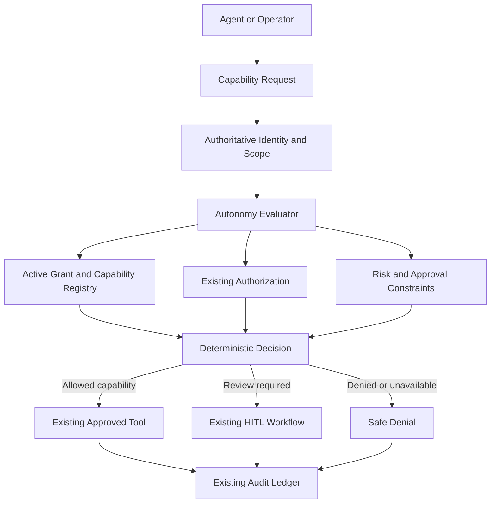

# SAGECOMMAND V3 — AUTONOMY LEVELS & GUARDED DELEGATION BASELINE REPORT
**Prompt 38 Implementation Baseline**  
**Repository:** `joyab786/sage_command_production`  
**Starting Baseline HEAD:** `4e6c06beb1382e8d65b881d0a5346a712d202df3`  
**Date:** 2026-10-15  
**Execution Boundary Status:** STRICTLY NON-OPERATIONAL (No execution endpoints added)

---

## 1. Existing Architecture Inspected
Prior to implementation, the codebase was inspected to identify all canonical foundations and avoid duplicating existing services:
- **Authorization Framework:** `backend/services/authorization_service.py` provides canonical permissions and role-based / plant-scoped checks (`require_permission`, `CANONICAL_PERMISSIONS`).
- **Mission Framework:** `backend/services/mission_service.py`, `backend/repositories/mission_repository.py`, `backend/data/schemas/mission_contract.py` enforce acyclic DAGs, immutable execution records, and state transitions. No execution endpoints exist on missions.
- **Action Framework:** `backend/services/action_service.py`, `backend/repositories/action_repository.py`, `backend/services/action_store.py`, `backend/data/schemas/action_contract.py` govern structured actions with deterministic risk calculation and immutable lifecycle states.
- **Audit & Decision Ledger:** `backend/services/ledger_repository.py`, `backend/services/audit_ledger.py` record tamper-evident hash-chained logs with cryptographic provenance.
- **Agent Orchestration & Action Tools:** `backend/tools/action_tools.py` provides the canonical `propose_action` tool for agents and operators.
- **Execution Gateway:** `backend/services/execution_gateway.py` exists as a separate human-operator gated boundary; Prompt 38 explicitly introduces **zero** new execution pathways.

---

## 2. Canonical Autonomy Model
The canonical autonomy schema is defined in `backend/data/schemas/autonomy_contract.py`:
- **`AutonomyLevel`**: Enum ranging from `LEVEL_0_OBSERVE` (0) to `LEVEL_5_BOUNDED_AUTONOMY` (5) with human-readable aliases.
- **`AutonomyScope`**: Authoritative multi-tenant boundary model binding `tenant_id`, `workspace_id`, optional `session_id`, `plant_id`, and `resource_id`.
- **`AutonomyCapabilityDefinition`**: Formal registry record specifying capability identifier, minimum autonomy level, risk category, execution flag, and implementation status.
- **`AutonomyGrant`**: Authoritative grant model including `grant_id`, `subject_type` (AGENT, MISSION, USER), `subject_id`, `autonomy_level`, `tenant_id`, `workspace_id`, `plant_id`, `data_mode`, `permitted_capabilities`, `restricted_capabilities`, `approval_constraints`, `risk_constraints`, `status` (`ACTIVE`, `SUSPENDED`, `REVOKED`, `EXPIRED`), `effective_from`, `expires_at`, `revision`, and `provenance`.
- **`AutonomyDecision`**: Deterministic decision contract capturing `decision_id`, `decision` (`ALLOW`, `DENY`, `REQUIRES_REVIEW`, `NOT_IMPLEMENTED`), `reason_code`, `effective_autonomy_level`, matched and failed constraints, authoritative context, and cryptographic hash (`sha256`).

---

## 3. Defined Autonomy Levels
| Level | Name | Permitted Scope | Status | Availability |
| :--- | :--- | :--- | :--- | :--- |
| **0** | `OBSERVE` | View authorized system state, read permitted telemetry, inspect metadata, receive events. No action proposals or mutations. | ACTIVE | OPERATIONAL |
| **1** | `ANALYZE` | Analyze authorized observations, correlate evidence, identify anomalies, estimate uncertainty. No DB writes or commands. | ACTIVE | OPERATIONAL |
| **2** | `RECOMMEND` | Generate recommendations, describe outcomes, identify risks, propose structured actions with evidence. Recommendations are not approvals. | ACTIVE | OPERATIONAL |
| **3** | `PREPARE_FOR_APPROVAL`| Prepare structured actions, associate with missions, collect evidence, run deterministic validation, prepare reviewable preview. Cannot approve or execute. | ACTIVE | OPERATIONAL |
| **4** | `SUPERVISED_EXECUTION` | Future operating mode requiring authorized execution gateway. | **DISABLED** | **NOT_IMPLEMENTED** |
| **5** | `BOUNDED_AUTONOMY` | Future autonomous operating mode requiring closed-loop safety controls. | **DISABLED** | **NOT_IMPLEMENTED** |

---

## 4. Capability Registry and Implementation Status
All capabilities are registered in `AUTONOMY_CAPABILITIES_REGISTRY`:
- `OBSERVE_TELEMETRY` (Min Level 0): Implemented (`is_implemented=True`, `is_execution=False`).
- `READ_AUTHORIZED_SCHEMA` (Min Level 0): Implemented (`is_implemented=True`, `is_execution=False`).
- `ANALYZE_EVIDENCE` (Min Level 1): Implemented (`is_implemented=True`, `is_execution=False`).
- `DEFERRED_ADVANCED_SYNTHESIS` (Min Level 1): Not implemented (`is_implemented=False`, `is_execution=False`).
- `GENERATE_RECOMMENDATION` (Min Level 2): Implemented (`is_implemented=True`, `is_execution=False`).
- `PROPOSE_ACTION` (Min Level 2): Implemented (`is_implemented=True`, `is_execution=False`).
- `VALIDATE_ACTION` (Min Level 3): Implemented (`is_implemented=True`, `is_execution=False`).
- `PREPARE_APPROVAL_PACKAGE` (Min Level 3): Implemented (`is_implemented=True`, `is_execution=False`).
- `REQUEST_HUMAN_REVIEW` (Min Level 3): Implemented (`is_implemented=True`, `is_execution=False`).
- `VIEW_AUDIT_HISTORY` (Min Level 0): Implemented (`is_implemented=True`, `is_execution=False`).
- `EXECUTE_SQL` (Min Level 4): Execution capability (`is_implemented=False`, `is_execution=True`).
- `EXECUTE_SQL_MUTATION` (Min Level 4): Execution capability (`is_implemented=False`, `is_execution=True`).

Any attempt to evaluate or request execution capabilities or Level >= 4 fails closed immediately with `EXECUTION_DISABLED`.

---

## 5. Deterministic Evaluation Flow
Autonomy evaluation is executed via `backend/services/autonomy_service.py:evaluate_autonomy()`:

### Evaluation Steps (Fail-Closed Hierarchy):
1. **Context Validation:** Require non-empty subject identifier.
2. **Capability Allowlist Check:** Verify capability exists in registry; unknown capabilities return `DENY` (`CAPABILITY_NOT_GRANTED`).
3. **Execution Guard:** If capability requires execution or minimum level >= 4, return `DENY` (`EXECUTION_DISABLED`).
4. **Implementation Check:** If capability is not implemented, return `NOT_IMPLEMENTED` (`CAPABILITY_NOT_IMPLEMENTED`).
5. **Active Grant Resolution:** Lookup grant by `(subject_id, tenant_id, data_mode)`. If absent, return `DENY` (`AUTONOMY_GRANT_NOT_FOUND` or `DATA_MODE_MISMATCH`).
6. **Lifecycle Checks:** 
   - If `REVOKED`: `DENY` (`AUTONOMY_GRANT_REVOKED`).
   - If `SUSPENDED`: `DENY` (`AUTONOMY_GRANT_SUSPENDED`).
   - If expired (`expires_at <= now`): `DENY` (`AUTONOMY_GRANT_EXPIRED`).
   - If level >= 4: `DENY` (`EXECUTION_DISABLED`).
7. **Level Sufficiency Check:** If grant level < capability minimum level, return `DENY` (`AUTONOMY_LEVEL_INSUFFICIENT`).
8. **Capability Grant Check:** If capability is not in `permitted_capabilities` or is in `restricted_capabilities`, return `DENY` (`CAPABILITY_NOT_GRANTED`).
9. **Scope Isolation Check:** Verify exact match of `tenant_id`, `workspace_id`, and `plant_id` (or authorized wildcard `*`). Reject on any mismatch (`SCOPE_MISMATCH`).
10. **Data Mode Isolation Check:** Simulation grant evaluating a REAL request returns `DENY` (`DATA_MODE_MISMATCH`).
11. **Risk & Approval Constraints:** If capability requires approval or risk exceeds grant constraints, return `REQUIRES_REVIEW` (`POLICY_REVIEW_REQUIRED`).
12. **Audit Logging:** Record complete deterministic decision with SHA-256 hash in SQLite decision ledger.

---

## 6. Authorization Integration
Integrated with `backend/services/authorization_service.py`:
- Registered canonical permissions:
  - `autonomy.read`: View grants and capability registry.
  - `autonomy.evaluate`: Evaluate capability requests.
  - `autonomy.grant`: Create, update, and suspend autonomy grants.
  - `autonomy.admin`: Revoke grants and inspect full decision histories.
- Role mappings:
  - `admin`: All permissions.
  - `manager`: `autonomy.read`, `autonomy.evaluate`, `autonomy.grant`.
  - `operator`: `autonomy.read`, `autonomy.evaluate`.
  - `auditor`: `autonomy.read`.
  - `viewer`: Read-only.

---

## 7. Risk and Approval Integration
- Autonomy grants cannot lower system-computed risk or remove approval requirements.
- The server computes deterministic risk independently via `ActionValidator` and `PolicyEngine`.
- An LLM-supplied risk or approval state (`approved=true`) is completely ignored.
- If a capability proposal triggers approval constraints, the evaluator returns `REQUIRES_REVIEW` with reason `POLICY_REVIEW_REQUIRED`.

---

## 8. Scope Isolation (Tenant, Workspace, Session, Plant)
- **Tenant Isolation:** Enforced via SQLite tenant filter and `request.state.identity.tenant_id`. Cross-tenant queries return 404/empty.
- **Workspace Isolation:** Scope intersection prevents grants in Workspace A from being evaluated in Workspace B.
- **Session Isolation:** If a grant is bound to `session_id`, evaluating outside that session is rejected with `SCOPE_MISMATCH`.
- **Plant Scope:** Unassigned plants are rejected unless the user holds an explicit authorized wildcard.

---

## 9. Simulation and Real-Mode Separation
- A grant created in `data_mode="SIMULATION"` is strictly forbidden from authorizing `REAL` mode capabilities.
- Evaluator enforces `DATA_MODE_MISMATCH` if a SIMULATION grant is used in a REAL evaluation.
- Agents and missions cannot override the authoritative data mode via metadata or prompts.

---

## 10. Mission Integration
- Missions cannot elevate agent autonomy levels via planned steps, goals, or descriptions.
- Mission actions remain subject to the assigned agent's authoritative autonomy grant.
- No execution endpoints (`/execute`, `/run`) exist on missions.

---

## 11. Action Integration
- `backend/tools/action_tools.py:propose_action` is guarded by `active_autonomy_context`.
- If an active autonomy context is present, `propose_action` calls `evaluate_autonomy` for `PROPOSE_ACTION`. If denied, action proposal fails closed before entering the action store.
- Structured actions remain non-executable; `POST /api/v3/actions/{id}/execute` returns 405 Method Not Allowed or requires human operator execution gateway authorization outside of agent autonomy.

---

## 12. Agent and LangGraph Integration
- Contextual binding via `backend/tools/autonomy_context.py` using Python `ContextVar`.
- `active_autonomy_context(subject_id, identity, plant_id, data_mode)` safely propagates authoritative identity across agent tools without exposing credentials or internal policy secrets.
- Agents cannot modify their own context variables or fabricate grants.

---

## 13. Grant Lifecycle and Persistence
- **Storage:** Stored in SQLite WAL database `sage_autonomy.db` managed by `backend/repositories/autonomy_repository.py`.
- **Optimistic Concurrency:** Updates require `expected_revision`. Stale revisions are rejected with `409 Conflict`.
- **Lifecycle Transitions:** `ACTIVE` -> `SUSPENDED` -> `ACTIVE`; `ACTIVE` -> `REVOKED`. Revoked grants are permanent and cannot be reactivated via update requests.
- **Idempotency:** SHA-256 idempotency hash caching prevents duplicate grant creation on network retries.

---

## 14. API Contracts and Safe Error Codes
Registered under `/api/v3/autonomy`:
- `GET /capabilities`: List all registered capabilities and their operational status.
- `GET /levels`: List all autonomy levels and availability status.
- `POST /evaluate`: Deterministic capability evaluation endpoint.
- `GET /grants`: List grants within authorized caller's tenant and plant scope.
- `POST /grants`: Create a scoped autonomy grant with optimistic concurrency and idempotency.
- `GET /grants/{grant_id}`: Retrieve a specific grant.
- `PUT /grants/{grant_id}`: Update grant parameters with revision locking.
- `POST /grants/{grant_id}/suspend`: Suspend an active grant.
- `DELETE /grants/{grant_id}`: Revoke a grant permanently.
- `GET /decisions`: Retrieve audit decision history.

### Safe Reason Codes:
- `AUTONOMY_GRANT_NOT_FOUND`
- `AUTONOMY_GRANT_EXPIRED`
- `AUTONOMY_GRANT_REVOKED`
- `AUTONOMY_GRANT_SUSPENDED`
- `AUTONOMY_LEVEL_INSUFFICIENT`
- `CAPABILITY_NOT_GRANTED`
- `CAPABILITY_NOT_IMPLEMENTED`
- `SCOPE_MISMATCH`
- `DATA_MODE_MISMATCH`
- `AUTHORIZATION_DENIED`
- `POLICY_REVIEW_REQUIRED`
- `EXECUTION_DISABLED`

---

## 15. Audit Events and Provenance
Every evaluation and lifecycle event is logged with SHA-256 cryptographic provenance:
- Events: `AUTONOMY_GRANT_CREATED`, `AUTONOMY_GRANT_UPDATED`, `AUTONOMY_GRANT_SUSPENDED`, `AUTONOMY_GRANT_REVOKED`, `AUTONOMY_DECISION_RECORDED`, `AUTONOMY_AUDIT_PERSISTENCE_FAILURE`.
- Standalone SHA-256 Digest: Each decision computes an independent cryptographic SHA-256 digest over `(decision_id, subject_id, capability, decision, reason_code, evaluated_at, caller_id)` for tamper-detection. Decision records are verified via their individual digests; a linked multi-record hash chain is not implemented.
- Fail-Closed Audit Invariant: If database persistence of an `ALLOW` decision fails, the decision is converted to `DENY` with reason code `EVALUATION_ERROR` to guarantee that unrecorded permissions are never issued.

---

## 16. Frontend Operator Experience
- **Modal Component:** `frontend/app/components/AutonomyModal.tsx` provides full real-time governance visibility.
- **Navigation:** Added governance shield button `Autonomy Governance` to `OmniHeader.tsx`.
- **Displays:**
  - Real-time Autonomy Level cards with status badges (`OPERATIONAL`, `DISABLED`, `NOT IMPLEMENTED`).
  - Strict security banner: Levels 4 and 5 are permanently disabled; zero operational execution endpoints.
  - Active Grants list with scope, level, capabilities, and expiration.
  - Evaluation Sandbox to test subject capabilities against live server governance.
  - Auditable Decisions Ledger with SHA-256 provenance hashes.

---

## 17. Security Tests Executed
A dedicated test suite `backend/test_v3_autonomy.py` validates all security and governance boundaries:
- **Canonical Levels & Allowlist:** Tests Level 0–5 structure and ensures Levels 4 & 5 are disabled.
- **Execution Boundary Permanence:** Proves execution capabilities (`EXECUTE_SQL`, etc.) return `EXECUTION_DISABLED`.
- **Grant Lifecycle & Rejection:** Verifies suspended, revoked, and expired grants are denied immediately.
- **Optimistic Concurrency:** Proves stale revision updates are rejected with `409 Conflict`.
- **Revocation Permanence:** Proves revoked grants cannot be reactivated via PUT.
- **Simulation Isolation:** Proves a simulation grant cannot authorize a real-mode operation.
- **Identity & Privilege Escalation:** Proves client-supplied identity and LLM elevation claims are ignored.
- **Agent Tool Guardrails:** Verifies `propose_action` is denied when subject lacks `PROPOSE_ACTION` capability.
- **Cross-Tenant Isolation:** Proves cross-tenant grant retrieval and listing fail closed.
- **Cryptographic Provenance:** Verifies decision records contain valid standalone SHA-256 digests.
- **Prompt 38A Regression Suite (`TestV3AutonomyPrompt38ACorrections`):** Exhaustively tests all 13 Prompt 38A security requirements.

**Result: 41 passed out of 41 tests.**

---

## 18. Regression Test Results
Full regression suites were executed across the codebase:
- `backend/test_v3_autonomy.py`: 41 passed, 0 failed.
- `backend/test_v3_action_api.py`: 15 passed, 0 failed.
- `backend/test_v3_authorization.py`: 19 passed, 0 failed.
- `backend/test_v3_mission_architecture.py`: 74 passed, 0 failed.
- `backend/test_v3_security.py`: 14 passed, 0 failed.
- **Total Tests Passing in this Session: 163 passed, 0 failed.**

---

## 19. Known Limitations and Remaining Risks
- **Level 4 and 5 Unimplemented:** Autonomous and supervised execution remains permanently unavailable pending future execution safety infrastructure.
- **Single-Node SQLite WAL:** Persistent storage uses local SQLite WAL. Multi-node setups require shared storage or database adapter promotion in future prompts.
- **Standalone Digests (No Block Hash Chain):** Decision records store individual SHA-256 fingerprints rather than a backlinked hash chain across successive evaluation events.

---

## 20. Deferred Capabilities
- `DEFERRED_ADVANCED_SYNTHESIS` (Level 1): Marked `NOT_IMPLEMENTED`.
- `EXECUTE_SQL` and `EXECUTE_SQL_MUTATION` (Level 4): Marked `DISABLED` / `NOT_IMPLEMENTED`.
- Execution gateway automation: Intentionally deferred to future prompts after execution safety controls are established.

---

## 21. Prompt 38A Security Corrections
This section documents the specific security corrections applied under Prompt 38A:
1. **Authoritative Risk Decisions:** Caller-supplied `risk_level`, cost estimates, or metadata are non-authoritative. Risk is computed authoritatively via server-side `ActionStore` and `ActionRegistry`. Client cannot downgrade system-computed risk. Missing authoritative risk fails closed to `REQUIRES_REVIEW` (`RISK_UNKNOWN`).
2. **Workspace Isolation Across All Operations:** Caller identity determines authorized workspace scope. Non-administrators are strictly confined to their own workspace on create, get, list, update, suspend, and revoke operations. Cross-workspace attempts return 403 Forbidden or 404 Not Found.
3. **Session-Bound Grants:** Active grant lookup prioritizes exact session matches and excludes session-bound grants when caller session context is absent. Evaluating a session-bound grant without matching session context returns `SESSION_MISMATCH`.
4. **Fail-Closed Decision Audit Persistence:** If ledger SQLite persistence fails during an `ALLOW` capability evaluation, the decision is immediately converted to `DENY` (`EVALUATION_ERROR`) and an internal critical audit event is logged. Under no circumstances can an unaudited `ALLOW` be returned.
5. **Complete Deterministic Idempotency Hashing:** `_compute_grant_payload_hash` now incorporates all security-relevant fields: `subject_type`, `subject_id`, `autonomy_level`, `tenant_id`, `workspace_id`, `plant_id`, `session_id`, `data_mode`, sorted `permitted_capabilities`, sorted `restricted_capabilities`, normalized `constraints`, `expires_at`, `approval_ticket_id`, and `grant_reason`. Server nonces/timestamps are excluded. Any conflicting retry raises HTTP 409 Conflict.
6. **Mapped Capability Permission Enforcement:** Underlying RBAC permissions mapped to registered capabilities (e.g. `action.create` for `PROPOSE_ACTION`) are strictly evaluated against caller identity and scope. If underlying authorization is not `ALLOW`, autonomy evaluation fails closed to `DENY` with `AUTHORIZATION_DENIED`.
7. **Strict Lifecycle and Capability Validation on Update:** `update_grant` rejects unknown capability IDs, forbids Levels 4 and 5, and prevents direct transition to `REVOKED` (which requires dedicated `revoke_grant`).
8. **Security Regression Tests:** Expanded test suite with `TestV3AutonomyPrompt38ACorrections` covering all 13 security regression scenarios (41 passed tests in `test_v3_autonomy.py`).
