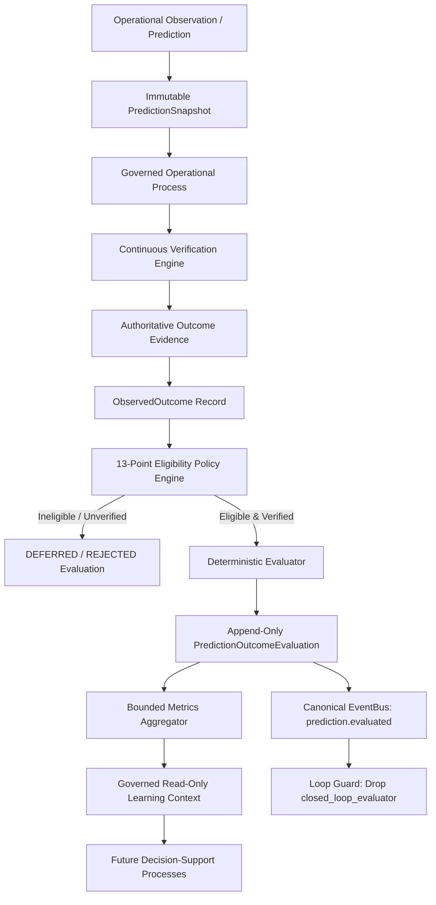

# SageCommand V3 — Closed-Loop Learning Foundation

**Document Version:** 1.0.0  
**Prompt Reference:** Prompt 37  
**Subsystem:** Closed-Loop Learning Foundation (`backend/services/verification_trigger_coordinator.py`, `backend/data/schemas/closed_loop_contract.py`, `backend/repositories/verification_repository.py`, `backend/api/verification_routes.py`)  
**Starting Baseline Git Commit:** `8c18e6745e1704c51d4ed11b904f349160ce8e44`  
**Classification:** Governed Verification Feedback Loop (Observation, Deterministic Verification, Traceable Feedback — NOT Autonomous Execution)

---

## 1. Primary Objective and Architectural Scope

The **Closed-Loop Learning Foundation** implements a secure, deterministic, and observable event-triggered feedback loop in SageCommand V3. It connects incoming operational events to continuous verification and records persistent, auditable feedback without manual operator intervention.

### Core Architectural Principle
> **Closed-loop learning means SageCommand can observe new information, re-evaluate what it knows against evidence, and record a traceable result. It does not mean the system can silently change its own rules, alter model weights, or autonomously execute operational actions.**

The system learns from **recorded outcomes and evidence** by maintaining traceable feedback and improving the availability of verified context.

### What the Closed-Loop Learning Foundation Does NOT Do
- It does **not** execute missions or transition missions to `COMPLETED`.
- It does **not** approve Actions or call the `ExecutionGateway`.
- It does **not** write raw SQL or manage database connection engines.
- It does **not** alter industrial machinery or issue PLC/SCADA commands.
- It does **not** rewrite policy rules or train/fine-tune LLM weights.
- It does **not** introduce an autonomous reinforcement learning cycle against production equipment.

---

## 2. Architecture & Data Flow

The closed-loop architecture strictly reuses the existing `EventBus`, `EventDeliveryRepository`, `VerificationService`, and `VerificationRepository`.

```mermaid
flowchart TD
    E[Canonical Operational Event] --> B[Existing EventBus]
    B --> F[Eligibility Filter]
    F -->|REJECTED / IGNORED| L1[Record Safe Non-Verification Outcome]
    F -->|ELIGIBLE| S[Trusted Scope & Identity Validation]
    S -->|Scope Mismatch| L2[Reject Trigger (Fail Closed)]
    S -->|Valid Scope| C[Verification Trigger Coordinator]
    C --> V[Existing VerificationService]
    V --> R[VerificationRepository]
    R --> O[Persisted Verification Findings & Run]
    O --> P[Feedback Recorder (WAL Table: verification_feedback_records)]
    P --> FB[Canonical Feedback Event (verification.feedback.recorded)]
    FB --> B
    B --> G[Feedback Loop Guard]
    G -->|Provenance is closed_loop_coordinator| X[Stop - Deterministic Loop Break]
```

---

## 3. Five Distinct Stages of Closed-Loop Learning

### Stage A — Observe
Receives an existing canonical event (`CanonicalEvent`) ingested through the normal event delivery path via the existing `EventBus`.
Relevant event categories and types include:
- `TELEMETRY_UPDATED` (`telemetry.updated`)
- `EVIDENCE_RECORDED` (`evidence.recorded`)
- `EVIDENCE_INVALIDATED` (`evidence.invalidated`)
- `QUALITY_STATUS_CHANGED` (`quality.status_changed`)
- `MAINTENANCE_STATUS_CHANGED` (`maintenance.status_changed`)
- `ANOMALY_DETECTED` (`anomaly.detected`)
- `ASSET_STATE_CHANGED` (`asset.state_changed`)
- `INVENTORY_STATE_CHANGED` (`inventory.state_changed`)

### Stage B — Decide Whether Verification is Relevant
The `VerificationTriggerCoordinator` evaluates the event against an explicit, deterministic eligibility policy (`evaluate_eligibility`).
- Outcomes: `ELIGIBLE`, `IGNORED`, `REJECTED`, `DEFERRED`.
- Deterministic reasons include:
  - `UNSUPPORTED_EVENT_TYPE`: Category or event type not configured for verification.
  - `UNTRUSTED_PROVENANCE`: Missing or untrusted origin source.
  - `MISSING_SCOPE`: Missing required tenant or plant identifiers.
  - `MISSING_TARGET_REFERENCE`: Event does not reference a valid target mission.
  - `STALE_EVENT`: Event timestamp older than `SAGE_VERIFICATION_EVENT_MAX_AGE_SECONDS` (default: 3600s).
  - `FUTURE_DATED_EVENT`: Event timestamp is in the future beyond allowable clock skew tolerance (60s).
  - `INVALIDATED_EVENT`: Event lifecycle state is `INVALIDATED` or `SUPERSEDED`.
  - `FEEDBACK_LOOP_GUARD`: Event origin provenance is the coordinator itself.
  - `DISABLED`: Closed-loop trigger feature flag is disabled.
Fail-closed policy: LLMs never evaluate eligibility.

### Stage C — Verify
Invokes the existing `VerificationService.request_verification(...)` using a server-derived service identity:
- Revalidates the mission, its revision, and physical plant boundary.
- Resolves evidence strictly within caller's tenant and workspace boundaries.
- Preserves diagnostic versus authoritative verification semantics.
- Generates standard, persisted `VerificationFinding` records and `VerificationRun` records.
- Never executes the mission and never approves operational actions.

### Stage D — Record Feedback
Persists the relationship between:
- Triggering event ID & fingerprint
- Trigger rule version
- Authoritative tenant & workspace scope
- Verification run ID & outcome status
- Diagnostic status & outcome
- Feedback event ID
in the dedicated SQLite table `verification_feedback_records` in `VerificationRepository`.

### Stage E — Improve Future Context
Publishes a canonical feedback event (`verification.feedback.recorded`) back to the `EventBus` with provenance `closed_loop_coordinator`, making verification outcomes observable to downstream subscribers while the feedback loop guard stops recursion.

---

## 4. Trusted Identity, Scope Boundaries & Producer Validation (Prompt 37A Hardened)

A core invariant of Prompt 37A is that **a valid event schema is not proof of an authorized event scope**.

### 4.1 Authenticated Event Producer Boundary (`POST /api/v3/events`)
1. **Producer Identity is Authoritative:** The caller's authenticated identity (`identity.tenant_id`, `identity.workspace_id`, `identity.assigned_plants`) governs the event submission boundary. The event body is untrusted input.
2. **Tenant Mismatch Forbidden:** Cross-tenant event submissions return `HTTP 403 Forbidden`.
3. **Workspace Isolation:** Producers cannot choose an arbitrary workspace by editing the event body. Mismatched workspaces return `HTTP 403 Forbidden`.
4. **Physical Plant Scoping:** If a producer is assigned to specific physical plants, the submitted `plant_id` must belong to that authorized set (`HTTP 403 Forbidden` otherwise). Wildcard `*` in assigned plants is honored only if server-authoritative.
5. **Fail-Closed on Missing Scope:** Events with missing, empty, or manufactured scopes (`"global"`, `"unknown"`, `"default"`) return `HTTP 400 Bad Request`.
6. **No Privilege Escalation via Payload:** Payload fields attempting to inject `user_id`, `roles`, `permissions`, or `clearance` are completely ignored and cannot grant operational authority.
7. **Scope-Bound Fingerprint Validation:** Client-supplied `event_fingerprint` must match `event.compute_fingerprint()`. Inconsistent fingerprints return `HTTP 400 Bad Request`.
8. **Repository Return Scope Verification:** The API layer verifies the returned event's scope (`tenant_id`, `workspace_id`, `plant_id`) and fingerprint against the validated request before returning or publishing it.
9. **Persistence & Publication Ordering:**
   - Authenticated caller validation
   - Event body scope validation
   - Scope-bound fingerprint recomputation & verification
   - Immutably persist or resolve exact replay via `EventRepository.record_event_ex`
   - Validate returned event scope and canonical equality
   - Publish to `EventBus` only if newly persisted (`is_replay is False`)
   - Return canonical event response to caller

### 4.2 Independent Verification Scope Check (`VerificationTriggerCoordinator`)
Event fields cannot independently grant the coordinator authority to verify a mission:
1. **Scope Validation:** Validates that tenant, workspace, and plant are present, non-blank, and not manufactured strings (`"global"`, `"unknown"`, `"default"`).
2. **Independent Mission Resolution:** Before calling `VerificationService.request_verification(...)`, the coordinator independently resolves the target mission from `MissionRepository.get_mission(tenant_id, workspace_id, mission_id)`.
3. **Scope Alignment Verification:** Confirms that the mission's scope (`mission.scope.tenant_id`, `mission.scope.workspace_id`, `mission.scope.plant_id`) strictly matches the event's authorized scope.
4. **Revision & Target Validation:** Verifies that requested `mission_revision` matches `mission.revision`, and target criterion/step exists on the mission DAG.
5. **Strict Service Identity Construction:** Service identity is constructed strictly from the validated `Mission` scope via `_build_trusted_service_identity(mission)`:
   - `user_id`: `"system:closed_loop_coordinator:{tenant_id}"`
   - `tenant_id`: `mission.scope.tenant_id`
   - `workspace_id`: `mission.scope.workspace_id`
   - `roles`: `["SYSTEM_VERIFIER"]`
   - `permissions`: `["mission.verification.request", "mission.verification.read", "mission.read"]`
   - `assigned_plants`: `[mission.scope.plant_id]` (strictly the mission's plant, never wildcard)

### 4.3 Global Workspace Policy
- Missing or blank workspace scope fails closed.
- Manufactured scopes (`"global"`, `"default"`, `"unknown"`) are strictly rejected.
- No manufactured scope is ever stored in `verification_feedback_records`.

---

## 5. EventBus Reuse & Delivery Semantics

No competing event bus was introduced. The coordinator integrates with the existing `EventBus` (`backend/services/event_bus.py`):
- Registers explicitly configured tenant/workspace/plant subscriptions with `Subscription` records.
- Implements `SubscriberCallback` via `async def handle_event(delivery: EventDelivery, event: CanonicalEvent) -> bool`.
- Respects at-least-once delivery semantics:
  - If event is already processed or duplicate, acknowledges delivery safely without re-running verification.
  - Returns `False` on retryable errors so `EventBus` retry and dead-letter queue mechanisms function normally.
  - Acknowledges permanent rejections (`IGNORED`, `REJECTED`, `FEEDBACK_LOOP_GUARD`) as `True` to prevent dead-letter thrashing.

---

## 6. Scope-Bound Fingerprinting, Idempotency & Deduplication Safety (Prompt 37B)

### 6.1 Canonical Fingerprint Fields & Serialization
`CanonicalEvent.compute_fingerprint()` computes a deterministic SHA-256 fingerprint over an unambiguous canonical JSON structure with sorted keys and compact separators (`separators=(',', ':')`):
- **Included Fields (Canonical Reality & Scope):**
  - `schema_version`: Contract schema version (e.g. `"event.v1"`)
  - `tenant_id`: Authoritative tenant isolation boundary
  - `workspace_id`: Workspace isolation boundary
  - `plant_id`: Physical plant boundary
  - `category`: Event category enum string
  - `event_type`: Specific event type (e.g. `"telemetry.updated"`)
  - `occurred_at`: ISO timestamp of physical reality occurrence
  - `provenance`: Origin source string
  - `payload`: Canonicalized data dictionary
- **Excluded Fields (Transient & Non-Identity):**
  - `event_id`: Transient database UUID identifier
  - `event_fingerprint`: Excluded from its own hash
  - `recorded_at`: Server ingest timestamp
  - `observed_at`: Observation latency timestamp
  - `severity`: Alerting rating tag
  - `lifecycle`: Mutable state machine status (`RECORDED` -> `ACTIVE` -> `RESOLVED`)
  - `correlation_id` / `causation_id`: Distributed tracing links
  - `references`: Object links

### 6.2 Exact Replay vs. Conflicting Duplicate vs. Legacy Records
`EventRepository.record_event_ex(event)` strictly distinguishes three outcomes:
1. **Newly Persisted Event:**
   - Database insert succeeds.
   - Returns `(event, False)`.
   - Published to `EventBus`.
2. **Exact Legitimate Replay:**
   - Fingerprint matches an existing record in SQLite.
   - All canonical scope fields (`tenant_id`, `workspace_id`, `plant_id`) and content fields (`category`, `event_type`, `occurred_at`, `provenance`, `payload`, `schema_version`) match existing record exactly.
   - Returns `(existing_event, True)`.
   - **Publication Semantics:** Exact replays return the canonical event to the caller idempotently without re-publishing to `EventBus`, preventing downstream duplicate message traffic.
3. **Conflicting Duplicate:**
   - Fingerprint matches, but incoming event scope (`workspace_id`, `plant_id`) or payload differs.
   - Rejects deterministically by raising `EventIdempotencyConflictError`.
   - API translates to `HTTP 409 Conflict`. Zero publication to `EventBus`.
4. **Ambiguous Legacy Records:**
   - Existing record has missing/empty `workspace_id` or `plant_id`, or legacy unverified fingerprint.
   - Fails closed by raising `LegacyEventFingerprintError`.
   - Never returned as a verified exact replay.

### 6.3 Returned Event Integrity & Canonical Re-Verification (Prompt 37C)
After `EventRepository.record_event_ex()` returns, `POST /api/v3/events` requires comprehensive verification before returning or publishing the event:
- `saved_event.tenant_id == identity.tenant_id` (403 on mismatch)
- `saved_event.workspace_id == identity.workspace_id` (403 on mismatch)
- `saved_event.plant_id == event.plant_id` (403 on mismatch; mandatory exact check even for wildcard callers)
- Saved plant is authorized for caller (`"*" in auth_plants or saved_event.plant_id in auth_plants`)
- `saved_event.event_fingerprint == computed_fp` (409 on mismatch)
- `saved_event.compute_fingerprint() == computed_fp` (recomputes deterministic fingerprint; 409 on tampering)
- Canonical field comparison: verifies `schema_version`, `category`, `event_type`, `occurred_at`, `provenance`, and `payload` match the validated request.
- **Fail-Closed Guarantee:** If any check fails, the mismatched or tampered record is immediately rejected without publication to `EventBus` and without returning cross-scope data.

### 6.4 Publication Failure Recovery & Idempotent Retry (Prompt 37C)
To guarantee at-least-once delivery without duplicate executions:
1. **Initial Publication Failure:** If `EventBus.publish()` fails due to transient transport errors, the API request fails safely with `HTTP 500 Internal Server Error`, while preserving the persisted event in `EventRepository`.
2. **Replay Retry:** Re-submitting the exact same canonical event resolves to `is_replay=True`, creating **zero duplicate event records**.
3. **Selective Publication:** On replay, `bus.has_unfulfilled_deliveries(saved_event)` checks whether matching subscriptions lack `DeliveryStatus.SUCCESS`.
   - If unfulfilled deliveries exist, `bus.publish()` is retried (skipping already-succeeded subscriptions and delivering only to unfulfilled ones).
   - If all deliveries already succeeded, publication is skipped completely, preserving exact-replay idempotency with zero duplicate deliveries.
4. **Background Sweeper Recovery:** `EventBus.recover_pending_deliveries()` and background `_sweeper_loop()` sweep `deliveries` where `status = 'PENDING'`, resolve the canonical event from `EventRepository`, and fulfill deliveries directly.

### 6.5 Missing-Subscriber Recovery & Publication Error Sanitization (Prompt 37D)
1. **Deterministic Missing-Subscriber Recovery:**
   - When a subscriber callback is temporarily unavailable (e.g. offline service or delayed memory registration), `_process_delivery()` increments `delivery.attempts`, records `"Subscriber callback not found in memory"`, and computes bounded exponential backoff (`min(2 ** attempts, 60)` seconds).
   - If `attempts < max_attempts`, the delivery transitions to `DeliveryStatus.PENDING` with `next_retry_at` set. It is **never permanently stranded** in `FAILED`.
   - Once the callback is registered via `EventBus.register_callback()` or `EventBus.subscribe()`, the background sweeper (`recover_pending_deliveries(respect_backoff=True)`) or subsequent publication sweeps fulfill the delivery to `DeliveryStatus.SUCCESS`.
2. **Terminal Retries & Dead-Letter Isolation:**
   - If a delivery exceeds `max_attempts`, it transitions to `DeliveryStatus.FAILED`, clears `next_retry_at`, and creates an immutable `DeadLetter` record in `dead_letters`.
   - Terminally exhausted deliveries are **never retried indefinitely** by subsequent sweeps or event replays.
   - An administrative redrive path (`EventBus.redrive_dead_letter(dead_letter_id, tenant_id)`) safely re-arms dead-lettered deliveries to `PENDING` within the tenant boundary once subscriber configuration is resolved.
3. **Idempotency Protection Against Downstream Resets:**
   - `EventDeliveryRepository.record_delivery_attempt()` enforces that an already `SUCCESS` delivery record is **never downgraded or reset** back to `PENDING` or `FAILED` by concurrent workers, replays, or late sweeps.
   - Cross-tenant delivery updates are strictly rejected.
4. **API Publication Error Sanitization (`POST /api/v3/events`):**
   - Raw exception details (`str(pub_err)`) are completely stripped from client-facing responses across both initial publication and replay-retry paths.
   - Client responses return stable, safe error descriptions:
     - Initial: `"Event persisted but publication encountered transient error."`
     - Replay retry: `"Event persisted but publication retry encountered transient error."`
   - Client responses accurately communicate that the event was safely recorded in `EventRepository` and not rolled back.
   - Diagnostic trace details are kept strictly in server-side logs, sanitized via `sanitize_log_message()` to prevent leaking credentials, connection URIs, or tokens.
   - Request correlation is preserved via `X-Correlation-ID` HTTP response headers and structured log attributes.

---

## 7. Feedback Event Contract & Schema

Defined in [backend/data/schemas/closed_loop_contract.py](file:///E:/js/sage_command_production/backend/data/schemas/closed_loop_contract.py):

### Canonical Feedback Record
```python
class VerificationFeedbackRecord(BaseModel):
    feedback_id: str
    tenant_id: str
    workspace_id: str
    plant_id: str
    trigger_event_id: str
    trigger_event_fingerprint: str
    eligibility_status: EligibilityStatus
    eligibility_reason: EligibilityReasonCode
    mission_id: Optional[str]
    mission_revision: Optional[int]
    verification_id: Optional[str]
    verification_status: Optional[str]
    is_diagnostic: bool
    diagnostic_status: Optional[str]
    diagnostic_outcome: Optional[str]
    findings_count: int
    trigger_rule_version: str
    recorded_at: str
    feedback_event_id: Optional[str]
    dedup_hash: str
```

### Published Feedback Event
Published to `EventBus` as a `CanonicalEvent`:
- `event_type`: `"verification.feedback.recorded"`
- `category`: `EventCategory.AUDIT`
- `provenance.source`: `"closed_loop_coordinator"`
- `references.mission_id`: Mission ID
- `references.parent_event_id`: Triggering event ID
- `payload`: Contains verification outcome, diagnostic status, findings count, and feedback record reference.

---

## 8. Feedback Loop Guard (Preventing Infinite Recursion)

Without a deterministic guard, publishing a feedback event could cause infinite cycles (`event -> verify -> feedback -> event -> verify...`).
The `VerificationTriggerCoordinator` implements a multi-layer guard:
1. **Category Check:** `EventCategory.AUDIT` events are ignored (`EligibilityReasonCode.UNSUPPORTED_EVENT_TYPE`).
2. **Provenance Guard:** If `event.provenance.source == "closed_loop_coordinator"`, the eligibility filter immediately yields:
   ```text
   status = EligibilityStatus.IGNORED
   reason = EligibilityReasonCode.FEEDBACK_LOOP_GUARD
   ```
3. **Event Type Guard:** Events matching `verification.feedback.*` are ignored.
4. **Zero State Mutation:** Feedback events do not emit secondary verification events.

---

## 9. Diagnostic vs. Authoritative Semantics

Strictly preserves Prompt 36 and Prompt 36E–36H invariants:
- A diagnostic run (`rule_type=EVIDENCE_EXISTS`) produces:
  - `is_diagnostic = True`
  - `diagnostic_outcome = "CONFIRMED"`
  - `status = VerificationStatus.NOT_VERIFIED` (or `INDETERMINATE`)
  - `status != VerificationStatus.VERIFIED`
- The coordinator propagates `is_diagnostic`, `diagnostic_status`, and `diagnostic_outcome` into the feedback record and feedback event.
- Diagnostic confirmation is never reported as authoritative mission verification.

---

## 10. Copilot and Agent Integration Decision

**Decision:** Verification tools remain **UNREGISTERED** in the default `copilot_tools` registry for Prompt 37 / Prompt 37A / Prompt 37B.

**Reason:**
Current LangGraph `ToolNode` architecture in `backend/agents/copilot.py` does not provide an immutable, request-scoped identity propagation context for background sub-agents. Allowing the LLM to invoke verification tools without verified identity propagation would risk client-forged identity parameters.
As mandated by Prompt 37 Section 15, Prompt 37A Section 10, and Prompt 37B Section 7:
> *"If the current Copilot architecture cannot guarantee trusted identity propagation, keep the tool unregistered and document the blocker. Do not weaken the identity boundary to make a demo work."*

---

## 11. REST API Endpoints

Mounted in FastAPI:
1. `GET /api/v3/missions/{mission_id}/verifications/feedback`
   - Returns feedback records for a specific mission within caller's tenant and workspace.
   - Enforces `mission.verification.read` permission and mission plant scoping.
2. `GET /api/v3/verification/feedback`
   - Returns tenant-wide closed-loop feedback records with optional `mission_id` filtering.
   - Enforces `mission.verification.read` permission and tenant/workspace boundaries.
3. `POST /api/v3/events`
   - Ingests canonical operational events with strict producer tenant/workspace/plant authorization.
   - Enforces exact-replay deduplication and rejects conflicting duplicates (HTTP 409).
4. `GET /api/v3/events`
   - Retrieves events filtered by tenant, workspace, and authorized plant scoping.
5. `GET /api/v3/events/fingerprint/{fingerprint}`
   - Retrieves event by fingerprint with strict tenant, workspace, and plant access control.

---

## 12. Configuration Settings & Startup Subscriptions (Prompt 37A & 37B)

Configured in `backend/core/config.py`:
- `SAGE_CLOSED_LOOP_ENABLED` (bool, default: `False`): Master toggle for closed-loop subsystem. Defaults to `false` for startup safety.
- `SAGE_VERIFICATION_EVENT_TRIGGER_ENABLED` (bool, default: `False`): Toggles event-triggered verification. Defaults to `false`.
- `SAGE_CLOSED_LOOP_SUBSCRIPTION_SCOPES` (str, default: `""`): Comma-separated triples `tenant:workspace:plant` defining explicitly authorized subscription scopes.
- `SAGE_VERIFICATION_EVENT_MAX_AGE_SECONDS` (int, default: `3600`): Maximum acceptable age of operational events.
- `SAGE_VERIFICATION_EVENT_DEDUP_WINDOW_SECONDS` (int, default: `300`): Deduplication window for identical event replays.
- `SAGE_VERIFICATION_EVENT_MAX_BATCH_SIZE` (int, default: `100`): Max batch processing size.

### Startup Behavior
- When either flag is `False`, no closed-loop subscriptions are registered on startup.
- Unconditional `register_tenant_subscription("default")` is permanently removed.
- When flags are `True`, the server subscribes only to explicitly configured scopes in `SAGE_CLOSED_LOOP_SUBSCRIPTION_SCOPES`.
- Missing or invalid subscription configuration logs a safe diagnostic and registers 0 subscriptions.

---

## 13. Test Coverage Summary

- **Focused Closed-Loop Test Suite:** `backend/test_v3_closed_loop_learning.py`
  - 88 tests covering eligibility, identity boundary, scope isolation, idempotency, loop guards, AST checks, producer authorization, coordinator independent scope verification, feature flag defaults, fingerprint integrity, workspace/plant fingerprint isolation, exact replay, conflicting duplicate rejection, repository-return tampering rejection, publication failure recovery, missing-subscriber recovery state, bounded exponential backoff, dead-letter policy, administrative redrive, API publication error sanitization, cross-tenant recovery isolation, atomic claims, concurrent race elimination, lease expiration, stale claim token rejection, and callback idempotency keys.
  - **Result: 88 passed (100%)**.
- **All Core Regression Suites:**
  - Canonical Event Model (`test_v3_event_model.py`): 33 passed
  - Event Driven Architecture (`test_v3_event_driven_architecture.py`): 5 passed
  - Continuous Verification (`test_v3_continuous_verification.py`): 128 passed
  - Security Core (`test_v3_security.py`): 14 passed
  - Security Integration (`test_v3_security_integration.py`): 16 passed
  - Authorization Engine (`test_v3_authorization.py`): 19 passed
  - Mission Architecture (`test_v3_mission_architecture.py`): 74 passed
  - Evidence Explainability (`test_v3_evidence_explainability.py`): 140 passed
  - Organizational Memory (`test_v3_organizational_memory.py`): 83 passed
  - Root Cause Analysis (`test_v3_rca.py` / `test_v3_root_cause_analysis.py`): 30 passed
  - Incident Management (`test_v3_incident_management.py`): 56 passed
  - Confidence & Uncertainty (`test_v3_confidence_uncertainty.py`): 122 passed
  - **Total: 808 passed, 0 failed.**

---

## 14. Remaining Limitations and Deferred Work

1. **At-Least-Once Delivery Semantics for Crash Recovery:** While atomic claims prevent concurrent worker execution of the same active delivery, a crash occurring after a subscriber executes external side effects but before `finalize_delivery()` durably commits will allow a later retry upon lease expiry. Subscribers must use the stable `delivery.idempotency_key` for deduplication.
2. **Dynamic Subscriber Scope Discovery:** The server requires explicit configuration in `SAGE_CLOSED_LOOP_SUBSCRIPTION_SCOPES`; dynamic subscription authorization from a tenant directory is deferred until an external tenant registry is introduced.
3. **Autonomous Policy Mutation:** Self-modifying policy engines remain strictly forbidden.
4. **Model Weight Fine-Tuning:** Dynamic training of model weights is deferred.
5. **Autonomous Action Approval:** Human-in-the-loop governance remains mandatory for all operational actions.
6. **LangGraph Identity Context Propagation:** Tool registration deferred until request-scoped security context is added to LangGraph `ToolNode`.
7. **Historical Legacy Event Backfill:** Pre-Prompt 37B events lacking workspace/plant scope fail closed on deduplication. An explicit migration script is required if replay support for historical events is needed.

---

## 15. Atomic Delivery Claims & Concurrency Safety (Prompt 37E)

### 15.1 Motivation & Concurrency Defect Closed
Prior to Prompt 37E, `EventBus._process_delivery()` inspected delivery status via a read-only query before invoking the subscriber callback. When an event was enqueued or retried, a worker and the recovery sweeper (or two concurrent workers) could execute concurrent checks, observe `status = PENDING`, and both invoke the subscriber callback.

### 15.2 Database-Backed Atomic Claim & Lease Architecture
1. **Atomic State Transition (`claim_delivery`):**
   - Implemented in `EventDeliveryRepository.claim_delivery(delivery_id, tenant_id, lease_seconds, respect_backoff)`.
   - Executes an atomic SQL `UPDATE ... WHERE ...` with rowcount verification:
     - Delivery must match `delivery_id` and authoritative `tenant_id`.
     - Status must not be `SUCCESS`.
     - Must not be terminally exhausted in `dead_letters`.
     - Eligible only if `status = 'PENDING'` (and `next_retry_at <= now` when backoff is respected) OR `status = 'PROCESSING'` with `lease_expires_at <= now` (expired lease recovery).
   - Atomically transitions status to `PROCESSING`, increments `attempts = attempts + 1`, and assigns a cryptographically unique `claim_token` and `lease_expires_at` (`now + lease_seconds`).
   - If two workers attempt to claim the same delivery simultaneously, SQLite write serialization guarantees exactly one update succeeds (`rowcount == 1`). The competing worker receives `None` and drops the duplicate dispatch.

2. **Isolated Callback Invocation:**
   - The subscriber callback is invoked **completely outside of any database transaction**, preventing long-running subscriber logic from locking the database or stalling other workers.

3. **Claim Token Finalization (`finalize_delivery`):**
   - Only the holder of the active `claim_token` can finalize the attempt.
   - On success: transitions to `SUCCESS`, clearing `claim_token`, `lease_expires_at`, and `next_retry_at`.
   - On failure: if attempts $< \text{max\_attempts}$, transitions to `PENDING` with exponential backoff (`min(2 ** attempts, 60)`). If attempts $\ge \text{max\_attempts}$, transitions to `FAILED` and records an immutable `DeadLetter`.
   - If a worker's lease expired and a newer worker claimed the delivery, the stale worker's finalization attempt matches 0 rows and is safely rejected.

4. **Stale Lease Recovery:**
   - If a worker crashes or encounters an unhandled exception before finalization, the lease expires.
   - Background sweepers and queue workers retrieve expired leases (`status = 'PROCESSING'` and `lease_expires_at <= now`) and safely redrive them under a fresh claim token.

5. **Stable Subscriber Idempotency Keys:**
   - `delivery.idempotency_key` is populated deterministically from the cryptographic `delivery_id` and remains invariant across all retry attempts.
   - External subscribers can use `delivery.idempotency_key` for reliable idempotency tracking and external side-effect deduplication.

---

## 16. Lease Expiration Enforcement & Long-Running Callback Safety (Prompt 37F)

### 16.1 Motivation & Lifecycle Defect Closed
Prompt 37E established atomic database claims and leases for delivery attempts, but left two critical edge cases:
1. **Unenforced Lease Expiration on Finalization:** `finalize_delivery()` checked that the worker's `claim_token` matched, but did not verify `lease_expires_at >= now_iso`. An expired worker whose delivery was not yet reclaimed by another worker could still finalize the delivery.
2. **Silent Expiry during Long-Running Callbacks:** Legitimate subscriber callbacks running longer than the default lease (30 seconds) could lose their claim silently, enabling the background sweeper or a competing worker to concurrently re-claim and re-invoke the callback.

Prompt 37F definitively resolves both edge cases while maintaining Prompt 37A–37E invariants, tenant boundaries, and bounded retries.

### 16.2 Enforced Lease Expiration on Finalization
In `EventDeliveryRepository.finalize_delivery()`, the state transition is guarded by an atomic database predicate:
```sql
UPDATE deliveries
SET status = :new_status,
    claim_token = NULL,
    lease_expires_at = NULL,
    last_error = :error_msg,
    next_retry_at = :next_retry_at,
    updated_at = :now_iso
WHERE delivery_id = :delivery_id
  AND tenant_id = :tenant_id
  AND claim_token = :claim_token
  AND UPPER(status) = 'PROCESSING'
  AND lease_expires_at IS NOT NULL
  AND lease_expires_at >= :now_iso
```
- **Expired Claims Fail Closed:** If `lease_expires_at < now_iso`, the atomic update matches 0 rows and returns `None`. An expired worker cannot finalize its attempt, even if no other worker has claimed the delivery yet.
- **Superseded Claims Rejected:** If another worker claimed the delivery, `claim_token` does not match, returning `None`.
- **Non-Downgrade of SUCCESS:** If the delivery has reached terminal `SUCCESS`, `status = 'PROCESSING'` fails, ensuring `SUCCESS` cannot be downgraded or altered by late replays or sweeps.
- **Race Serialization:** Because SQLite serializes writes, concurrent finalization and claim takeover resolve deterministically to exactly one valid transition.

### 16.3 Long-Running Callback Safety via Heartbeat Lease Renewal
To protect legitimate callbacks running longer than the initial lease:
1. **Atomic Lease Extension (`renew_delivery_lease`):**
   - Extends `lease_expires_at` only for the active, unexpired claim token:
   ```sql
   UPDATE deliveries
   SET lease_expires_at = :new_lease_expires_at,
       updated_at = :now_iso
   WHERE delivery_id = :delivery_id
     AND tenant_id = :tenant_id
     AND claim_token = :claim_token
     AND UPPER(status) = 'PROCESSING'
     AND lease_expires_at IS NOT NULL
     AND lease_expires_at >= :now_iso
     AND NOT EXISTS (
         SELECT 1 FROM dead_letters dl
         WHERE dl.delivery_id = deliveries.delivery_id
           AND dl.tenant_id = deliveries.tenant_id
     )
   ```
   - Rejects stale tokens, expired claims (cannot resurrect), terminal `SUCCESS`, and dead letters.
   - Raises `ValueError` on cross-tenant renewal attempts.

2. **Heartbeat Lifecycle in `EventBus._process_delivery()`:**
   - Interval: `min(SAGE_EVENT_DELIVERY_HEARTBEAT_INTERVAL_SECONDS, max(0.05, lease_seconds / 3.0))` (default 10s for 30s lease; dynamically scales down for sub-second test leases).
   - Spawned immediately prior to `await callback(claimed, event)`.
   - Cleanly stopped, cancelled, and awaited in the `finally:` block of `_process_delivery()`.
   - Subscriber execution runs completely outside database transactions; renewals run in brief, non-blocking atomic writes.

### 16.4 Sweeper Behavior & Crash Recovery Semantics
- **Sweeper Eligibility:** `get_pending_deliveries()` retrieves only `PENDING` deliveries and genuinely expired `PROCESSING` deliveries (`lease_expires_at <= now_iso`).
- **Live Callback Immunity:** Active callbacks renewing their leases keep `lease_expires_at > now_iso`, preventing sweepers from reclaiming in-flight deliveries.
- **Crash Recovery:** If a worker crashes or is cancelled, the heartbeat terminates immediately. Once `lease_expires_at` elapses, background sweepers or queue workers reclaim the delivery under a new claim token.
- **At-Least-Once Delivery Truthfulness:** If a subscriber performs non-idempotent external actions before crashing prior to SQLite commit, the delivery will eventually be retried. SageCommand does not claim impossible distributed exactly-once side effects; subscribers rely on `delivery.idempotency_key` for deduplication.

---

## 17. Outcome Evaluation, Prediction Accuracy & Governed Feedback (Prompt 39)

### 17.1 Conceptual Distinctions & Mission Scope
Prompt 39 elevates SageCommand's Closed-Loop Learning from merely recording verification feedback toward an evidence-driven, governed operational evaluation layer.
Four critical operational concepts remain strictly segregated:
1. **Recording Verification Feedback:** Capturing that an operational event triggered a verification run and preserving the run ID and finding references (`verification_feedback_records`).
2. **Evaluating Outcomes:** Comparing a previously recorded, immutable expectation against an eligible, verified observation deterministically (`prediction_outcome_evaluations`).
3. **Using Historical Context:** Exposing properly scoped, aggregate historical prediction performance and directional tendencies as read-only decision support for future planning (`GovernedLearningContext`).
4. **Training or Modifying Models:** Modifying neural network weights, fine-tuning LLMs, altering policy rules, or updating machine parameters. **This remains STRICTLY OUT OF SCOPE in Prompt 39.**

### 17.2 Architecture & Lifecycle Flow


### 17.3 Deterministic 13-Point Outcome Eligibility Policy
An outcome is never evaluated or promoted to learning context via LLM guesswork. Before evaluation, the system deterministically validates:
1. **Prediction Existence:** Prediction snapshot must exist within the caller's tenant and workspace.
2. **Authorized Scope:** Requesting identity must possess assigned plant access and tenant authorization.
3. **Schema & Domain Validity:** Supported prediction type (`DEMAND_FORECAST`, `RECOVERY_DURATION`, `MAINTENANCE_RISK`, `OPERATIONAL_COST`, `MISSION_CRITERION`, `ENERGY_CONSUMPTION`, `PRODUCTION_THROUGHPUT`).
4. **Temporal Ordering:** Prediction must be recorded BEFORE the outcome's observation timestamp (subject to configured 60-second clock skew tolerance). Rejects post-hoc predictions.
5. **Target Linkage:** Outcome must reference the prediction or share the identical canonical target reference.
6. **Multi-Scope Alignment:** Tenant, workspace, and plant scopes must match between prediction and outcome.
7. **Source Evidence Accessibility:** Referenced verification runs or telemetry sources must exist and resolve.
8. **Authoritative Verification State:** Distinguishes `OBSERVED`, `VERIFIED`, `UNVERIFIED`, `INDETERMINATE`, and `REJECTED`. Only `VERIFIED` outcomes qualify as eligible for learning.
9. **Evaluation Window Bounds:** Observation time must fall within `evaluation_window_start` and `evaluation_window_end` if specified.
10. **Data Mode Compatibility:** Real outcomes cannot evaluate simulation predictions; simulation data cannot contaminate real-world learning (`REAL`, `SIMULATION`, `HYBRID`).
11. **Evidence Invalidation:** Invalidation flags (`is_invalidated=True`) immediately disqualify the outcome.
12. **Idempotency & Deduplication:** Prevents duplicate authoritative evaluations across redeliveries or concurrent workers.
13. **Resource & Payload Limits:** Validates payload sizes against configured `SAGE_OUTCOME_EVALUATION_MAX_PAYLOAD_BYTES`.

### 17.4 Mathematical Evaluation & Honest Uncertainty
For supported numeric domains:
- Absolute error: $e_{\mathrm{abs}} = |y - \hat{y}|$
- Signed error: $e_{\mathrm{signed}} = y - \hat{y}$
- Relative error: $e_{\mathrm{rel}} = \frac{|y - \hat{y}|}{|y|}$ (when $y \neq 0$; explicitly `None` when $y = 0$).
- Directional bias: `OVER_PREDICTED` ($\hat{y} > y$), `UNDER_PREDICTED` ($\hat{y} < y$), `MATCHED` ($\hat{y} = y$).
- Categorical / Boolean: Exact match comparisons only; numeric formulas are never misapplied to categories.

### 17.5 Bounded Aggregate Metrics & Minimum Sample Thresholding
Historical aggregates (`AggregateMetricsSummary`):
- `sample_status`: Reports `INSUFFICIENT_DATA` when eligible evaluations are below configured `min_sample_threshold` (default 5).
- MAE, RMSE, MAPE, signed mean error (bias), and exact match rate.
- Never combines incompatible prediction types, units, plants, or data modes.

### 17.6 Governed Read-Only Decision-Support Context
`GovernedLearningContext` supplies future estimators with historical empirical accuracy:
- Mean absolute error and historical bias.
- Explicit limitations and data freshness indicators.
- Strictly read-only: Historical context is evidence for human or decision-support context, NEVER an execution grant or automatic policy override.

### 17.7 Persistence & Idempotency Invariants
- Stored in SQLite WAL tables: `prediction_snapshots`, `observed_outcomes`, `prediction_outcome_evaluations`.
- Idempotency enforced by unique `idempotency_key` and partial unique index on canonical pairs where `prior_evaluation_id IS NULL AND reevaluation_reason IS NULL`.
- Re-evaluations create append-only records linking to `prior_evaluation_id`. Historical records are never overwritten.

### 17.8 Administrative Historical Revalidation & Privilege Boundary
Historical evaluations determine learning eligibility and directly feed governed metrics and downstream learning context.
To prevent unauthorized manipulation of historical metrics:
1. **Dedicated Permission (`learning.evaluation.revalidate`):**
   - Marked sensitive (`is_sensitive=True`).
   - Distinct from ordinary prediction-outcome evaluation (`learning.evaluation.evaluate`).
   - Ordinary evaluation permission allows computing error metrics for prediction-outcome pairs, but does NOT grant authority to administratively mutate historical `eligible_for_learning` flags across the repository.
2. **Authorized Role (`ADMINISTRATOR`):**
   - Granted exclusively to canonical `ADMINISTRATOR` (Platform Administrator).
   - Excluded from `OPERATOR`, `MAINTENANCE_ENGINEER`, `ANALYST`, `VIEWER`, and internal `OutcomeLearningEventHandler` identities.
3. **Audit & Scope Protections:**
   - Both API and service operations enforce tenant, workspace, and plant scope matching.
   - Any revalidation attempt triggers structured security audit events: `HISTORICAL_REVALIDATION_AUTHORIZATION_DENIED` on forbidden attempts, and `HISTORICAL_EVALUATION_REVALIDATION_CORRECTION` on remediated records.
   - Denied requests fail closed and produce zero mutations to evaluation records.
4. **Distinction Between Revalidation Permission and Authoritative Proof:**
   - Administrative authorization permits invoking the revalidation procedure.
   - It does NOT by itself prove or establish that an outcome was verified.
   - Revalidation strictly grounds eligibility decisions in persisted Verification Engine records (`VerificationRun` or `VerificationFinding`). Privileged callers cannot override or bypass canonical verification evidence.
5. **Fail-Closed Plant Scope Enforcement:**
   - Empty or missing plant assignments (`assigned_plants=[]` or `None`) never silently fall back to wildcard access.
   - Wildcard plant access is honored ONLY when `"*"` is explicitly present in the authoritative identity.
   - Unassigned identities or identities requesting an unauthorized plant are denied fail-closed before any database query or mutation occurs.
6. **Persistence Query Boundary Plant Scope Enforcement (Prompt 39 Correction 4):**
   - Plant authorization strictly constrains the persistence query itself, not merely filtering records after retrieval.
   - Explicit `plant_id` requests validate access before querying only that specific plant (`AND plant_id = ?`).
   - Requests without a specified plant query only explicitly assigned plants individually at the repository boundary, combining results deterministically (`evaluated_at DESC, evaluation_id ASC`) with overall `limit` enforcement.
   - Cross-plant records outside caller's authorized plant scope are never fetched into memory, preventing data exposure at the persistence query boundary.
