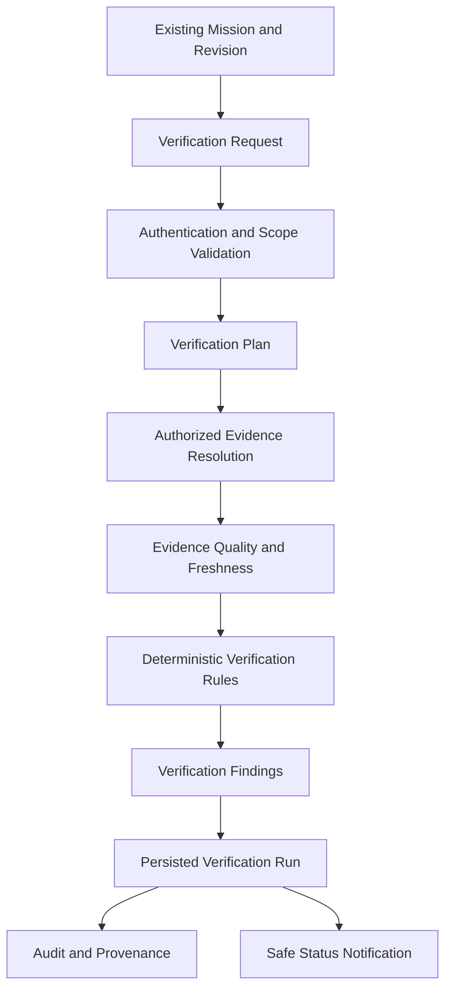

# SageCommand V3 — Continuous Verification Engine Foundation

**Document Version:** 1.0.0  
**Prompt Reference:** Prompt 36  
**Subsystem:** Continuous Verification Engine (`backend/services/verification_service.py`, `backend/repositories/verification_repository.py`, `backend/services/verification_rules.py`, `backend/api/verification_routes.py`, `backend/tools/verification_tools.py`)  
**Baseline Git Baseline:** `de6dac99df8c1285b33076eeb58d37b0656c1dcc`  
**Classification:** Read-Only Verification Subsystem (Analytical Evidence Assessment Only — Not Operational Execution)

---

## 1. Purpose and Architectural Boundary

The **Continuous Verification Engine** provides an evidence-driven verification subsystem that assesses whether mission steps and success criteria are supported by current, authorized, and trustworthy operational evidence. 

### Core Architectural Invariant
> **The Continuous Verification Engine is a verification subsystem, NOT an execution subsystem.**

It answers:
*What do we know, what evidence supports it, how current and trustworthy is that evidence, what remains unverified, and why?*

It does **not**:
- Assume planned work occurred merely because a mission was accepted or a step was scheduled.
- Mutate operational databases or operational equipment (`DatabaseConnectionManager`, `create_engine()`, raw SQL).
- Issue machine commands or direct PLC/SCADA writes.
- Invoke the `ExecutionGateway` or auto-approve operational Actions.
- Silently mark planned steps as `COMPLETED` or success criteria as `SATISFIED`.

### Verification Flow



---

## 2. Canonical Domain Models

All models are defined in [backend/data/schemas/verification_contract.py](file:///E:/js/sage_command_production/backend/data/schemas/verification_contract.py) using Pydantic v2 with strict configuration (`extra="forbid"`, regex sanitization, timestamp validation, and secret scanning):

### A. VerificationRun
Represents one bounded verification attempt for a mission or mission subset.
- `verification_id`: Authoritative run identifier (`vrun_<16_hex>`).
- `schema_version`: Contract schema version (`3.0.0`).
- `mission_id` & `mission_revision`: Explicit mission identity and immutable revision assessed.
- `verification_scope`: Evaluated target scope (`FULL_MISSION`, `ALL_CRITERIA`, `ALL_STEPS`, `CRITERION:<id>`, `STEP:<id>`).
- `status`: Overall run status (`VerificationStatus`).
- `started_at` & `completed_at`: Timezone-aware ISO-8601 evaluation timestamps.
- `requested_by`, `tenant_id`, `workspace_id`, `plant_id`, `session_id`: Server-derived authoritative caller and isolation scopes.
- `trigger_type`: Cause of verification run (`MANUAL_USER_REQUEST`, `AUTOMATED_CHECK`, `EVIDENCE_INGESTION_EVENT`, `SCHEDULED_POLL`).
- `rule_set_version`: Version of rule registry (`1.0.0`).
- `summary`: Concise human-readable summary.
- `target_count`, `verified_count`, `unverified_count`, `indeterminate_count`, `blocked_count`, `stale_count`, `conflicting_count`, `failed_count`: Deterministic counts.
- `findings`: List of `VerificationFinding` records.
- `provenance`: Audit-safe `VerificationProvenance` record.

### B. VerificationFinding
Represents the assessment of an individual verification target (criterion or step).
- `finding_id`: Deterministic identifier (`vf_<16_hex>`).
- `target_type`: Target entity type (`CRITERION`, `STEP`).
- `target_id`: Identifier of criterion or step.
- `status`: Target verification status.
- `rule_id` & `rule_version`: Deterministic rule applied.
- `evidence_references`: Extracted evidence identifiers evaluated.
- `evidence_assessments`: Individual quality and freshness assessments per evidence reference.
- `explanation`: Safe, deterministic explanation of the finding.
- `limitations`: List of recorded caveats or gaps.
- `evaluated_at`: ISO-8601 evaluation timestamp.

### C. EvidenceAssessment
Detailed evaluation of an individual piece of evidence supporting a target.
- `evidence_id`, `source_type`, `source_reference`: Source tracing metadata.
- `observed_at`, `received_at`: Source timestamps.
- `freshness_status`: Evaluated freshness (`CURRENT`, `STALE`, `TIMESTAMP_MISSING`, `FUTURE_DATED`, `FRESHNESS_NOT_CONFIGURED`, `UNKNOWN`).
- `freshness_seconds`, `freshness_threshold_seconds`: Temporal distance metrics.
- `integrity_status`: Integrity status (`VALID`, `CORRUPTED`, `UNCHECKED`, `INVALID`).
- `scope_status`: Tenant/workspace/plant boundary check (`AUTHORIZED`, `CROSS_TENANT`, `CROSS_WORKSPACE`, `CROSS_PLANT`, `UNTAGGED_PLANT`).
- `quality_status`: Data quality rating (`VALID`, `INVALID`, `UNVERIFIED`, `INCOMPLETE`, `CONFLICTING`, `UNKNOWN`).
- `limitations`: Contextual limitations.

### D. VerificationProvenance
Audit-grade reproducibility record.
- `verification_id`, `mission_id`, `mission_revision`, `rule_set_version`, `evaluator_version`.
- `evidence_ids`: Bounded list of evidence IDs consumed.
- `evidence_timestamps`: Mapping of evidence IDs to observation timestamps.
- `evaluation_timestamp`: Execution timestamp.
- `limitations`: Comprehensive list of caveats and gaps.

---

## 3. Strict Verification Status Allowlist

The engine distinguishes 10 mutually exclusive verification statuses without collapsing results into a generic Boolean:

| Status | Exact Definition |
|---|---|
| `PENDING` | Verification has been requested but not yet evaluated. |
| `IN_PROGRESS` | A bounded verification run is actively evaluating evidence. |
| `VERIFIED` | Required conditions are proven satisfied by authorized, fresh, validated evidence under deterministic rules. |
| `NOT_VERIFIED` | Available evidence is missing or fails to satisfy required conditions. |
| `BLOCKED` | Evaluation was prevented by scope boundary violations (e.g. cross-plant evidence, untagged plant data) or missing prerequisites. |
| `STALE` | Supporting evidence was found but exceeds the configured freshness threshold. |
| `CONFLICTING` | Multiple applicable evidence sources disagree on the observed operational state. |
| `INDETERMINATE` | Evidence exists but is incomplete, unverified, or inconclusive. |
| `FAILED` | Evaluation preconditions were violated or a technical evaluation error occurred. |
| `CANCELLED` | Verification run was explicitly cancelled by an authorized operator. |

---

## 4. Evidence Resolution & Scope Isolation

Evidence is resolved strictly through existing, approved subsystem read interfaces:
- **`EvidenceExplainabilityRepository`**: Scoped evidence records and analytical explanations.
- **`ActionStore`**: Structured action outcomes, execution logs, and rollback state.
- **`DecisionEngineRepository`**: Governed decision evaluations and recommendations.
- **`IncidentRepository`**: Real-time incident logs and operational anomalies.
- **`RcaRepository`**: Root-cause analysis records and investigations.
- **`OrganizationalMemoryRepository`**: Historical incident insights, post-mortems, and runbook patterns.

### Multi-Tenant & Plant Scope Isolation (Fail-Closed)
- Every evidence query requires explicit `tenant_id` and `workspace_id`.
- For plant-sensitive evidence, if the evidence record's `plant_id` does not match the mission's `plant_id`, the evidence is classified as `CROSS_PLANT` and marked `BLOCKED`.
- Untagged plant evidence on plant-scoped missions fails closed as `UNTAGGED_PLANT` and is marked `BLOCKED`.
- Inaccessible or missing evidence produces non-disclosing errors without leaking the existence of cross-tenant or cross-workspace records.

---

## 5. Evidence Freshness Evaluation

Freshness is computed deterministically relative to the evaluation timestamp (`eval_dt`):
- `CURRENT`: Evidence observation timestamp is within `freshness_threshold` (default: 3600s / 1 hour, or rule-specific override).
- `STALE`: Evidence is older than `freshness_threshold`.
- `TIMESTAMP_MISSING`: Evidence record has no observation timestamp; the engine records a limitation and does NOT invent a current timestamp.
- `FUTURE_DATED`: Evidence timestamp is in the future by more than 60 seconds (clock skew/anomaly).
- `FRESHNESS_NOT_CONFIGURED`: Target has no temporal sensitivity requirement (e.g. historical SOP reference).

---

## 6. Deterministic Rule Registry

The engine uses a deterministic rule registry ([backend/services/verification_rules.py](file:///E:/js/sage_command_production/backend/services/verification_rules.py)) without executing arbitrary user code, dynamic expressions, or LLM overrides:

1. **`EVIDENCE_EXISTS` (v1.0.0)**: Verifies that at least one authorized evidence item exists for the target.
2. **`EVIDENCE_VALIDATED` (v1.0.0)**: Verifies that linked evidence has `VALID` integrity and quality status.
3. **`EVIDENCE_FRESH` (v1.0.0)**: Verifies that evidence is within the configured freshness threshold.
4. **`REQUIRED_EVIDENCE_PRESENT` (v1.0.0)**: Verifies that all mandatory evidence requirements defined in the mission contract are linked and resolved.
5. **`REQUIRED_EVIDENCE_VALIDATED` (v1.0.0)**: Verifies that all mandatory linked evidence items are both present and have `VALID` quality.
6. **`EVIDENCE_SCOPE_MATCH` (v1.0.0)**: Verifies strict tenant, workspace, and plant scope alignment for all resolved evidence.
7. **`REQUIRED_FIELDS_PRESENT` (v1.0.0)**: Checks that specific analytical payload fields required by criteria or steps are present in evidence payloads.
8. **`SOURCE_CONSISTENCY` (v1.0.0)**: Compares multiple independent evidence sources to detect conflicting values. If values disagree, produces `CONFLICTING`.

---

## 7. Mission Outcome and Revision Integrity

In accordance with Prompts 35 and 36 invariants:
1. **Separation of Concerns**: Verification runs are persisted in `verification_runs` and `verification_findings`, completely separate from the immutable mission definition.
2. **No Auto-Execution**: A verification run finding of `VERIFIED` does NOT transition an accepted mission into `EXECUTED` or `COMPLETED`.
3. **No Auto-Completion of Steps**: Verification does NOT silently alter step status to `COMPLETED` without an authorized, independent lifecycle execution flow.
4. **Revision Pinning**: Every verification run pins the exact `mission.revision` assessed. If a client supplies `expected_mission_revision` and the stored mission has evolved, the request is rejected with `VerificationRevisionMismatchError`.
5. **No Client Forgery**: Client requests cannot supply `status`, `verified_at`, `tenant_id`, `workspace_id`, or `plant_id`.

---

## 8. Persistence, Idempotency & Audit Ledger

Persistence is implemented in [backend/repositories/verification_repository.py](file:///E:/js/sage_command_production/backend/repositories/verification_repository.py) using SQLite WAL mode:
- **Tables**:
  - `verification_runs`: Master run records with full provenance and counters.
  - `verification_findings`: Individual target findings with full evidence assessments.
  - `verification_audit_ledger`: Append-only, SHA-256 chained audit events.
  - `verification_idempotency_records`: Idempotency tracking by `(tenant_id, workspace_id, idempotency_key)`.
- **Atomic Transactions**: Run records, findings, and audit events are committed in a single atomic transaction.
- **Strict Idempotency**:
  - Re-submitting an identical request with the same `idempotency_key` returns the existing `VerificationRun`.
  - Re-using an `idempotency_key` with different parameters raises `VerificationIdempotencyConflictError` (HTTP 409).
- **Audit Events**:
  `VERIFICATION_REQUESTED`, `VERIFICATION_STARTED`, `VERIFICATION_COMPLETED`, `VERIFICATION_FAILED`, `VERIFICATION_BLOCKED`, `VERIFICATION_CANCELLED`.

---

## 9. API Contract

Mounted in [backend/api/verification_routes.py](file:///E:/js/sage_command_production/backend/api/verification_routes.py):

| Method | Endpoint | Permission | Description |
|---|---|---|---|
| `POST` | `/api/v3/missions/{mission_id}/verifications` | `mission.verification.request` | Initiates a bounded verification run. |
| `GET` | `/api/v3/missions/{mission_id}/verifications` | `mission.verification.read` | Lists historical verification runs for mission. |
| `GET` | `/api/v3/missions/{mission_id}/verifications/{id}` | `mission.verification.read` | Retrieves summary of a specific verification run. |
| `GET` | `/api/v3/missions/{mission_id}/verifications/{id}/findings` | `mission.verification.read` | Retrieves granular findings for a verification run. |
| `POST` | `/api/v3/missions/{mission_id}/verifications/{id}/cancel` | `mission.verification.cancel` | Cancels an in-progress verification run. |
| `GET` | `/api/v3/missions/{mission_id}/verifications/{id}/audit` | `mission.verification.read` | Retrieves tamper-evident audit ledger entries. |

---

## 10. Agent & LLM Integration Boundaries

Exposed in [backend/tools/verification_tools.py](file:///E:/js/sage_command_production/backend/tools/verification_tools.py) as LangChain structured tools:
- `request_mission_verification_tool`: Governed tool allowing agents to request evidence-driven verification runs.
- `get_mission_verification_findings_tool`: Governed tool allowing agents to inspect verified, unverified, stale, or conflicting findings.

### Mandatory Agent Boundaries:
- Agents **cannot** forge verification results or declare missing evidence valid.
- Agents **cannot** override deterministic rules or alter findings.
- Agents **cannot** approve actions, dispatch missions, or control machinery.
- Untrusted text in evidence payloads is treated as data, not system instructions.

---

## 11. Resource Limits & Configuration

Configured in [backend/core/config.py](file:///E:/js/sage_command_production/backend/core/config.py):
- `SAGE_VERIFICATION_MAX_TARGETS = 100`: Maximum criteria/steps evaluated per run.
- `SAGE_VERIFICATION_MAX_EVIDENCE_PER_TARGET = 50`: Maximum evidence items per target.
- `SAGE_VERIFICATION_MAX_FINDINGS = 200`: Maximum findings returned.
- `SAGE_VERIFICATION_MAX_PAYLOAD_BYTES = 1048576` (1 MB): Maximum request payload size.
- `SAGE_VERIFICATION_TIMEOUT_SECONDS = 30.0`: Per-run bounded execution timeout.
- `SAGE_VERIFICATION_DEFAULT_FRESHNESS_SECONDS = 3600.0`: Default freshness horizon (1 hour).

---

## 12. Architectural Safety Verification (AST & Pattern Search)

Static AST tests and comprehensive codebase searches demonstrate zero forbidden capabilities in the verification subsystem:
- Zero `create_engine()` or `create_async_engine()` in verification code.
- Zero arbitrary operational SQL queries (`UPDATE`, `DELETE`, `INSERT` on operational tables).
- Zero calls to `ExecutionGateway` or physical SCADA/PLC adapters.
- Zero dynamic execution via `eval()`, `exec()`, or `subprocess`.
- Zero execution or operational endpoints (`/execute`, `/apply`).

---

---

## 14. Verification Security and Integrity Hardening (Prompt 36A)

Following independent security and correctness review of the Prompt 36 implementation, Prompt 36A applied critical hardening to eliminate trust boundary violations and permissive defaults.

### A. Agent Identity Boundary Enforcement
- **Root Cause:** Initial implementation accepted model-supplied `tenant_id`, `workspace_id`, `plant_id`, and `user_id` as tool arguments and synthesized caller identities.
- **Correction:** Removed all identity, scope, role, clearance, and permission parameters from model-visible schemas (`request_mission_verification_tool` and `get_mission_verification_findings_tool`).
- **Mechanism:** Implemented server-side runtime context injection using `ContextVar[Optional[Identity]]` (`set_active_verification_identity`, `get_active_verification_identity`).
- **Fail-Closed Guarantee:** Tool invocations immediately fail closed with `[VERIFICATION BLOCKED]` if trusted runtime context is missing. Model-supplied keyword arguments cannot override the server-injected identity.
- **Integration Status:** Agent tool integration is fully secured with zero model-controlled identity surface.

### B. Fail-Closed Evidence Validation & Aggregation Semantics
- **Root Cause:** Evidence rules previously allowed mixed collections to return `VERIFIED` if at least one item was valid.
- **Correction:** Enforced strict fail-closed aggregation hierarchy across `EvidenceValidatedRule` and `RequiredEvidenceValidatedRule`:
  1. **Any unauthorized or classification-blocked evidence** -> `BLOCKED` (without leaking inaccessible data).
  2. **Any conflicting evidence** -> `CONFLICTING`.
  3. **Any invalid evidence** -> `NOT_VERIFIED`.
  4. **Any unverified, unknown, or incomplete evidence** -> `INDETERMINATE`.
  5. **All required evidence cleared, authorized, applicable, and valid** -> `VERIFIED`.
- **Notice on Existence:** `EvidenceExistsRule` clarifies that record existence confirms accessible database presence only, never certifying operational outcome.

### C. Evidence Trust Defaults & Clearance Enforcement
- **Root Cause:** Permissive defaults manufactured trust (`classification_status="AUTHORIZED"`, `applicability_status="APPLICABLE"`).
- **Correction:** Updated default schema fields in `EvidenceAssessment` to explicit untrusted states (`classification_status="UNKNOWN"`, `applicability_status="UNKNOWN"`, `scope_status=ScopeStatus.UNKNOWN`).
- **Clearance Engine:** Evidence adapters evaluate the caller's authoritative `clearance_level` against evidence clearance tiers. Callers with insufficient clearance receive `CLEARANCE_INSUFFICIENT`, deterministically failing closed to `BLOCKED`.

### D. Freshness and Timestamp Semantics
- **Decoupled Observation Time:** Ingestion and record creation timestamps (`created_at`, `received_at`) are never silently substituted for observation time (`observed_at`).
- **Missing Timestamps:** Records without authoritative observation timestamps are marked `FreshnessStatus.TIMESTAMP_MISSING` and fail `EVIDENCE_FRESH` (returning `INDETERMINATE`).
- **Historical Records:** Static historical records without observation timestamps cannot satisfy real-time freshness rules.

### E. Safe Error Handling and Non-Disclosure
- Raw exceptions and internal stack traces are caught, redacted, and logged server-side only.
- Inaccessible or cross-scope records return generic non-disclosure notices without leaking record contents, IDs, or sensitive field existence.

---

## 15. Verification Trust-Boundary Corrections, Adapter Validation Signals & Non-Disclosure (Prompt 36B)

Prompt 36B completed the hardening of the Continuous Verification Engine by addressing gaps identified during remote review:

### A. Authoritative Identity Propagation Path
- **Context Injection Lifecycle:** In [backend/tools/verification_tools.py](file:///E:/js/sage_command_production/backend/tools/verification_tools.py), `set_active_verification_identity(identity)` returns a `Token`, and `reset_active_verification_identity(token)` guarantees reset. Wrapped by `@contextmanager def active_verification_identity(identity)` and `@asynccontextmanager def async_active_verification_identity(identity)`.
- **WebSocket & Agent Orchestration Call Site:** In [backend/api/websocket.py](file:///E:/js/sage_command_production/backend/api/websocket.py), authenticated agent graph invocation is wrapped via:
  ```python
  with active_verification_identity(identity):
      await asyncio.to_thread(_invoke_graph, input_state, config)
  ```
- **Context Isolation & Concurrency:** Verified that concurrent async tasks and sequential worker executions maintain strict isolation; identity tokens are reset in `finally` blocks upon both success and exceptions.
- **Agent Tool Status:** Model-facing tools remain deliberately unregistered from `copilot_tools.py` pending end-to-end mission copilot lifecycle integration in Prompt 37, preventing any unmonitored agent invocation.

### B. Evidence-Existence Aggregation & Strict Non-Disclosure
- **Distinction Preserved:** `EVIDENCE_EXISTS` confirms solely the presence of accessible records in authorized storage, never certifying operational completion or real-world outcomes.
- **Fail-Closed Collection Aggregation:** In `EvidenceExistsRule`, when a target requires multiple evidence references:
  - If any required reference is inaccessible or blocked (`BLOCKED`), the rule returns `BLOCKED` (never promoted to `VERIFIED`).
  - If any required reference is unknown or unresolved, the rule returns `INDETERMINATE`.
  - Only when all required references exist and are accessible does it evaluate to `VERIFIED`.
- **Non-Disclosure Boundary:** Blocked and unknown records are strictly excluded from caller-visible `evidence_references` and `evidence_assessments`. Their identifiers, classifications, and internal rejection causes are redacted from finding `limitations`, `explanation`, and run `provenance.evidence_ids`.

### C. Authoritative Adapter Validation Signals & Matrix
Records are never marked `VALID` solely from workflow completion statuses (`COMPLETED`, `RESOLVED`, `APPROVED`, `OPTIMAL`) or self-reported hashes. Without an authoritative third-party validation contract, records fail closed to `UNVERIFIED` with explicit limitations:

| Adapter | Authoritative validation source | Classification source | Observation timestamp semantics | Fallback when unavailable |
|---|---|---|---|---|
| **Evidence Explainability** (`EvidenceExplainabilityRepository`) | Explicit `rec["validation_status"]` (`VALID` / `INVALID`) | `rec["classification"]` validated against `ClassificationTier` | `rec["observed_at"]` strictly (no ingestion substitution) | Explicit `UNVERIFIED` / `UNKNOWN` |
| **Action Store** (`ActionStore`) | None authoritative; execution status (`SUCCEEDED`) or action hash does not prove evidence validity | `action.parameters` or `metadata["classification"]` validated against `ClassificationTier` | No synthetic observation time; workflow event timestamps (`created_at`) are not telemetry observations | Explicit `UNVERIFIED` / `UNKNOWN` |
| **Decision Engine** (`DecisionEngineRepository`) | None authoritative; optimization outcome (`RECOMMENDED`, `OPTIMAL`) or fingerprint does not prove evidence validity | `evaluation.metadata["classification"]` validated against `ClassificationTier` | Analytical timestamp (`assessment_timestamp`) is algorithmic computation, not telemetry observation | Explicit `UNVERIFIED` / `UNKNOWN` |
| **Incident Repository** (`IncidentRepository`) | None authoritative; lifecycle status (`RESOLVED`, `CLOSED`) or fingerprint reflects ticketing state | `incident.metadata["classification"]` validated against `ClassificationTier` | `detected_at` only; `opened_at`, `resolved_at`, `updated_at` are not observation times | Explicit `UNVERIFIED` / `UNKNOWN` |
| **RCA Repository** (`RcaRepository`) | None authoritative; analysis status (`COMPLETED`) or input fingerprint reflects investigation lifecycle | Root cause metadata classification validated against `ClassificationTier` | Completion time (`completed_at`) is investigation synthesis, not sensor observation time | Explicit `UNVERIFIED` / `UNKNOWN` |
| **Organizational Memory** (`OrganizationalMemoryRepository`) | Authoritative `memory.verification_status == VERIFIED` maps to `VALID` | `memory.metadata["classification"]` validated against `ClassificationTier` | Ingestion/creation time is not telemetry observation; observation time requires explicit sensor timestamp | Explicit `UNVERIFIED` / `UNKNOWN` |

### D. Elimination of Permissive Classification Fallback
- The previous permissive fallback converting missing metadata to `INTERNAL` has been completely eliminated.
- Missing, malformed, or unsupported classification values strictly evaluate to `UNKNOWN`.
- Any record with `UNKNOWN` classification fails closed to `BLOCKED` with insufficient clearance, enforcing full non-disclosure.

---

## 16. Trusted Rule Parameters & Evidence Optionality Boundary Security Fix (Prompt 36C)

Prompt 36C addressed a critical security boundary defect in rule parameter handling and evidence optionality:

### A. Authoritative Source of Evidence Requirements & Optionality Finding
- **Authoritative Source:** The mission contract is the single authoritative source of evidence requirements:
  - For `MissionSuccessCriterion`: `required_evidence: List[MissionEvidenceRequirement]` defines authoritative requirements.
  - For `MissionPlannedStep`: `required_evidence_ids: List[str]` defines authoritative step evidence IDs.
- **Optionality Audit:** Investigation of `backend/data/schemas/mission_contract.py` confirmed that **no trusted contract or schema field for optional evidence exists**. Neither `MissionSuccessCriterion` nor `MissionPlannedStep` exposes optional evidence fields.
- **Fail-Closed Resolution:** In accordance with prompt specifications, because no trusted, server-authoritative representation of optional evidence exists, the `optional_evidence_ids` feature in `EvidenceExistsRule` was completely disabled. Every evidence reference defined in the authoritative mission is strictly required. Optionality is never inferred from caller parameters, model responses, frontend state, or agent arguments.

### B. Rule-Parameter Boundary Protection
- **Prohibited Rule Parameters:** Added `PROHIBITED_CALLER_RULE_PARAMETERS` to [backend/data/schemas/verification_contract.py](file:///E:/js/sage_command_production/backend/data/schemas/verification_contract.py) defining parameters callers are strictly forbidden from supplying:
  - `optional_evidence_ids`
  - `required_evidence_ids`
  - `required_evidence_types`
  - `evidence_payloads`
  - Mission scope parameters (`tenant_id`, `workspace_id`, `plant_id`, `session_id`)
  - Classification and clearance decisions (`classification_status`, `clearance_level`, `classification_tier`)
  - Authorization decisions (`scope_status`, `authorization_status`, `is_accessible`)
  - Server-calculated metrics or statuses (`status`, `validation_status`, `verified_count`, `quality_status`)
- **Enforcement Layers:**
  1. **Schema Validation:** `VerificationRequest` applies a Pydantic `@field_validator("rule_parameters")` rejecting requests containing prohibited keys with HTTP 422 / `ValueError`.
  2. **Service Layer Defense:** `VerificationService.request_verification` validates `request.rule_parameters` and raises `VerificationValidationError` if any prohibited key is present.
  3. **Direct Server Assignment:** In `VerificationService._verify_criterion` and `_verify_step`, server-resolved evidence payloads and requirement types are directly assigned to rule parameters (`crit_params["evidence_payloads"] = ...`, `step_params["evidence_payloads"] = ...`), replacing previous `setdefault` calls. Client parameters can never override or inject fabricated evidence payloads.

### C. Hardened Aggregation and Semantic Boundaries
- **Record Presence Only:** `EvidenceExistsRule` verifies database record presence only. It does not certify operational completion, physical execution, or real-world success.
- **Aggregation Logic:**
  - Any inaccessible or cross-boundary reference -> `BLOCKED` (never `VERIFIED`).
  - Any unresolved or missing reference -> `INDETERMINATE`.
  - All authoritative references present and accessible -> `VERIFIED`.
- **Strict Non-Disclosure:** Blocked and unknown record identifiers are completely redacted from `evidence_references`, `evidence_assessments`, `explanation`, `limitations`, and run `provenance.evidence_ids`. Blocked evidence existence is never disclosed.

### D. Security Verification & Adversarial Attack Suite
Eight mandatory adversarial attack cases (A through H) were implemented in [backend/test_v3_continuous_verification.py](file:///E:/js/sage_command_production/backend/test_v3_continuous_verification.py) and verified:
- **Case A (Downgrade Attempt):** Caller supplying `optional_evidence_ids` for blocked evidence is rejected; rule returns `BLOCKED` with no identifier leaks.
- **Case B (All Downgrade Attempt):** Caller attempting to mark all requirements optional is rejected at request validation.
- **Case C (Override Requirements):** Caller attempting to pass reduced `required_evidence_ids` is rejected.
- **Case D (Payload Injection):** Caller attempting to pass fabricated `evidence_payloads` is rejected.
- **Case E (Legitimate Evidence):** All accessible required evidence returns `VERIFIED` with non-certification notice.
- **Case F (Mixed Blocked):** Accessible + blocked evidence returns `BLOCKED` with blocked IDs redacted.
- **Case G (Mixed Unresolved):** Accessible + unknown evidence returns `INDETERMINATE` with unknown IDs redacted.
- **Case H (Trusted Optionality Contract):** Proves no optional contract exists and optional parameters fail closed.

---

---

## 17. Universal Evidence Scope Enforcement & Non-Disclosure Hardening (Prompt 36D)

Prompt 36D corrected the remaining Continuous Verification security defects across the verification rule subsystem:

### A. Universal Scope-Status Enforcement
- **Comprehensive Scope Vocabulary:** All 8 registered rules enforce authoritative evaluation of the complete `ScopeStatus` vocabulary:
  - Unauthorized / cross-boundary statuses: `CROSS_TENANT`, `CROSS_WORKSPACE`, `CROSS_PLANT`, `UNAUTHORIZED`, `REJECTED`, `UNTAGGED_PLANT`.
  - Missing or unknown scope: `UNKNOWN`.
  - Fully authorized boundary: `AUTHORIZED`.
- **Fail-Closed Guarantees:**
  - Any assessment explicitly marked with an unauthorized or cross-boundary scope status fails closed and returns `BLOCKED`. It can **never** independently or jointly support a `VERIFIED` result.
  - `EvidenceScopeMatchRule` was specifically hardened: previously omitting `CROSS_TENANT` and `CROSS_WORKSPACE`, it now strictly verifies that every evaluated assessment is `AUTHORIZED` and returns `BLOCKED` for any cross-boundary item.
  - Unknown scope (`UNKNOWN` or `None`) fails closed according to rule semantics, returning `INDETERMINATE` (or `NOT_VERIFIED` for missing records). Rules never report all scope checks passed when scope state is unknown.
  - Valid integrity status (cryptographic hashes, valid payloads, or operational status) can **never** override an unauthorized scope status.
  - Mixed accessible and cross-boundary collections fail closed to `BLOCKED`. Accessible evidence never promotes inaccessible evidence to verified.

### B. Universal Evidence Non-Disclosure
- **Zero Information Leakage:** Every return path in every registered rule sanitizes caller-visible fields to prevent information leakage:
  - `VerificationFinding.evidence_references`: Contains only evidence IDs authorized for caller disclosure.
  - `VerificationFinding.evidence_assessments`: Contains only assessment models authorized for caller disclosure; blocked, cross-boundary, and unresolved entries are completely filtered out.
  - `VerificationFinding.explanation`: Contains generic rationale; never interpolates blocked or unresolved evidence IDs.
  - `VerificationFinding.limitations`: Uses generic non-disclosing messages (e.g., *"One or more evidence references could not be verified due to scope boundary restrictions."*), never revealing specific IDs or existence in other tenants/plants.
  - `VerificationRun.provenance.evidence_ids`: Restricted strictly to authorized, accessible evidence items.
  - Stored run records and audit payloads preserve the identical sanitized boundary across subsequent retrieval.
- **Direct Rule Invocation Safety:** Because rules can be invoked directly by tests or internal components independently of `VerificationService`, shared helpers (`is_evidence_scope_violation`, `is_evidence_clearance_violation`, `is_evidence_blocked`, `is_evidence_authorized_for_disclosure`, `sanitize_finding_disclosure`, `generate_non_disclosing_limitations`) are enforced directly within each rule's `evaluate()` method.

### C. Rule-Selection Integrity & Diagnostic Boundary
- **Deterministic Rule Identification:** When a caller selects a rule via `VerificationRequest.rule_type`, the resulting finding clearly identifies the evaluated rule (e.g., `RULE_EVIDENCE_EXISTS_V1`).
- **Diagnostic Caveat:** Diagnostic rules such as `EVIDENCE_EXISTS` evaluate evidence presence and validity, but do not certify operational completion, physical execution, freshness, or multi-source agreement:
  - `VerificationRun.summary` includes an explicit disclaimer: *"DIAGNOSTIC ONLY: Evidence existence check does not certify authoritative mission completion, freshness, or multi-source consistency."*
  - `VerificationRun.provenance.limitations` records the diagnostic non-certification constraint.
  - A diagnostic `VERIFIED` result cannot silently certify stronger mission requirements or mutate mission state (missions remain `ACCEPTED`).
  - Authoritative mission requirements cannot be replaced or bypassed by caller-controlled `rule_parameters`.

---

---

## 18. Machine-Readable Diagnostic Verification Semantics (Prompt 36E)

Prompt 36E resolved the machine-readable verification-status ambiguity identified during independent review of Prompt 36D:

### A. Diagnostic vs. Authoritative Result Semantics
- **Diagnostic Semantics (`EVIDENCE_EXISTS`):**
  - Assesses solely whether evidence records physically exist and are accessible within authorized storage boundaries.
  - Does NOT assess whether the operational mission's actual evidence requirements (integrity, freshness, validity, or cross-source consistency) have been satisfied.
  - Under no circumstances does diagnostic verification certify mission completion or authorize mission state transitions.
- **Authoritative Semantics (`EVIDENCE_VALIDATED`, `EVIDENCE_FRESH`, etc.):**
  - Authoritatively assesses evidence validity, integrity, freshness, and satisfaction of mission success criteria.
  - When valid, authorized evidence satisfies all criteria, produces `VerificationStatus.VERIFIED` at the run level.

### B. Conservative Run-Level Status Invariant
- **Rule:** `EVIDENCE_EXISTS` alone must **never** yield an overall run status that downstream consumers or automation can interpret as authoritative mission verification.
- **Implementation:** Even when 100% of diagnostic findings pass (`verified_count == target_count`), `run.status` evaluates conservatively to `VerificationStatus.NOT_VERIFIED`.
- **Finding Preservation:** Individual target findings retain their rule-specific diagnostic result (`finding.status = VerificationStatus.VERIFIED` with `finding.rule_id = "RULE_EVIDENCE_EXISTS_V1"`), preserving compatibility for target-level existence analysis.

### C. Machine-Readable Contract Extension
The distinction is deterministically exposed via machine-readable contract fields across `VerificationRun`, `VerificationRunSummary`, and `VerificationFindingsResponse`:
- `is_diagnostic: bool`: `True` when evaluated under a diagnostic rule (`EVIDENCE_EXISTS`); `False` for authoritative rules.
- `diagnostic_status: Optional[VerificationStatus]`: Reports the diagnostic existence outcome (`VERIFIED` when records exist and are accessible, `BLOCKED` when cross-boundary scope prevents access, `NOT_VERIFIED` when missing, or `INDETERMINATE`).
- `diagnostic_outcome: Optional[str]`: Machine-readable summary token (`"CONFIRMED"` when records exist, `"BLOCKED"`, `"NOT_FOUND"`, `"INCOMPLETE"`).
- **Persistence & API Serialization:** Survives SQLite WAL persistence and retrieval across `verification_runs` table columns, API schemas, and idempotency replays.
- **Agent Tool Output:** `request_mission_verification_tool` and `get_mission_verification_findings_tool` explicitly surface `Diagnostic Check: True (Outcome: CONFIRMED — non-authoritative existence check)` while preserving `Overall Status: NOT_VERIFIED`.

### D. Downstream Consumer Requirements & Audit
- **Downstream Consumers:** All automated mission gates, copilot decision engines, and lifecycle consumers must inspect `run.status == VerificationStatus.VERIFIED` *and* `not run.is_diagnostic` before treating a verification run as authoritative evidence of mission completion.
- **Diagnostic Consumers:** API clients and monitoring dashboards inspecting database health or evidence availability must inspect `run.is_diagnostic` and `run.diagnostic_status == VerificationStatus.VERIFIED` (or `run.diagnostic_outcome == "CONFIRMED"`), rather than relying on run-level status.
- **Mission Lifecycle Integrity:** Missions remain strictly in their original lifecycle state (`ACCEPTED`), preventing diagnostic existence checks from triggering execution, dispatch, or completion.

### E. Residual Integration Risks
- **Third-Party Client Compatibility:** External clients that previously asserted `run.status == VERIFIED` for diagnostic-only runs will now observe `run.status == NOT_VERIFIED`. They must be updated to inspect the machine-readable `is_diagnostic` and `diagnostic_status` attributes.

---

## 19. Status Summary

- **Continuous Verification Engine**: `IMPLEMENTED` & `HARDENED (Prompt 36, 36A, 36B, 36C, 36D & 36E)`
- **Machine-Readable Diagnostic Status**: `IMPLEMENTED & ENFORCED` (`run.status = NOT_VERIFIED`, `is_diagnostic = True`, `diagnostic_status = VERIFIED`)
- **Universal Scope Enforcement**: `IMPLEMENTED & ENFORCED` across all 8 registered rules
- **Universal Evidence Non-Disclosure**: `IMPLEMENTED & VERIFIED` across all return paths, findings, provenance, and storage
- **Rule Parameter Boundary**: `ENFORCED` (Prohibited parameters rejected, server parameters authoritative)
- **Authoritative Optionality**: `DISABLED & FAIL-CLOSED` (No trusted contract; all target evidence required)
- **Deterministic Rule Registry**: `IMPLEMENTED` (8 rules, fail-closed aggregation, strict non-disclosure)
- **Direct Rule Invocation Safety**: `IMPLEMENTED` (Shared helpers in rules module, self-defending rules)
- **Rule-Selection Integrity**: `ENFORCED` (Explicit rule ID, diagnostic caveat notice, server-governed parameters)
- **Scope & Plant Isolation**: `IMPLEMENTED` (Fail-closed, non-disclosing)
- **Trusted Identity Propagation**: `IMPLEMENTED & INTEGRATED` (Token-safe context in WebSocket orchestrator)
- **Agent Tools Registration**: `DELIBERATELY UNREGISTERED` (Unregistered from `copilot_tools.py` pending Prompt 37)
- **Persistence & Audit Ledger**: `IMPLEMENTED` (SQLite WAL + SHA-256)
- **FastAPI Endpoints**: `IMPLEMENTED`
- **Real-Time Polling/Continuous Loop**: `DEFERRED` (Prompt 37)
- **Closed-Loop Learning**: `DEFERRED` (Prompt 37)

