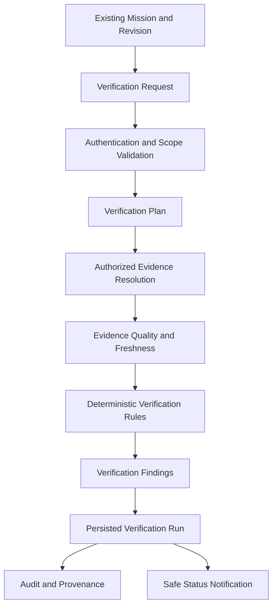

# SageCommand V3 — Continuous Verification Engine Foundation

**Document Version:** 1.0.0  
**Prompt Reference:** Prompt 36  
**Subsystem:** Continuous Verification Engine (`backend/services/verification_service.py`, `backend/repositories/verification_repository.py`, `backend/services/verification_rules.py`, `backend/api/verification_routes.py`, `backend/tools/verification_tools.py`)  
**Baseline Git Baseline:** `de6dac99df8c1285b33076eeb58d37b0656c1dcc`  
**Classification:** Read-Only Verification Subsystem (Analytical Evidence Assessment Only — Not Operational Execution)

---

## 1. Purpose and Architectural Boundary

The **Continuous Verification Engine** provides an evidence-driven verification subsystem that assesses whether mission steps and success criteria are supported by current, authorized, and trustworthy operational evidence. 

### Core Architectural Invariant
> **The Continuous Verification Engine is a verification subsystem, NOT an execution subsystem.**

It answers:
*What do we know, what evidence supports it, how current and trustworthy is that evidence, what remains unverified, and why?*

It does **not**:
- Assume planned work occurred merely because a mission was accepted or a step was scheduled.
- Mutate operational databases or operational equipment (`DatabaseConnectionManager`, `create_engine()`, raw SQL).
- Issue machine commands or direct PLC/SCADA writes.
- Invoke the `ExecutionGateway` or auto-approve operational Actions.
- Silently mark planned steps as `COMPLETED` or success criteria as `SATISFIED`.

### Verification Flow

---

## 2. Canonical Domain Models

All models are defined in [backend/data/schemas/verification_contract.py](file:///E:/js/sage_command_production/backend/data/schemas/verification_contract.py) using Pydantic v2 with strict configuration (`extra="forbid"`, regex sanitization, timestamp validation, and secret scanning):

### A. VerificationRun
Represents one bounded verification attempt for a mission or mission subset.
- `verification_id`: Authoritative run identifier (`vrun_<16_hex>`).
- `schema_version`: Contract schema version (`3.0.0`).
- `mission_id` & `mission_revision`: Explicit mission identity and immutable revision assessed.
- `verification_scope`: Evaluated target scope (`FULL_MISSION`, `ALL_CRITERIA`, `ALL_STEPS`, `CRITERION:<id>`, `STEP:<id>`).
- `status`: Overall run status (`VerificationStatus`).
- `started_at` & `completed_at`: Timezone-aware ISO-8601 evaluation timestamps.
- `requested_by`, `tenant_id`, `workspace_id`, `plant_id`, `session_id`: Server-derived authoritative caller and isolation scopes.
- `trigger_type`: Cause of verification run (`MANUAL_USER_REQUEST`, `AUTOMATED_CHECK`, `EVIDENCE_INGESTION_EVENT`, `SCHEDULED_POLL`).
- `rule_set_version`: Version of rule registry (`1.0.0`).
- `summary`: Concise human-readable summary.
- `target_count`, `verified_count`, `unverified_count`, `indeterminate_count`, `blocked_count`, `stale_count`, `conflicting_count`, `failed_count`: Deterministic counts.
- `findings`: List of `VerificationFinding` records.
- `provenance`: Audit-safe `VerificationProvenance` record.

### B. VerificationFinding
Represents the assessment of an individual verification target (criterion or step).
- `finding_id`: Deterministic identifier (`vf_<16_hex>`).
- `target_type`: Target entity type (`CRITERION`, `STEP`).
- `target_id`: Identifier of criterion or step.
- `status`: Target verification status.
- `rule_id` & `rule_version`: Deterministic rule applied.
- `evidence_references`: Extracted evidence identifiers evaluated.
- `evidence_assessments`: Individual quality and freshness assessments per evidence reference.
- `explanation`: Safe, deterministic explanation of the finding.
- `limitations`: List of recorded caveats or gaps.
- `evaluated_at`: ISO-8601 evaluation timestamp.

### C. EvidenceAssessment
Detailed evaluation of an individual piece of evidence supporting a target.
- `evidence_id`, `source_type`, `source_reference`: Source tracing metadata.
- `observed_at`, `received_at`: Source timestamps.
- `freshness_status`: Evaluated freshness (`CURRENT`, `STALE`, `TIMESTAMP_MISSING`, `FUTURE_DATED`, `FRESHNESS_NOT_CONFIGURED`, `UNKNOWN`).
- `freshness_seconds`, `freshness_threshold_seconds`: Temporal distance metrics.
- `integrity_status`: Integrity status (`VALID`, `CORRUPTED`, `UNCHECKED`, `INVALID`).
- `scope_status`: Tenant/workspace/plant boundary check (`AUTHORIZED`, `CROSS_TENANT`, `CROSS_WORKSPACE`, `CROSS_PLANT`, `UNTAGGED_PLANT`).
- `quality_status`: Data quality rating (`VALID`, `INVALID`, `UNVERIFIED`, `INCOMPLETE`, `CONFLICTING`, `UNKNOWN`).
- `limitations`: Contextual limitations.

### D. VerificationProvenance
Audit-grade reproducibility record.
- `verification_id`, `mission_id`, `mission_revision`, `rule_set_version`, `evaluator_version`.
- `evidence_ids`: Bounded list of evidence IDs consumed.
- `evidence_timestamps`: Mapping of evidence IDs to observation timestamps.
- `evaluation_timestamp`: Execution timestamp.
- `limitations`: Comprehensive list of caveats and gaps.

---

## 3. Strict Verification Status Allowlist

The engine distinguishes 10 mutually exclusive verification statuses without collapsing results into a generic Boolean:

| Status | Exact Definition |
|---|---|
| `PENDING` | Verification has been requested but not yet evaluated. |
| `IN_PROGRESS` | A bounded verification run is actively evaluating evidence. |
| `VERIFIED` | Required conditions are proven satisfied by authorized, fresh, validated evidence under deterministic rules. |
| `NOT_VERIFIED` | Available evidence is missing or fails to satisfy required conditions. |
| `BLOCKED` | Evaluation was prevented by scope boundary violations (e.g. cross-plant evidence, untagged plant data) or missing prerequisites. |
| `STALE` | Supporting evidence was found but exceeds the configured freshness threshold. |
| `CONFLICTING` | Multiple applicable evidence sources disagree on the observed operational state. |
| `INDETERMINATE` | Evidence exists but is incomplete, unverified, or inconclusive. |
| `FAILED` | Evaluation preconditions were violated or a technical evaluation error occurred. |
| `CANCELLED` | Verification run was explicitly cancelled by an authorized operator. |

---

## 4. Evidence Resolution & Scope Isolation

Evidence is resolved strictly through existing, approved subsystem read interfaces:
- **`EvidenceExplainabilityRepository`**: Scoped evidence records and analytical explanations.
- **`ActionStore`**: Structured action outcomes, execution logs, and rollback state.
- **`DecisionEngineRepository`**: Governed decision evaluations and recommendations.
- **`IncidentRepository`**: Real-time incident logs and operational anomalies.
- **`RcaRepository`**: Root-cause analysis records and investigations.
- **`OrganizationalMemoryRepository`**: Historical incident insights, post-mortems, and runbook patterns.

### Multi-Tenant & Plant Scope Isolation (Fail-Closed)
- Every evidence query requires explicit `tenant_id` and `workspace_id`.
- For plant-sensitive evidence, if the evidence record's `plant_id` does not match the mission's `plant_id`, the evidence is classified as `CROSS_PLANT` and marked `BLOCKED`.
- Untagged plant evidence on plant-scoped missions fails closed as `UNTAGGED_PLANT` and is marked `BLOCKED`.
- Inaccessible or missing evidence produces non-disclosing errors without leaking the existence of cross-tenant or cross-workspace records.

---

## 5. Evidence Freshness Evaluation

Freshness is computed deterministically relative to the evaluation timestamp (`eval_dt`):
- `CURRENT`: Evidence observation timestamp is within `freshness_threshold` (default: 3600s / 1 hour, or rule-specific override).
- `STALE`: Evidence is older than `freshness_threshold`.
- `TIMESTAMP_MISSING`: Evidence record has no observation timestamp; the engine records a limitation and does NOT invent a current timestamp.
- `FUTURE_DATED`: Evidence timestamp is in the future by more than 60 seconds (clock skew/anomaly).
- `FRESHNESS_NOT_CONFIGURED`: Target has no temporal sensitivity requirement (e.g. historical SOP reference).

---

## 6. Deterministic Rule Registry

The engine uses a deterministic rule registry ([backend/services/verification_rules.py](file:///E:/js/sage_command_production/backend/services/verification_rules.py)) without executing arbitrary user code, dynamic expressions, or LLM overrides:

1. **`EVIDENCE_EXISTS` (v1.0.0)**: Verifies that at least one authorized evidence item exists for the target.
2. **`EVIDENCE_VALIDATED` (v1.0.0)**: Verifies that linked evidence has `VALID` integrity and quality status.
3. **`EVIDENCE_FRESH` (v1.0.0)**: Verifies that evidence is within the configured freshness threshold.
4. **`REQUIRED_EVIDENCE_PRESENT` (v1.0.0)**: Verifies that all mandatory evidence requirements defined in the mission contract are linked and resolved.
5. **`REQUIRED_EVIDENCE_VALIDATED` (v1.0.0)**: Verifies that all mandatory linked evidence items are both present and have `VALID` quality.
6. **`EVIDENCE_SCOPE_MATCH` (v1.0.0)**: Verifies strict tenant, workspace, and plant scope alignment for all resolved evidence.
7. **`REQUIRED_FIELDS_PRESENT` (v1.0.0)**: Checks that specific analytical payload fields required by criteria or steps are present in evidence payloads.
8. **`SOURCE_CONSISTENCY` (v1.0.0)**: Compares multiple independent evidence sources to detect conflicting values. If values disagree, produces `CONFLICTING`.

---

## 7. Mission Outcome and Revision Integrity

In accordance with Prompts 35 and 36 invariants:
1. **Separation of Concerns**: Verification runs are persisted in `verification_runs` and `verification_findings`, completely separate from the immutable mission definition.
2. **No Auto-Execution**: A verification run finding of `VERIFIED` does NOT transition an accepted mission into `EXECUTED` or `COMPLETED`.
3. **No Auto-Completion of Steps**: Verification does NOT silently alter step status to `COMPLETED` without an authorized, independent lifecycle execution flow.
4. **Revision Pinning**: Every verification run pins the exact `mission.revision` assessed. If a client supplies `expected_mission_revision` and the stored mission has evolved, the request is rejected with `VerificationRevisionMismatchError`.
5. **No Client Forgery**: Client requests cannot supply `status`, `verified_at`, `tenant_id`, `workspace_id`, or `plant_id`.

---

## 8. Persistence, Idempotency & Audit Ledger

Persistence is implemented in [backend/repositories/verification_repository.py](file:///E:/js/sage_command_production/backend/repositories/verification_repository.py) using SQLite WAL mode:
- **Tables**:
  - `verification_runs`: Master run records with full provenance and counters.
  - `verification_findings`: Individual target findings with full evidence assessments.
  - `verification_audit_ledger`: Append-only, SHA-256 chained audit events.
  - `verification_idempotency_records`: Idempotency tracking by `(tenant_id, workspace_id, idempotency_key)`.
- **Atomic Transactions**: Run records, findings, and audit events are committed in a single atomic transaction.
- **Strict Idempotency**:
  - Re-submitting an identical request with the same `idempotency_key` returns the existing `VerificationRun`.
  - Re-using an `idempotency_key` with different parameters raises `VerificationIdempotencyConflictError` (HTTP 409).
- **Audit Events**:
  `VERIFICATION_REQUESTED`, `VERIFICATION_STARTED`, `VERIFICATION_COMPLETED`, `VERIFICATION_FAILED`, `VERIFICATION_BLOCKED`, `VERIFICATION_CANCELLED`.

---

## 9. API Contract

Mounted in [backend/api/verification_routes.py](file:///E:/js/sage_command_production/backend/api/verification_routes.py):

| Method | Endpoint | Permission | Description |
|---|---|---|---|
| `POST` | `/api/v3/missions/{mission_id}/verifications` | `mission.verification.request` | Initiates a bounded verification run. |
| `GET` | `/api/v3/missions/{mission_id}/verifications` | `mission.verification.read` | Lists historical verification runs for mission. |
| `GET` | `/api/v3/missions/{mission_id}/verifications/{id}` | `mission.verification.read` | Retrieves summary of a specific verification run. |
| `GET` | `/api/v3/missions/{mission_id}/verifications/{id}/findings` | `mission.verification.read` | Retrieves granular findings for a verification run. |
| `POST` | `/api/v3/missions/{mission_id}/verifications/{id}/cancel` | `mission.verification.cancel` | Cancels an in-progress verification run. |
| `GET` | `/api/v3/missions/{mission_id}/verifications/{id}/audit` | `mission.verification.read` | Retrieves tamper-evident audit ledger entries. |

---

## 10. Agent & LLM Integration Boundaries

Exposed in [backend/tools/verification_tools.py](file:///E:/js/sage_command_production/backend/tools/verification_tools.py) as LangChain structured tools:
- `request_mission_verification_tool`: Governed tool allowing agents to request evidence-driven verification runs.
- `get_mission_verification_findings_tool`: Governed tool allowing agents to inspect verified, unverified, stale, or conflicting findings.

### Mandatory Agent Boundaries:
- Agents **cannot** forge verification results or declare missing evidence valid.
- Agents **cannot** override deterministic rules or alter findings.
- Agents **cannot** approve actions, dispatch missions, or control machinery.
- Untrusted text in evidence payloads is treated as data, not system instructions.

---

## 11. Resource Limits & Configuration

Configured in [backend/core/config.py](file:///E:/js/sage_command_production/backend/core/config.py):
- `SAGE_VERIFICATION_MAX_TARGETS = 100`: Maximum criteria/steps evaluated per run.
- `SAGE_VERIFICATION_MAX_EVIDENCE_PER_TARGET = 50`: Maximum evidence items per target.
- `SAGE_VERIFICATION_MAX_FINDINGS = 200`: Maximum findings returned.
- `SAGE_VERIFICATION_MAX_PAYLOAD_BYTES = 1048576` (1 MB): Maximum request payload size.
- `SAGE_VERIFICATION_TIMEOUT_SECONDS = 30.0`: Per-run bounded execution timeout.
- `SAGE_VERIFICATION_DEFAULT_FRESHNESS_SECONDS = 3600.0`: Default freshness horizon (1 hour).

---

## 12. Architectural Safety Verification (AST & Pattern Search)

Static AST tests and comprehensive codebase searches demonstrate zero forbidden capabilities in the verification subsystem:
- Zero `create_engine()` or `create_async_engine()` in verification code.
- Zero arbitrary operational SQL queries (`UPDATE`, `DELETE`, `INSERT` on operational tables).
- Zero calls to `ExecutionGateway` or physical SCADA/PLC adapters.
- Zero dynamic execution via `eval()`, `exec()`, or `subprocess`.
- Zero execution or operational endpoints (`/execute`, `/apply`).

---

## 13. Status Summary

- **Continuous Verification Engine**: `IMPLEMENTED`
- **Deterministic Rule Registry**: `IMPLEMENTED` (8 rules)
- **Scope & Plant Isolation**: `IMPLEMENTED` (Fail-closed)
- **Persistence & Audit Ledger**: `IMPLEMENTED` (SQLite WAL + SHA-256)
- **Agent Tools Integration**: `IMPLEMENTED`
- **FastAPI Endpoints**: `IMPLEMENTED`
- **Real-Time Polling/Continuous Loop**: `DEFERRED` (Prompt 37)
- **Closed-Loop Learning**: `DEFERRED` (Prompt 37)
