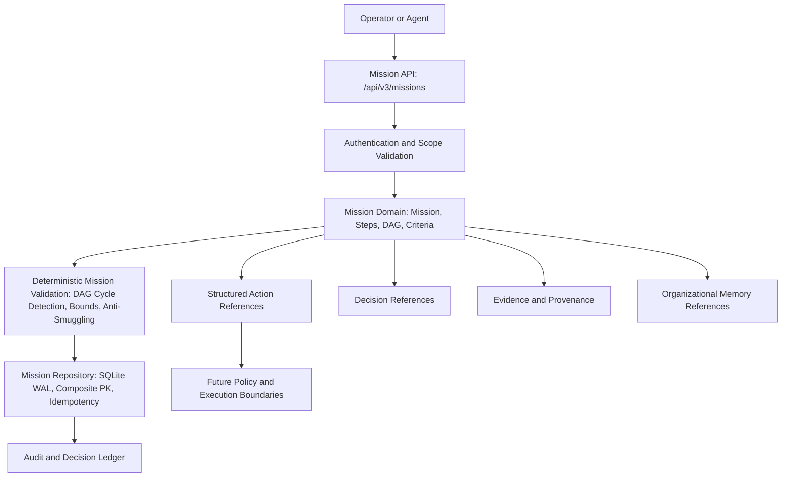

# SageCommand V3 — Mission Architecture Foundation
**Repository:** `joyab786/sage_command_production`  
**Workspace:** `E:\js\sage_command_production`  
**Branch:** `main`  
**Implementation Commit:** `62f4f3646c63eab903118fe1793e50d5a988149f`

## 1. Mission Domain and Purpose

In **SageCommand V3**, an industrial mission represents a **governed, auditable, bounded operational objective** that organizes work intent across complex industrial domains. A mission coordinates decisions, evidence requirements, structured actions, policy reviews, approvals, and post-outcome verification.

### Core Principle
> **A Mission is a governed representation of an industrial objective and its intended work—NOT permission to execute that work.**

A mission is:
- **NOT** a chatbot conversation or conversational prompt.
- **NOT** a free-form LLM plan.
- **NOT** an execution command, SQL mutation, shell script, or direct PLC/SCADA write.

It formally captures:
- **What** operational objective is pursued (`objective`).
- **Why** it matters (`provenance.origin_reason`, related incidents, or RCAs).
- **What scope and constraints apply** (`scope.plant_id`, `constraints`).
- **What reviewable outcomes define success** (`success_criteria`).
- **Which structured actions or decisions are relevant** (`planned_steps`, `related_resources`).
- **What dependencies exist between steps** (acyclic DAG).
- **What evidence is required** to determine whether objectives have been met (`evidence_requirements`).



---

## 2. Canonical Architecture Selected

After inspecting the repository, no competing `MissionService`, `MissionRepository`, `MissionRegistry`, `MissionStore`, `MissionEngine`, or `MissionOrchestrator` was found. A stub `MissionObject` existed in `backend/data/schemas/mission.py` for early tests.

The canonical implementation establishes:
- **Contracts:** `backend/data/schemas/mission_contract.py` defining full domain models, DAG validation, and lifecycle transitions. `backend/data/schemas/mission.py` preserves `MissionObject` for backward compatibility while re-exporting the new contracts.
- **Repository:** `backend/repositories/mission_repository.py` backed by SQLite WAL with thread safety (`threading.Lock()`), composite primary key `(tenant_id, workspace_id, mission_id)`, table for `missions`, `mission_revisions`, `mission_audit_ledger`, and `mission_idempotency_records`.
- **Service:** `backend/services/mission_service.py` enforcing authoritative caller identity, fail-closed workspace isolation, plant scope intersections, deterministic DAG validation, immutable revisions, and atomic audit logging.
- **API:** `backend/api/mission_routes.py` exposing 10 versioned REST endpoints rooted at `/api/v3/missions`.
- **Authorization:** `backend/services/authorization_service.py` registering canonical `mission.*` permissions and role assignments across VIEWER, ANALYST, OPERATOR, PLANT_MANAGER, and ADMINISTRATOR.
- **Server Registration:** `backend/server.py` mounts `mission_router` at `/api/v3/missions`.

---

## 3. Mission Schema and Versioning

### Schema Version
`schema_version = "3.0.0"`

### Canonical Fields
```text
mission_id: str                (Unique identifier: msn_<uuid16>)
schema_version: str            (3.0.0)
revision: int                  (Monotonically increasing: 1, 2, 3...)
title: str                     (Bounded, max 256 characters)
description: str               (Bounded, max 4000 characters)
mission_type: MissionType      (Strict allowlist enum)
objective: str                 (Bounded, max 4000 characters)
scope: MissionScope            (Authoritative tenant_id, workspace_id, plant_id, session_id)
constraints: List[...]         (Max 30 structured, reviewable constraints)
success_criteria: List[...]    (Max 30 non-executable conditions, defaults to UNKNOWN)
planned_steps: List[...]       (Max 50 DAG-validated planned work steps)
evidence_requirements: List... (Max 30 typed evidence requirements)
related_resources: Dict...     (Referenced Action proposals, Decisions, Incidents, RCAs, Memories)
data_mode: DataMode            (SIMULATION vs REAL, authoritative server boundary)
status: MissionStatus          (Deterministic lifecycle status)
provenance: MissionProvenance  (Creator, origin reason, incident/RCA parentage)
created_at: str                (ISO-8601 UTC)
updated_at: str                (ISO-8601 UTC)
created_by: str                (Authoritative creator identity)
validation_errors: List[str]   (Deterministic validation findings)
validation_warnings: List[str] (Domain advisory warnings)
review_notes: Optional[str]    (Governance rationale)
reviewed_by: Optional[str]     (Reviewer identity)
reviewed_at: Optional[str]     (Review timestamp)
```

---

## 4. Lifecycle and Transition Map

The mission lifecycle is deterministic and state-machine guarded:

```text
DRAFT ----------> VALIDATED ----------> REVIEW_REQUIRED ----------> ACCEPTED (Terminal accepted)
  |                  |                      |                       |
  v                  v                      v                       v
CANCELLED        CANCELLED               REJECTED               CANCELLED
                                            |
                                            v
                                          DRAFT (Revision)
```

### Transition Table
| Current Status | Allowed Target Statuses | Guard Condition |
| :--- | :--- | :--- |
| `DRAFT` | `PROPOSED`, `VALIDATING`, `VALIDATED`, `CANCELLED` | Validation passes with 0 errors to reach `VALIDATED` |
| `PROPOSED` | `VALIDATING`, `VALIDATED`, `DRAFT`, `CANCELLED` | Same as draft |
| `VALIDATING` | `VALIDATED`, `DRAFT`, `REJECTED`, `CANCELLED` | Validation evaluation |
| `VALIDATED` | `REVIEW_REQUIRED`, `DRAFT`, `CANCELLED` | Requires formal submission |
| `REVIEW_REQUIRED` | `ACCEPTED`, `REJECTED`, `DRAFT`, `CANCELLED` | Governance decision by authorized reviewer |
| `ACCEPTED` | `CANCELLED` | Terminal accepted state; cannot be directly executed or mutated |
| `REJECTED` | `DRAFT`, `CANCELLED` | Can revert to draft for revision |
| `CANCELLED` | None | Terminal state |

---

## 5. Scope and Ownership

1. **Authoritative Server Identity:** Client-supplied tenant or workspace fields are ignored. Identity is derived strictly from `identity.tenant_id` and `identity.workspace_id`.
2. **Fail-Closed Workspace Isolation:** If `identity.workspace_id` is missing or empty, access is rejected immediately with `403 Forbidden`.
3. **Plant Scope Validation:** Callers restricted to specific plants (`assigned_plants != ["*"]`) can only view or create missions for assigned plants.
4. **Cross-Tenant & Cross-Workspace Isolation:** All queries filter on `tenant_id = ? AND workspace_id = ?`. Queries never cross boundaries.

---

## 6. Objectives and Success Criteria

- Objectives define the operational problem and boundary.
- Success criteria are **structured, human-reviewable conditions**, not executable expressions or arbitrary code.
- Status defaults to `UNKNOWN`. Completion status is never inferred or fabricated.
- **Anti-Code Smuggling:** All criteria, objectives, and titles pass strict regex checks rejecting SQL statements (`SELECT`, `DROP`, `INSERT`), shell commands (`rm -rf`, `curl`, `bash`), and code invocation (`eval(`, `exec(`).

---

## 7. Planned Steps and Dependencies

A mission represents its planned work as a directed acyclic graph (DAG) of typed steps:
- **Step Types:** `ANALYSIS`, `INVESTIGATION`, `EVIDENCE_COLLECTION`, `ACTION_PROPOSAL`, `DECISION_REQUEST`, `POLICY_CHECK`, `REVIEW`.
- **Deterministic DAG Validation:**
  - Detects duplicate step IDs.
  - Enforces dependency existence in planned steps.
  - Rejects self-dependencies.
  - Rejects cyclic dependencies using Kahn's algorithm topological sorting.
  - Enforces bounds: max 50 steps, max 100 total dependencies.

---

## 8. Action, Decision, Evidence, and Memory Integration

- **Structured Actions:** Steps reference Action proposal IDs in `related_resource_ids`. A mission step **never bypasses Action API validation** or executes actions.
- **Decisions:** References decision problem IDs and option IDs.
- **Evidence:** References typed evidence requirements and existing evidence records. Missing evidence remains missing.
- **Organizational Memory:** References lessons learned, past incident memories, and historical benchmarks.
- **Untrusted Context:** When mission data is provided to agents, it is strictly treated as untrusted context with fences.

---

## 9. Risk and Governance

- LLMs and clients **cannot** set risk classification or waive required human approvals.
- Accepting a mission (`ACCEPTED`) confirms governance acceptance of the plan. It **does NOT** invoke execution.
- Operational actions require separate approval through the canonical Structured Action and Policy boundaries.

---

## 10. Data Mode Enforcement

- Supports `SIMULATION` and `REAL`.
- Default is authoritatively `SIMULATION`.
- Client and LLM inputs **cannot** escalate `SIMULATION` to `REAL`.
- If mode cannot be determined, system fails closed.

---

## 11. Persistence and Revision History

- **Persistence:** SQLite WAL database at `SAGE_MISSION_DB_PATH`.
- **Composite Primary Key:** `(tenant_id, workspace_id, mission_id)`.
- **Immutability:** Once in `VALIDATED`, `REVIEW_REQUIRED`, or `ACCEPTED`, missions cannot be mutated in place. Any update requires creating an explicit revision (`revision = current + 1`).
- **Snapshots:** Each update stores a full JSON snapshot in `mission_revisions`.
- **Optimistic Concurrency:** Updates take an `expected_revision` parameter to prevent concurrent overwrite.

---

## 12. API Contract

Mounted at `/api/v3/missions`:

| Method | Endpoint | Permission | Description |
| :--- | :--- | :--- | :--- |
| `POST` | `/api/v3/missions` | `mission.create` | Create draft mission |
| `GET` | `/api/v3/missions/{id}` | `mission.read` | Retrieve mission |
| `GET` | `/api/v3/missions` | `mission.read` | List missions with pagination |
| `PUT` | `/api/v3/missions/{id}` | `mission.update` | Update editable draft |
| `POST` | `/api/v3/missions/{id}/validate` | `mission.validate` | Run deterministic validation |
| `POST` | `/api/v3/missions/{id}/submit` | `mission.update` | Submit validated mission for review |
| `POST` | `/api/v3/missions/{id}/review` | `mission.review` | Accept or reject mission |
| `POST` | `/api/v3/missions/{id}/cancel` | `mission.cancel` | Cancel mission |
| `GET` | `/api/v3/missions/{id}/revisions` | `mission.read` | Retrieve revision snapshots |
| `GET` | `/api/v3/missions/{id}/audit` | `mission.read` | Retrieve audit ledger |

**Strict Rule:** No execution endpoints (`/execute`, `/run`) exist.

---

## 13. Audit and Provenance

All lifecycle mutations write an atomic event to `mission_audit_ledger`:
- `MISSION_CREATED`
- `MISSION_VALIDATION_SUCCEEDED`
- `MISSION_VALIDATION_FAILED`
- `MISSION_SUBMITTED_FOR_REVIEW`
- `MISSION_ACCEPTED`
- `MISSION_REJECTED`
- `MISSION_CANCELLED`
- `MISSION_REVISION_CREATED`
- `MISSION_SCOPE_ACCESS_DENIED`

Records contain `audit_id`, `mission_id`, `revision`, `tenant_id`, `workspace_id`, `plant_id`, `event_type`, `result`, `actor_id`, `actor_role`, `request_id`, `trace_id`, `details`, `timestamp`. Never contains secrets or credentials.

---

## 14. Agent and LangGraph Integration

- Agents can propose missions or analyze mission context.
- All agent output is treated as untrusted input and passes through strict server-side validation.
- Autonomous mission execution is **strictly prohibited** in this prompt.

---

## 15. Frontend and WebSocket Integration

- WebSockets may emit mission lifecycle status events (`MISSION_STATUS_CHANGED`).
- Events are purely notifications, never an execution channel.
- Frontend builds cleanly with zero errors.

---

## 16. Security Review

| Review Question | Result | Details |
| :--- | :--- | :--- |
| Can an LLM execute a mission directly? | **NO** | No execution methods or endpoints exist. |
| Can a mission bypass the Structured Action boundary? | **NO** | Missions only reference Actions; Action API maintains independent validation. |
| Can a client forge tenant/workspace/plant identity? | **NO** | Server identity is authoritative; missing workspace fails closed. |
| Can a mission change SIMULATION into REAL? | **NO** | Data mode is strictly server-assigned. |
| Can a mission claim approval without server authorization? | **NO** | Review endpoint requires `mission.review` permission and state `REVIEW_REQUIRED`. |
| Can invalid dependencies be accepted? | **NO** | Kahn's algorithm validates acyclicity; self-deps and unknown deps rejected. |
| Can a mission access evidence from another workspace? | **NO** | All queries strictly scoped by tenant and workspace. |
| Can a retry create duplicate missions? | **NO** | Supported via atomic idempotency key checking. |
| Can mission data contain raw secrets? | **NO** | Anti-smuggling filter and parameterized SQL reject code and secrets. |

---

## 17. Explicitly Deferred Capabilities

The following are strictly deferred to future prompts:
- Autonomous multi-step mission execution.
- Multi-step mission scheduling and automatic dispatch.
- Continuous verification engine (Prompt 36).
- Closed-loop learning.
- Direct ExecutionGateway invocation from mission steps.
- Distributed sagas or distributed transactions.
