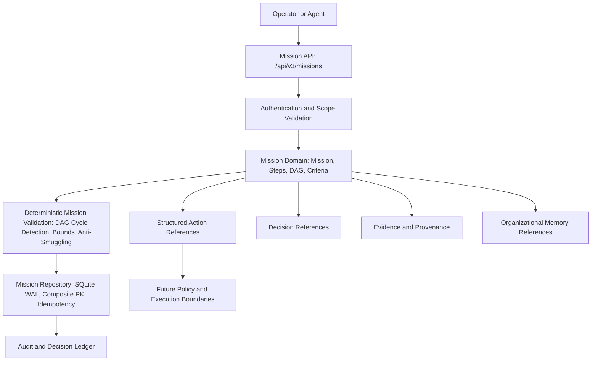

# SageCommand V3 — Mission Architecture Foundation
**Repository:** `joyab786/sage_command_production`
**Workspace:** `E:\js\sage_command_production`
**Branch:** `main`
**Prompt 35 Implementation Commit:** `62f4f3646c63eab903118fe1793e50d5a988149f`
**Prompt 35 Follow-up Commit:** `7c634f6d94becf888f6a9e0f54eb7c856534a4c6`
**Prompt 35A Starting Baseline:** `7c634f6d94becf888f6a9e0f54eb7c856534a4c6`
**Prompt 35A Implementation Commit:** `76f3b3297a3a3c7efb4e7bc2400f834e465f4378`
**Prompt 35A Documentation Commit:** `08fc1738d35eafcc618596fcd3ef3b8353aad840`
**Prompt 35A Test Teardown Commit:** `36de22416ec1a533ad03eeb0c169c9b139db080d`
**Prompt 35A Baseline Final Commit:** `6dc4c1bbbbc19f8657071231c89b90e25303d55e`
**Prompt 35B Starting Baseline:** `6dc4c1bbbbc19f8657071231c89b90e25303d55e`
**Prompt 35B Implementation Commit:** `7cf387f740f53793e59af8609d583da03ca4e945`
**Prompt 35B Documentation Commit:** `b26eaa94a337f5f483e38557730a0cf04d137fac`
**Prompt 35B Baseline Final Commit:** `3a2154921a861e8bf33bc86b38ff37859736623d`
**Prompt 35B Pushed Baseline Update:** `84d52a6f29a81ccf2624916e7157395e0cbc7e12`
**Prompt 35C Starting Baseline HEAD:** `84d52a6f29a81ccf2624916e7157395e0cbc7e12`
**Prompt 35C Reconciliation Documentation Commit:** `PENDING_COMMIT` (to be recorded upon creation)

## 1. Mission Domain and Purpose

In **SageCommand V3**, an industrial mission represents a **governed, auditable, bounded operational objective** that organizes work intent across complex industrial domains. A mission coordinates decisions, evidence requirements, structured actions, policy reviews, approvals, and post-outcome verification.

### Core Principle
> **A Mission is a governed representation of an industrial objective and its intended work—NOT permission to execute that work.**

A mission is:
- **NOT** a chatbot conversation or conversational prompt.
- **NOT** a free-form LLM plan.
- **NOT** an execution command, SQL mutation, shell script, or direct PLC/SCADA write.

It formally captures:
- **What** operational objective is pursued (`objective`).
- **Why** it matters (`provenance.origin_reason`, related incidents, or RCAs).
- **What scope and constraints apply** (`scope.plant_id`, `constraints`).
- **What reviewable outcomes define success** (`success_criteria`).
- **Which structured actions or decisions are relevant** (`planned_steps`, `related_resources`).
- **What dependencies exist between steps** (acyclic DAG).
- **What evidence is required** to determine whether objectives have been met (`evidence_requirements`).



---

## 2. Canonical Architecture Selected

After inspecting the repository, no competing `MissionService`, `MissionRepository`, `MissionRegistry`, `MissionStore`, `MissionEngine`, or `MissionOrchestrator` was found. A stub `MissionObject` existed in `backend/data/schemas/mission.py` for early tests.

The canonical implementation establishes:
- **Contracts:** `backend/data/schemas/mission_contract.py` defining full domain models, DAG validation, and lifecycle transitions. `backend/data/schemas/mission.py` preserves `MissionObject` for backward compatibility while re-exporting the new contracts.
- **Repository:** `backend/repositories/mission_repository.py` backed by SQLite WAL with thread safety (`threading.Lock()`), composite primary key `(tenant_id, workspace_id, mission_id)`, tables for `missions`, `mission_revisions`, `mission_audit_ledger`, and `mission_idempotency_records`.
- **Service:** `backend/services/mission_service.py` enforcing authoritative caller identity, fail-closed workspace isolation, plant scope intersections, deterministic DAG validation, immutable revisions, and atomic audit logging.
- **API:** `backend/api/mission_routes.py` exposing 10 versioned REST endpoints rooted at `/api/v3/missions`.
- **Authorization:** `backend/services/authorization_service.py` registering canonical `mission.*` permissions and role assignments across VIEWER, ANALYST, OPERATOR, PLANT_MANAGER, and ADMINISTRATOR.
- **Server Registration:** `backend/server.py` mounts `mission_router` at `/api/v3/missions`.

---

## 3. Mission Schema and Versioning

### Schema Version
`schema_version = "3.0.0"`

### Canonical Fields
```text
mission_id: str                (Unique identifier: msn_<uuid16>)
schema_version: str            (3.0.0)
revision: int                  (Monotonically increasing: 1, 2, 3...)
title: str                     (Bounded, max 256 characters)
description: str               (Bounded, max 4000 characters)
mission_type: MissionType      (Strict allowlist enum)
objective: str                 (Bounded, max 4000 characters)
scope: MissionScope            (Authoritative tenant_id, workspace_id, plant_id, session_id)
constraints: List[...]         (Max 20 structured, reviewable constraints)
success_criteria: List[...]    (Max 20 non-executable conditions, defaults to UNKNOWN)
planned_steps: List[...]       (Max 50 DAG-validated planned work steps)
evidence_requirements: List... (Max 30 typed evidence requirements)
related_resources: Dict...     (Referenced Action proposals, Decisions, Incidents, RCAs, Memories)
data_mode: DataMode            (SIMULATION vs REAL, authoritative server boundary)
status: MissionStatus          (Deterministic lifecycle status)
provenance: MissionProvenance  (Creator, origin reason, incident/RCA parentage)
created_at: str                (ISO-8601 UTC)
updated_at: str                (ISO-8601 UTC)
created_by: str                (Authoritative creator identity)
validation_errors: List[str]   (Deterministic validation findings)
validation_warnings: List[str] (Domain advisory warnings)
review_notes: Optional[str]    (Governance rationale)
reviewed_by: Optional[str]     (Reviewer identity)
reviewed_at: Optional[str]     (Review timestamp)
```

---

## 4. Lifecycle and Transition Map

The mission lifecycle is deterministic and state-machine guarded:

```text
DRAFT ----------> VALIDATED ----------> REVIEW_REQUIRED ----------> ACCEPTED (Terminal accepted)
  |                  |                      |                       |
  v                  v                      v                       v
CANCELLED        CANCELLED               REJECTED               CANCELLED
                                            |
                                            v
                                          DRAFT (Revision)
```

### Transition Table
| Current Status | Allowed Target Statuses | Guard Condition |
| :--- | :--- | :--- |
| `DRAFT` | `PROPOSED`, `VALIDATING`, `VALIDATED`, `CANCELLED` | Validation passes with 0 errors to reach `VALIDATED` |
| `PROPOSED` | `VALIDATING`, `VALIDATED`, `DRAFT`, `CANCELLED` | Same as draft |
| `VALIDATING` | `VALIDATED`, `DRAFT`, `REJECTED`, `CANCELLED` | Validation evaluation |
| `VALIDATED` | `REVIEW_REQUIRED`, `DRAFT`, `CANCELLED` | Requires formal submission |
| `REVIEW_REQUIRED` | `ACCEPTED`, `REJECTED`, `DRAFT`, `CANCELLED` | Governance decision by authorized reviewer |
| `ACCEPTED` | `CANCELLED` | Terminal accepted state; cannot be directly executed or mutated |
| `REJECTED` | `DRAFT`, `CANCELLED` | Can revert to draft for revision |
| `CANCELLED` | None | Terminal state |

---

## 5. Scope and Ownership (Prompt 35A & 35B Hardened)

1. **Authoritative Server Identity:** Client-supplied tenant or workspace fields are ignored. Identity is derived strictly from `identity.tenant_id` and `identity.workspace_id`.
2. **Fail-Closed Workspace Isolation:** If `identity.workspace_id` is missing or empty, access is rejected immediately with `403 Forbidden`.
3. **Fail-Closed Plant Authorization:**
   - Any fallback converting empty plant assignments into wildcard access is strictly removed.
   - Only an explicit, authoritative wildcard assignment (`["*"]`) grants unrestricted plant access.
   - An explicitly empty plant assignment (`[]`), `None`, or missing attribute fails closed immediately across all operations: creation, retrieval, listing, updates, validation, submission, review, cancellation, revision history, and audit retrieval.
   - Wildcard plant assignments do not bypass plant identifier format validation (`validate_plant_identifier`).
   - Plant filtering in `list_missions` is pushed down into database-level SQL queries (`COUNT(*)` and `SELECT *`). Callers cannot query or infer the existence of missions in unauthorized plants through pagination totals or counts.
4. **Cross-Tenant & Cross-Workspace Isolation:** All queries filter on `tenant_id = ? AND workspace_id = ?`. Queries never cross boundaries.

---

## 6. Objectives and Success Criteria (Outcome Integrity)

- Objectives define the operational problem and boundary.
- **Server-Authoritative Status Rules:**
  - For newly proposed missions and draft updates, criterion status must be `UNKNOWN`.
  - Client-supplied values such as `SATISFIED`, `NOT_SATISFIED`, or `NOT_APPLICABLE` are strictly rejected. LLMs and API clients cannot self-certify completion.
  - Client payloads cannot provide `evaluation_notes` on creation or update; evaluation notes are server-authoritative.
  - Client payloads cannot set mission status directly on creation or update (e.g., attempting to pass `status: VALIDATED` or `status: ACCEPTED` is rejected with HTTP 422).
- **Anti-Code Smuggling & Secret Scanning:**
  - All criteria, objectives, descriptions, and titles pass strict regex checks rejecting SQL statements (`SELECT`, `DROP`, `INSERT`), shell commands (`rm -rf`, `curl`, `bash`), and code invocation (`eval(`, `exec(`).
  - Automated regex secret scanners reject embedded credentials, private keys, connection strings with passwords, and bearer tokens. Pattern scanning is heuristic and cannot detect every arbitrary secret format.

---

## 7. Planned Steps and Dependencies

A mission represents its planned work as a directed acyclic graph (DAG) of typed steps:
- **Step Types:** `ANALYSIS`, `INVESTIGATION`, `EVIDENCE_COLLECTION`, `ACTION_PROPOSAL`, `DECISION_REQUEST`, `POLICY_CHECK`, `REVIEW`.
- **Server-Authoritative Step Status:**
  - Initial step status must be `PLANNED` or `PENDING`.
  - Client-supplied states such as `IN_PROGRESS`, `COMPLETED`, `FAILED`, `SKIPPED`, `BLOCKED`, or `CANCELLED` are strictly rejected on creation and draft updates.
  - A model-generated status is never interpreted as evidence that work occurred.
- **Deterministic DAG Validation:**
  - Detects duplicate step IDs.
  - Enforces dependency existence in planned steps.
  - Rejects self-dependencies.
  - Rejects cyclic dependencies using Kahn's algorithm topological sorting.
  - Enforces bounds: max 50 steps, max 20 dependencies per step, max 100 aggregate dependencies, max 20 `related_resource_ids` per step, max 20 `required_evidence` items per step (max 128 characters each).

---

## 8. Resource Reference Validation Against Canonical Systems

Every referenced resource in `related_resources`, `step.related_resource_ids`, `step.required_evidence`, `evidence_requirements[].linked_evidence_id`, and `provenance.parent_*` is validated against canonical subsystems via dedicated repository methods:

1. **Resolution via Approved Repositories:**
   - `actions`: Resolved via `action_store.get_by_scope(res_id, caller_tenant, caller_ws)`.
   - `decisions`: Resolved via `DecisionEngineRepository.get_by_id(res_id, caller_tenant, workspace_id=caller_ws)`.
   - `evidence`: Resolved via `evidence_explainability_repository.get_evidence_or_explanation_scope(res_id, caller_tenant, caller_ws)`.
   - `incidents`: Resolved via `IncidentRepository.get_incident_scoped(res_id, caller_tenant, caller_ws)`.
   - `rcas`: Resolved via `RcaRepository.get_analysis_scoped(res_id, caller_tenant, caller_ws)`.
   - `memories`: Resolved via `OrganizationalMemoryRepository.get_entry(caller_tenant, caller_ws, res_id)`.
2. **Division of Scope Responsibility:**
   - **Repository Level:** Enforces **Tenant Isolation** and **Workspace Isolation** directly within repository queries or filters.
   - **Service Level (`MissionService`):** Enforces **Plant Isolation** and fail-closed handling of missing/untagged plant metadata. The repository does not filter by plant during lookup; `MissionService._validate_single_resource` extracts the resource plant, verifies that it is non-empty, matches the mission's scope plant (`mission.scope.plant_id`), and is authorized for the caller.
3. **Non-Disclosing Information Policy:**
   - Nonexistent and inaccessible references (cross-tenant, cross-workspace, cross-plant, or untagged) return the identical generic error:
     `"{context} reference '{res_id}' is invalid or inaccessible in the authorized scope."`
   - Exposes zero metadata regarding whether a resource exists outside the caller's authorized scope.
4. **Unsupported Categories Rejected:**
   - Only categories in `SUPPORTED_RESOURCE_CATEGORIES = {"actions", "action_proposals", "decisions", "evidence", "incidents", "rcas", "memories"}` are allowed.
   - Any unsupported category string is rejected during schema validation.
5. **Evidence Integrity:**
   - A linked evidence reference does NOT imply that evidence satisfies a criterion or that work has completed.
   - Unverified evidence records (`validation_status != "VALID"`) raise a domain warning during validation and never satisfy success criteria.
6. **Untrusted Context Fencing:**
   - When mission data is provided to LLM agents, it is treated as untrusted context with security fences.

---

## 9. Risk and Governance

- LLMs and clients **cannot** set risk classification or waive required human approvals.
- Accepting a mission (`ACCEPTED`) confirms governance acceptance of the plan. It **does NOT** invoke execution.
- Operational actions require separate approval through the canonical Structured Action and Policy boundaries.

---

## 10. Data Mode Enforcement

- Supports `SIMULATION` and `REAL`.
- Default is authoritatively `SIMULATION`.
- Client and LLM inputs **cannot** escalate `SIMULATION` to `REAL`.
- If mode cannot be determined, system fails closed.

---

## 11. Persistence and Revision History

- **Persistence:** SQLite WAL database at `SAGE_MISSION_DB_PATH`.
- **Composite Primary Key:** `(tenant_id, workspace_id, mission_id)`.
- **Immutability:** Once in `VALIDATED`, `REVIEW_REQUIRED`, or `ACCEPTED`, missions cannot be mutated in place. Any update requires creating an explicit revision (`revision = current + 1`).
- **Snapshots:** Each update stores a full JSON snapshot in `mission_revisions`.
- **Optimistic Concurrency:** Updates take an `expected_revision` parameter to prevent concurrent overwrite.
- **Idempotency:** Creation requests support optional `idempotency_key` backed by `mission_idempotency_records` table, with SHA-256 payload mismatch detection.

---

## 12. API Contract

Mounted at `/api/v3/missions`:

| Method | Endpoint | Permission | Description |
| :--- | :--- | :--- | :--- |
| `POST` | `/api/v3/missions` | `mission.create` | Create draft mission |
| `GET` | `/api/v3/missions/{id}` | `mission.read` | Retrieve mission |
| `GET` | `/api/v3/missions` | `mission.read` | List missions with pagination |
| `PUT` | `/api/v3/missions/{id}` | `mission.update` | Update editable draft |
| `POST` | `/api/v3/missions/{id}/validate` | `mission.validate` | Run deterministic validation |
| `POST` | `/api/v3/missions/{id}/submit` | `mission.update` | Submit validated mission for review |
| `POST` | `/api/v3/missions/{id}/review` | `mission.review` | Accept or reject mission |
| `POST` | `/api/v3/missions/{id}/cancel` | `mission.cancel` | Cancel mission |
| `GET` | `/api/v3/missions/{id}/revisions` | `mission.read` | Retrieve revision snapshots |
| `GET` | `/api/v3/missions/{id}/audit` | `mission.read` | Retrieve audit ledger |

**Strict Rule:** No execution endpoints (`/execute`, `/run`) exist.

---

## 13. Audit and Provenance

All lifecycle mutations write an atomic event to `mission_audit_ledger`:
- `MISSION_CREATED`
- `MISSION_VALIDATION_SUCCEEDED`
- `MISSION_VALIDATION_FAILED`
- `MISSION_SUBMITTED_FOR_REVIEW`
- `MISSION_ACCEPTED`
- `MISSION_REJECTED`
- `MISSION_CANCELLED`
- `MISSION_REVISION_CREATED`
- `MISSION_SCOPE_ACCESS_DENIED`

Records contain `audit_id`, `mission_id`, `revision`, `tenant_id`, `workspace_id`, `plant_id`, `event_type`, `result`, `actor_id`, `actor_role`, `request_id`, `trace_id`, `details`, `timestamp`. Never contains secrets or credentials.

---

## 14. Agent and LangGraph Integration

- Agents can propose missions or analyze mission context.
- All agent output is treated as untrusted input and passes through strict server-side validation.
- Autonomous mission execution is **strictly prohibited**.

---

## 15. Frontend and WebSocket Integration

- WebSockets may emit mission lifecycle status events (`MISSION_STATUS_CHANGED`).
- Events are purely notifications, never an execution channel.
- Frontend builds cleanly with zero errors.

---

## 16. Security Review (Prompt 35A & 35B Hardened)

| Review Question | Result | Details |
| :--- | :--- | :--- |
| Can an LLM execute a mission directly? | **NO** | No execution methods or endpoints exist. |
| Can a mission bypass the Structured Action boundary? | **NO** | Missions only reference Actions; Action API maintains independent validation. |
| Can an LLM or client self-certify criterion completion? | **NO** | Criterion status must be `UNKNOWN`; `SATISFIED`, `NOT_SATISFIED`, and `NOT_APPLICABLE` rejected. |
| Can a client claim completed or in-progress steps? | **NO** | Step status must be `PLANNED` or `PENDING`; execution outcomes rejected on drafts. |
| Can an empty plant assignment grant wildcard access? | **NO** | Fail-closed plant authorization requires explicit `["*"]`; `[]` or `None` denies access. |
| Can unauthorized plants be inferred from pagination? | **NO** | Database-level SQL `COUNT(*)` filters strictly by authorized plants. |
| Can a client forge tenant/workspace/plant identity? | **NO** | Server identity is authoritative; missing workspace fails closed. |
| Can cross-tenant or cross-workspace resources be referenced? | **NO** | Scope validation rejects them with non-disclosing 422 errors. |
| Can a mission change SIMULATION into REAL? | **NO** | Data mode is strictly server-assigned. |
| Can a mission claim approval without server authorization? | **NO** | Review endpoint requires `mission.review` permission and state `REVIEW_REQUIRED`. |
| Can invalid dependencies be accepted? | **NO** | Kahn's algorithm validates acyclicity; self-deps and unknown deps rejected. |
| Can a mission access evidence from another workspace? | **NO** | All queries strictly scoped by tenant and workspace. |
| Can a retry create duplicate missions? | **NO** | Supported via atomic idempotency key checking. |
| Can mission data contain raw secrets or unbounded payloads? | **NO** | Depth, key-count, and byte-size bounded; regex secret scanning and anti-smuggling active. |

---

## 17. Payload Bounds and Metadata Constraints

To prevent denial of service and data poisoning:
- **`MissionConstraint.parameters`:**
  - Maximum nesting depth: 3 levels.
  - Maximum key count: 20 keys.
  - Maximum serialized JSON size: 4096 bytes.
  - Prohibited parameter keys: `PROHIBITED_METADATA_KEYS` (`password`, `passwd`, `secret`, `secret_key`, `api_key`, `apikey`, `token`, `access_token`, `private_key`, `credentials`, `conn_str`, `connection_string`, `auth_token`).
- **`related_resources`:**
  - Maximum categories: 10.
  - Maximum resource IDs per category: 25.
  - Maximum aggregate resource IDs across all categories: 50.
  - Validated ID regex: `^[A-Za-z0-9_\-\.]{1,64}$`.
- **`MissionPlannedStep`:**
  - Maximum `related_resource_ids`: 20.
  - Maximum `required_evidence`: 20 (each max 128 characters).
- **Text Bounds & Secret Scanning:**
  - `title` <= 256 chars, `description` <= 4000 chars, `objective` <= 4000 chars, `origin_reason` <= 1000 chars, `update_reason` <= 1000 chars, `review_notes` <= 4000 chars, `submission_notes` <= 4000 chars, `cancel_reason` <= 1000 chars.
  - Multi-pattern regex secret scanner (`_SECRET_PATTERNS`) blocks embedded private keys (`BEGIN.*PRIVATE KEY`), connection strings with user:pass (`[a-z]+://.*:.*@`), bearer tokens (`Bearer\s+[a-zA-Z0-9_\-\.]{16,}`), AWS keys (`AKIA[0-9A-Z]{16}`), JWT tokens (`eyJ...`), and API keys with known prefixes (`sk_live`, `sk_test`, `ghp_`, `glpat-`, `xoxb-`, `xoxp-`).
  - Regex anti-smuggling scanner (`_DISALLOWED_PATTERNS`) blocks python execution calls, shell command invocations, and SQL DDL/DML injection.
  - **Limitation:** Heuristic pattern scanning cannot detect every possible high-entropy string or novel secret format.
- **Non-Existent Schema Fields (`NOT IMPLEMENTED`):**
  - Fields such as `target_systems`, `operational_boundaries`, and `source_reference` do not exist in the canonical schema and are not validated.

---

## 18. Explicitly Deferred Capabilities

The following are strictly deferred to future prompts:
- Autonomous multi-step mission execution.
- Multi-step mission scheduling and automatic dispatch.
- Continuous verification engine (Prompt 36).
- Closed-loop learning.
- Direct ExecutionGateway invocation from mission steps.
- Distributed sagas or distributed transactions.

---

## 19. Prompt 35B Outcome Integrity, Scoped Resource Lookup, and Input-Safety Corrections

1. **Server-Authoritative Outcome Status:**
   - **Criteria:** Only `UNKNOWN` may be supplied as the initial criterion status. `SATISFIED`, `NOT_SATISFIED`, and `NOT_APPLICABLE` are rejected on create and draft-update requests. Client-supplied `evaluation_notes` are rejected on create and draft updates.
   - **Steps:** Only `PLANNED` or `PENDING` may be accepted on create and draft-update requests. `SKIPPED`, `BLOCKED`, `CANCELLED`, `COMPLETED`, `IN_PROGRESS`, and `FAILED` are strictly rejected.
   - Enforced at both Pydantic request validation and domain/service boundaries to prevent direct programmatic bypass.

2. **Canonical Scoped Resource Lookup & Information Non-Disclosure:**
   - Zero private repository connections: removed all direct connection calls (`_get_connection()`, `_get_conn()`) from `_validate_single_resource`.
   - Scoped repository APIs used across all 6 categories: `action_store.get_by_scope()`, `DecisionEngineRepository.get_by_id(..., workspace_id=...)`, `evidence_explainability_repository.get_evidence_or_explanation_scope()`, `IncidentRepository.get_incident_scoped()`, `RcaRepository.get_analysis_scoped()`, and `OrganizationalMemoryRepository.get_entry()`.
   - Non-disclosure requirement: nonexistent and inaccessible references produce the identical generic error message (`reference '{id}' is invalid or inaccessible in the authorized scope`), exposing zero cross-scope metadata.

3. **Explicit Fail-Closed Plant Scope Policy:**
   - All 6 operational resource categories in SageCommand are site/plant-scoped.
   - Missing or untagged plant metadata on plant-sensitive resources fails closed immediately. Global scope is never silently inferred.
   - Referenced resource plant must match the mission's authorized plant (`mission.scope.plant_id`) AND the caller's assigned plants.

4. **Plant Identifier Validation & Secret Prevention:**
   - Canonical plant ID regex `^[A-Za-z0-9_\-\.]{2,64}$` strictly enforced on `MissionCreateRequest.plant_id`, `MissionScope.plant_id`, and `list_missions(plant_id=...)`.
   - Credential-bearing URLs, tokens, private keys, and passwords rejected in plant IDs and free-text fields.
   - Wildcard plant assignments (`["*"]`) on caller identities cannot bypass identifier validation.

5. **Fail-Closed Missing/Empty Plant Authorization:**
   - `list_missions()` fails closed with `MissionPermissionError` (HTTP 403 Forbidden) when caller has missing or empty assigned plants, preventing unauthorized existence discovery.

---

## 20. Prompt 35C Documentation Reconciliation Checkpoint

Prompt 35C reconciled the architecture and baseline documentation against the canonical implementation on `origin/main`:
1. Reconciled repository lookup method names and invocation contracts (`DecisionEngineRepository.get_by_id`, `OrganizationalMemoryRepository.get_entry`).
2. Clearly distinguished repository responsibilities (tenant and workspace isolation) from service responsibilities (plant isolation and fail-closed missing plant checks).
3. Verified Pydantic schema field definitions, bounds (`constraints` max 20, `success_criteria` max 20, `parameters` size 4096 bytes / depth 3 / keys 20), and confirmed non-existent fields (`target_systems`, `operational_boundaries`, `source_reference`) are not present.
4. Documented heuristic nature and known limits of regex-based secret scanning.
5. Re-executed and verified the full 74-test mission architecture test suite with detailed class breakdown and explicit status labeling.
